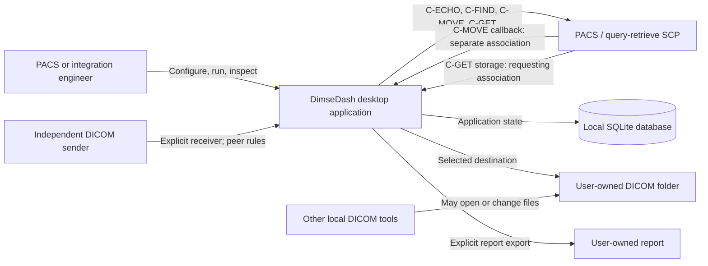
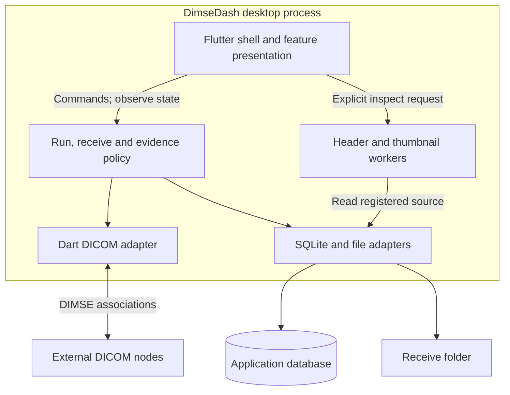
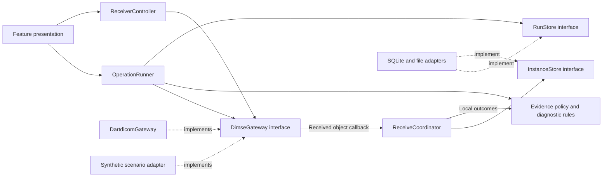
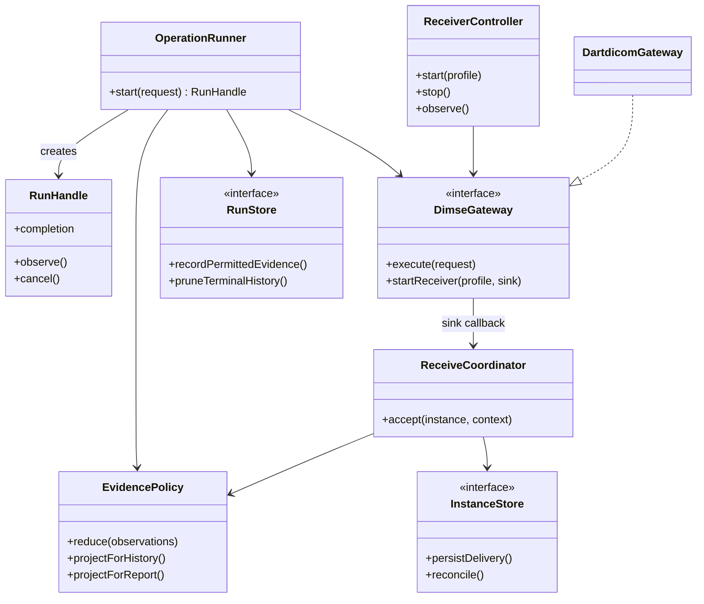
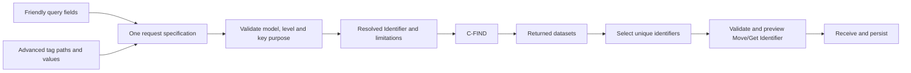
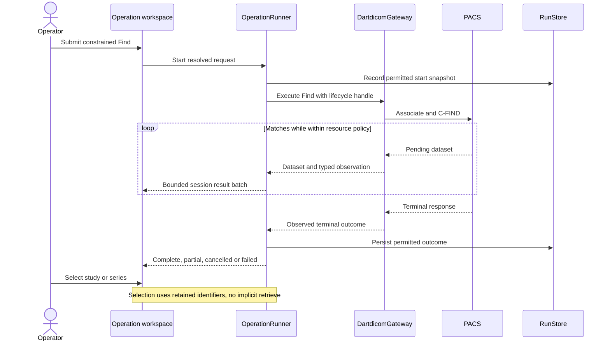
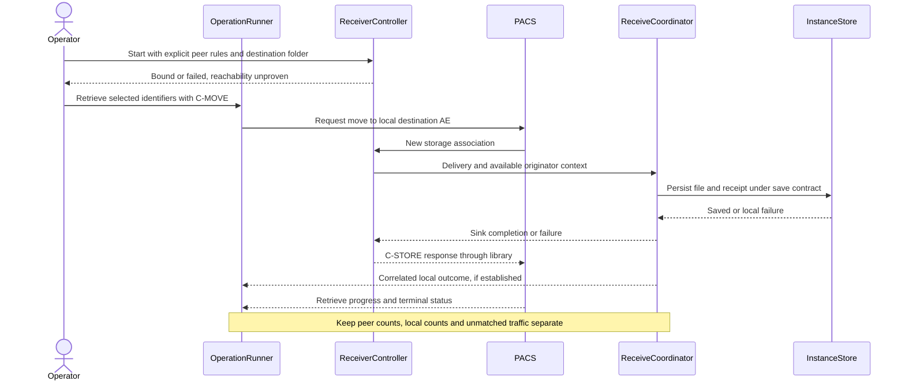
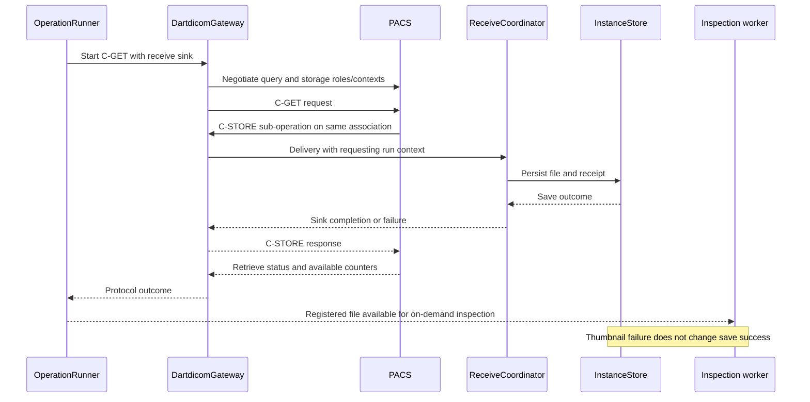

# DimseDash — System & OOP Architecture

> Source: [PRD v0.9](../req/dimsedash-prd.md), [exploration review](../ideas/2026-10-18-exploration.md) and approved storage/retention defaults · Date: 2026-10-18 · Mode: Design · Type: Application

> See also: [Data Architecture](02-data-architecture.md) · [Surface Architecture](03-surface-architecture.md) · [Codebase Blueprint](../structure/01-codebase-blueprint.md)

**Status: design draft with three settled architecture decisions (2026-10-18).** The root Flutter app/private Dart core boundary, Riverpod confined to Flutter, and one active outbound retrieve are approved, alongside PRD product/storage decisions. Component names, signatures and remaining mechanics are design proposals, not implemented APIs. S0 now implements the Flutter shell, configuration core and SQLite adapter. The remaining components are planned. Surface architecture is approved; the [S0 runbook](../tests/s0-configuration.md) records current verification.

## 1. Overview

DimseDash is a local desktop application for PACS/integration engineers to configure a DICOM node, query it, retrieve selected objects by C-MOVE or C-GET, inspect received headers and basic thumbnails, and understand the evidence. It is classified as an **application** because the intended deliverable is an interactive Flutter desktop executable. The private Dart package supports that executable; it is not a new public SDK or a separately deployed service.

The central design problem is coordinating **protocol outcomes, local receipt/storage and diagnostic evidence** without conflating them. A successful C-ECHO proves only Verification; a successful remote retrieve response does not prove that every local file is available; a missing thumbnail does not invalidate a saved file.

| Area | Baseline |
|---|---|
| Product | Complete Find → Move/Get → receive → inspect preview; macOS/Linux parity; basic thumbnails |
| UI/toolchain | Flutter/Dart, FVM SDK pin, just commands; approved compact blue Material workbench |
| Protocol and image support | Public `dartdicom`, `dartdicom_net`, `dartdicom_pixel` APIs; source baseline `v0.1.0-dev.1` at `7f9a80d3a257a6936011250ce3e701b47b717385` |
| Persistent state | Approved local SQLite database for settings, saved nodes, permitted templates, history and receipt inventory; Drift/native SQLite adapter approved |
| Files and transient data | User-selected DICOM folder; query datasets and thumbnails in bounded memory; JSON configuration interchange |
| Settled architecture direction | Modular Hybrid Cleanish: root Flutter app, private Dart core, concrete adapters; Riverpod only in Flutter; one active outbound retrieve |
| Deferred | TLS, legacy Thai charset work, clinical viewer, background daemon, cloud services and automation product surfaces |

The Study Root-only preview scope is approved (2026-10-19); Patient Root, MWL, standalone Store sending and third-party Move destinations are deferred. The platform/distribution baseline is approved in the implementation tracker (2026-10-19).

## 2. System context — C4 level 1

The operator initiates outbound operations and explicitly starts receiving. PACS and other DICOM nodes are external systems. A receiver can accept a separate C-MOVE callback or an independent test send under its configured peer rules. C-GET receives storage sub-operations on its requesting association.

No account, telemetry service, runtime font fetch or automatic update check is required. The shipped application does not require Docker or a test server to run. Synthetic Orthanc/DCMTK/pynetdicom peers are development dependencies, not production containers within DimseDash.

Node labels and AE/host allowlists are configuration, not cryptographic authentication. The first preview uses plaintext DIMSE as approved. The UI must show the resolved target and receive destination before an operation; selecting a node must not trigger a network probe. No deployment assumes access to a particular institution or private network.

## 3. High-level structure — C4 level 2

### One desktop process, independently owned resources

The proposal deploys one desktop process with optional Dart worker isolates. The SQLite database and selected receive folder are local stores. A listener runs only while this process is alive and explicitly enabled; closing a tab does not stop it, and reopening the application does not silently restart network work.

Boxes inside the process are responsibilities, not microservices. A worker is not a separate deployment. Runtime calls above differ from source dependencies: core code depends on narrow interfaces; concrete adapters implement them and are wired at application startup.

### Settled package boundary

**Settled — package boundary:** use a root Flutter app and one private pure-Dart `packages/dimsedash_core` package; keep protocol adapters and platform persistence wiring outside the core.

The split makes lifecycle, retention and diagnostic policy testable without a widget runtime. It also permits a later headless consumer without committing to one now. Its cost is an extra package and explicit exports. Avoid a package per feature or a full DDD aggregate layer for simple settings CRUD.

| Agreed package locations — not scaffolded | Responsibility |
|---|---|
| Root Flutter package, `lib/` | Composition root, platform integration, feature presentation and concrete adapters |
| `packages/dimsedash_core/` | Run lifecycle, receiver ownership policy, receive coordination, evidence/diagnostic policy and persistence/execution interfaces |
| Root platform directories generated by Flutter | Desktop host configuration and platform integration; exact targets follow release-baseline selection |
| `docs/design/` | System, data and surface contracts; code layout is refined later in `docs/structure/` |

Core imports no Flutter/Riverpod APIs and holds no widget context. It may use public DICOM value types where they are already the right representation, especially transient datasets; copying every tag into a parallel DTO hierarchy would add little value. It does not own sockets, issue SQL, select directories or parse PDU bytes. Platform adapters own those effects, while the DICOM libraries own wire semantics.

## 4. Components — C4 level 3

### Coordination and dependency seams

The following names are proposed roles derived from PRD capabilities and the exploration's runner/controller design. They establish responsibilities for review, not a complete class or file inventory.

| Responsibility | Owns | Must not do |
|---|---|---|
| Composition root | Creates stores, gateways, controllers and workers; coordinates startup/shutdown | Hide a second runtime inside a widget or global singleton |
| Feature presentation | Editable drafts, selection, validation feedback and immutable view state | Send network commands during rendering/provider recomputation |
| OperationRunner | Resolved request snapshot, run ID, execution handle, deadlines, cancellation and final evidence | Treat text traces or displayed table labels as authoritative protocol data |
| ReceiverController | Explicit listener start/stop, bind/peer/destination configuration and listener lifetime | Equate local bind with callback reachability; depend on the active tab |
| ReceiveCoordinator | Shared receive path for C-GET, C-MOVE callbacks and independent sends; per-delivery outcomes | Claim a run association solely because one retrieve is active |
| Evidence policy | Allowlisted persistent evidence, provenance, unknown states and reduction into outcomes | Persist arbitrary library `toString()`/error text or reconstruct discarded payloads |
| Diagnostic rules | Deterministic possible causes and next checks from observed facts | Replace facts with a speculative root cause or perform automatic probes |
| Persistence adapters | Transactional app records, explicit file writes, recovery, independent retention/cleanup | Let run-history expiry cascade into received files |
| Inspection workers | On-demand header parsing and supported thumbnail rendering with bounded caches | Change receive success based on codec support or retain a hidden image archive |

**Amended — [blueprint B-04](../structure/01-codebase-blueprint.md#1-reconciliation-findings):** simple settings and node edits use an injected ConfigStore interface returning core records, with no direct Drift/adapter import in presentation; they do not require one use-case class per form action. Execution and receive paths earn orchestration objects because they coordinate multiple resources and failures.

### Presentation state

**Settled — state management:** use Riverpod only in the Flutter layer, with constructor injection and streams in the core.

Providers compose/observe application-owned controllers. Explicit commands start network effects. Dropping a UI subscription releases that view's observation, not the underlying receiver or run. A dedicated run handle owns protocol cancellation; a view's disposal is not a C-CANCEL instruction. **Amended — [blueprint B-02/B-03](../structure/01-codebase-blueprint.md#1-reconciliation-findings):** the runner owns and consumes the upstream DICOM subscription; UI observers cannot pause/cancel it. Upstream subscription cancellation can finish normally after abort, so its completed future is not cancellation confirmation.

Riverpod documents automatic retry of failed provider computations. Operation execution must be outside those computations, and retry must be disabled wherever provider initialization could trigger an effect. A retry in DimseDash always creates a new user-initiated run. [Riverpod retry documentation](https://riverpod.dev/docs/concepts2/retry).

This adapts Flutter's separation of views, presentation logic and data responsibilities without adding a domain layer to every trivial feature. [Flutter architecture recommendations](https://docs.flutter.dev/app-architecture/recommendations).

### Resource and concurrency ownership

**Settled — initial concurrency:** allow one active outbound retrieve application-wide, with bounded incoming associations and independent receiver visibility. Do not introduce an unattended retrieve queue in the first preview.

This simplifies memory and destination ownership; it does **not** solve C-MOVE correlation. Echo/Find concurrency must share explicit resource budgets; a selected tab never implicitly cancels an unrelated run. Incoming callbacks can still be concurrent and can include unrelated traffic. The sink must tolerate simultaneous accepts, including duplicate instances.

Begin with asynchronous network/file APIs and move CPU-heavy header parsing and pixel rendering off the UI isolate. Dart async I/O does not make synchronous parsing non-blocking. Worker count and whether the complete network lifecycle needs a long-lived isolate remain measured implementation choices; the interface boundaries must permit that move. [Dart concurrency](https://dart.dev/language/concurrency).

Bound query buffers, event queues, simultaneous associations, in-progress bytes, decode jobs and decoded cache size. Coalesce UI progress updates without dropping correctness-critical save/failure facts. Record event truncation explicitly. A result cap invokes explicit query cancellation and reports partial results; it cannot promise a PACS-side row limit.

The current receive API materializes a whole instance before calling the sink. Checking size at the sink can reject persistence but cannot prevent that allocation. A hard pre-allocation instance limit/streaming guarantee needs upstream support; it must not be advertised as already enforced by an app queue.

### Protocol boundary and readiness

Existing public upstream APIs include `Association.sendCEcho`, `sendCFind`, `sendCMove`, `sendCGet`, `StorageScp.start/close`, and `InstanceSink.accept`. Both receive paths can use a shared application sink. `ReceivedInstance` contains negotiated dataset bytes and file-meta information for a Part 10 save; it is not itself an already-complete Part 10 file.

| Required observation | Baseline limitation / architecture response |
|---|---|
| Run/association/operation correlation | Incoming move-originator fields exist, but the high-level outbound operation does not expose a typed message-ID handle. Require upstream correlation events; retain unmatched/ambiguous receipts independently. |
| Structured timeline and context results | Textual trace fields cannot supply a reliable lifecycle schema. Add typed observations upstream; unknown stages stay unobserved. |
| Numeric rejection/abort/status and final Find outcome | Some negotiation/error detail is incomplete, and the Find result stream alone does not distinguish every terminal status. Use structured upstream outcomes rather than stream completion as universal success. |
| Counter presence | Retrieve progress currently defaults some missing counts to zero. Preserve optional presence upstream before using counters in diagnostic evidence. |
| Supported text and images | Unknown charset fallback and unavailable compressed decoding cannot become promises of correct text or thumbnails. Surface explicit limits. |
| Stop behavior | Current `StorageScp.close()` stops listening, aborts open associations and waits for serving work, including a sink write. Do not label that graceful draining. |

These are integration prerequisites or explicit limitations, not simulated proof that the application works. No `lib/src` imports, formatted-trace parsing or alternate PDU decoder belong in DimseDash. Public source anchors are listed in §9.

## 5. OOP & class architecture

Prefer composition. The core contains a few deep orchestration objects and immutable snapshots/results. Interfaces exist at effect boundaries that need a live and deterministic test implementation; a single local computation does not need an interface merely for symmetry.

Signatures above are illustrative. `DimseGateway` separates run ownership from the library's association/subscription lifecycle; it must not become a generic wrapper around every DICOM API. Its adapter bridges a sink to the existing `InstanceSink` interface. `InstanceStore` hides the coordinated file/receipt persistence operation, including its failure states; `RunStore` owns history independently. Both can use one SQLite implementation without pretending that filesystem and database writes form a single transaction.

Patterns are limited to **dependency inversion at effect seams**, **repository-style persistence**, **an adapter for public DICOM APIs**, and **observable immutable state**. Diagnostic rules can begin as ordinary Dart functions/table entries. No inheritance hierarchy per DIMSE command, global event bus, event-sourcing system or runtime plugin framework is proposed.

**Amended — [blueprint B-01](../structure/01-codebase-blueprint.md#1-reconciliation-findings):** the app owns an immutable Identifier value tree; upstream Dataset and nested sequence items are mutable and cannot be shared with an executing request. The adapter materializes a private dataset from a resolved revision. An editable draft is mutable presentation state. Starting a run resolves it into an immutable in-memory execution snapshot; subsequent node edits must not change that run. Persistent history stores only its permitted projection, not the sensitive snapshot wholesale. Historical settings must not silently resolve through today's edited node and masquerade as yesterday's configuration.

### Exact tag configuration and execution stages

[PRD R-19](../req/dimsedash-prd.md#query-criteria-and-exact-identifiers) adds a validated Identifier composer. Friendly fields and advanced entries edit one canonical request specification. Core policy validates operation/model/level, required parent identifiers, entry purpose and conflicting paths; the DICOM adapter uses public `dartdicom` dictionary, Dataset and Sequence APIs to materialize the resolved Identifier. Protocol encoding and matching rules remain upstream responsibilities. No second wire encoder, general-purpose scripting engine or class per tag is introduced.

The preview and execution use the same immutable snapshot. Peer matching support is separate from local syntax validity: unknown optional-key support is displayed as unknown, not guaranteed or automatically rejected as invalid. No unsupported predicate is silently moved to another level or evaluation stage. An explicit plan can require additional series queries; the app must not broaden a selected series into a whole-study retrieve to satisfy a missing identifier.

Sequence paths in a remote Find describe a query template, not an item index into a remote object. Supported sequence matching uses one query item, with its predicates satisfied within the same matching item; nested structure must be preserved. Private tags require explicit private-creator context and a known or supplied VR, without implying peer support. Multi-value input is checked against the applicable matching form; local `anyOf` is not a universal remote OR operator. [DICOM sequence matching](https://dicom.nema.org/medical/dicom/current/output/chtml/part04/sect_C.2.2.2.6.html).

Baseline Move/Get accepts its service-defined Identifier, including level and unique keys; general attribute predicates belong in Find. Move Destination AE and negotiation settings remain separate command/association options. Advanced target edits invalidate the previous selection summary and require a newly resolved preview. [C-MOVE Identifier](https://dicom.nema.org/medical/dicom/current/output/chtml/part04/sect_C.4.2.html), [C-GET Identifier](https://dicom.nema.org/medical/dicom/current/output/chtml/part04/sect_C.4.3.html).

The local predicate engine is explicitly deferred by PRD §3; the Identifier editor is confirmed for the first preview. For a later local-rule slice, it evaluates Find-result datasets or saved received instances through explicit stages and returns match / no match / unknown with reason codes. Instance checks run outside the storage acknowledgement path, under bounded inspection resources. They neither suppress receipts nor redefine DIMSE status. Rule evaluation should traverse intended sequence items and leaf values explicitly; predicates grouped for one item must never be satisfied by unrelated items. Missing/undecodable data remains unknown even if a display policy chooses to include such rows.

**Settled structural contracts (2026-10-19):** expected command failures use typed results and ongoing work uses typed observations/outcomes; unexpected defects remain exceptions. The DICOM adapter translates typed save failures into the upstream sink failure mechanism so a failed save cannot acknowledge success ([blueprint B-09](../structure/01-codebase-blueprint.md#1-reconciliation-findings)). Source organization is feature UI, capability core and shared adapters; the blueprint is conceptual rather than a pinned signature specification.

## 6. Key flows

### Find and select

The typed terminal observation in this flow is a required adapter/upstream contract, not a claim that the current result stream supplies it fully. On a buffer cap, the runner requests cancellation and retains a partial result indication. Query datasets are not serialized by normal history persistence.

### C-MOVE and separate incoming receipt

The PACS resolves the destination AE to a reachable address/port in its own configuration. The app cannot establish that route from a successful local bind. Correlation requires available operation/association context and move-originator evidence, with ambiguity preserved when fields are absent or insufficient. Independent sends enter the same receive inventory without a fabricated originating run.

### C-GET uses the same persistence contract

The C-GET path does not start or require the standalone listener. Both methods preserve successful partial files if the operation is cancelled or fails later. Header/thumbnail work runs independently of the storage response; the receive acknowledgement waits for the chosen save contract, not image rendering.

### Cancel, stop and close

1. A cancel command targets a run handle. The runner enters `cancelling`, requests the protocol-supported cancellation and continues accounting for in-flight receipts.
2. Peer completion, cancellation confirmation, timeout or abort are separate observations. Clicking Cancel does not prove the peer cancelled; a race with normal completion retains the actual terminal result.
3. When cancellation cannot complete within the configured deadline, the adapter aborts as needed and records that escalation. Already saved files remain saved.
4. Stopping the independent receiver follows the current library's aborting-close behavior. The surface must disclose effects on active transfers; a future graceful-drain contract needs upstream support.
5. **Amended — [blueprint B-10](../structure/01-codebase-blueprint.md#1-reconciliation-findings):** cancelable desktop exit coordinates shutdown through a platform adapter; forced termination relies on recovery. The normal shutdown path stops admitting new commands, cancels/terminates active operations, closes the listener, completes or records pending saves, and closes workers/database within a bounded shutdown policy. A deadline breach leaves recoverable uncertainty, not a fabricated completed save.

Terminal status is not one Boolean: retain protocol outcome, local persistence outcome, cancellation/abort observations and correlation completeness. A run can finish with warning or uncertainty even when its last peer status was success. Outcome reduction must never infer study completeness from an absent or incomparable count.

### Startup, retention and file/index recovery

Startup opens/migrates the database, reconciles interrupted operations and pending saves, applies eligible history cleanup, then presents configuration and retained records. It does not resume associations, restart the listener or reissue old requests. Query rows are empty until explicitly queried; supported thumbnails regenerate when a saved file is inspected.

The approved defaults are **30 days / 1,000 terminal runs**, whichever limit removes a run first, plus a separately bounded detailed-event budget. Active work and unresolved recovery records remain protected. Receipt inventory survives run expiry, and DICOM files are never silently removed by history/cache cleanup. No cleanup promises to run while the application is closed.

The file adapter stages/finalizes an object without overwrite and records its receipt. Filesystem and database updates are not atomic together, so reconciliation must distinguish an incomplete write, a finalized unindexed file, a saved file and an unavailable external path. A recovered file does not prove that a peer received a success acknowledgement. Exact ordering, flush guarantees, duplicate representation rules and recovery IDs are data-architecture work.

History persistence failure must be visible as missing evidence. A receipt-record failure must not disappear behind a successfully written file. Safe initial behavior is to fail the sink's save contract while preserving the file for reconciliation; the [data design](02-data-architecture.md#43-receive--persist--inspect) proposes the recoverable states and acknowledgement boundary. Verify the peer response mapping through the library. Do not silently reset a damaged database or delete files during migration recovery.

## 7. Extension points and verification seams

Extend first through configuration, a new explicit operation, a typed library capability or a deterministic diagnostic rule. Later CLI/automation consumers may reuse core orchestration with their own composition root; no headless interface ships merely because the package permits it. TLS and richer codecs remain upstream capabilities rather than application-level protocol replacements. Schema changes require migrations; report projections have an explicit export contract independent of internal records.

| Architectural claim | Required evidence before release | PRD |
|---|---|---|
| UI lifecycle cannot rerun or cancel network effects accidentally | Controller/provider rebuild and navigation tests with counted commands | R-07, R-12, R-13 |
| Facts and local outcomes remain distinct | Deterministic observations for unknown counters, timeout, warning, cancellation races and unmatched receipt | R-08, R-11, R-12 |
| Shared receive path is reliable | Concurrent duplicate accepts, file/database failures and crash-point recovery tests; actual live C-MOVE and C-GET | R-05–R-08, R-16 |
| Retention respects ownership | Clock/count cleanup tests; history expiry preserves receipts/files; no disk thumbnail/query persistence | R-10, R-13, R-15, R-16 |
| Persistent evidence excludes payloads | Synthetic canaries through request fields, returned tags, comments, traces and report projection | R-13–R-15 |
| Desktop integration works | Packaged macOS/Linux tests of folder access, networking, receiver stop, close and thumbnail behavior | R-17, R-18 |

Dry tests use fake gateway/store implementations plus real isolated local-file/database tests where appropriate. Synthetic replays prove policy, not interoperability. Live gates use real synthetic peers and compare fixture identities/counts against protocol and local observations. Native packaged checks remain separate from container protocol tests. FVM/just expose repeatable commands; a clean contributor checkout must not depend on an existing private test-bundle path.

## 8. Key abstractions / glossary

| Term | Meaning in this design |
|---|---|
| Node | Saved remote connection settings; selecting it is not contacting it |
| Local identity | Calling/listening AE configuration with explicit network and peer policy |
| Draft | Editable request state before execution |
| Run | One explicit operation attempt with a resolved request, lifecycle and evidence; retry creates another run |
| Association | A library-owned DICOM network session; one run may involve separate callback associations |
| Receiver | Explicit local Verification/Storage service, independent of the selected tab |
| Delivery / receipt | One observed inbound object attempt and its local outcome; distinct from a unique object |
| Registered file | A local source referenced by receipt inventory; it may later be changed or removed externally |
| Observation | An attributable fact with ordering/timing context and explicit availability |
| Diagnostic advice | Deterministic possible explanation or next check, separate from an observation |
| History projection | The permitted persistent subset of live run evidence; insufficient for exact replay by design |

These definitions are local to this draft. A future repository glossary should reconcile the same vocabulary rather than introducing competing terms.

## 9. Decisions needed and notes

### Review index

| Decision | Recommendation and location | Status |
|---|---|---|
| Package boundary | Root Flutter app plus private pure-Dart core, §3 | Approved 2026-10-18 |
| Presentation state | Riverpod at Flutter boundary only, §4 | Approved 2026-10-18 |
| Initial concurrency | One active outbound retrieve; bounded independent receiving, §4 | Approved 2026-10-18 |
| Product scope | Study Root-only preview and listed deferred operations, PRD §3 | Approved 2026-10-19 |
| Release baseline | Supported OS versions/architectures, Linux distribution, packages and signing, PRD §7 | Approved 2026-10-19 |

SQLite/files, session-only query data/thumbnails, independent receipt retention and the 30-day/1,000-run default are approved inputs, not decisions to re-open here. The data architecture records approved Drift/native SQLite, per-delivery opaque-ID files and evidence budgets; its logical schema and recovery protocol remain unimplemented design contracts. Exact worker topology remains an implementation choice to validate.

### Follow-on design work

- **Data architecture drafted:** [data design](02-data-architecture.md) defines identities, schema, correlation, file save/recovery, duplicate handling, independent pruning, migration and export boundaries. Its three marked choices are now settled; validate schema/recovery mechanics during implementation.
- **Surface architecture drafted:** [surface design](03-surface-architecture.md) defines commands, query/editor and retrieve review, terminal/partial/unknown states, receive-folder ownership, cleanup previews, rerun omissions and thumbnail fallback. Its selection, nested-editor and masking choices are settled (2026-10-19).
- **Codebase blueprint written:** [source map and contracts](../structure/01-codebase-blueprint.md) reconcile these lenses with framework behavior and record approved structural forks. The [first-preview tracker](../progress/overview-first-preview.md) now records approved scaffold and implementation slices; no application or ADR is created here.

### Source evidence and limits

The application is not implemented or verified. Upstream interfaces were rechecked against the same pinned commit while preparing this document. That source review does not rerun library interoperability or establish desktop support. Architecture diagrams express proposed contracts; upstream gaps above must be resolved or truthfully exposed before acceptance.

- [Association API](https://github.com/Lightbridge-KS/dartdicom/blob/v0.1.0-dev.1/dartdicom_net/lib/src/association/association.dart): outbound operations, cancellation and C-GET sink.
- [InstanceSink and ReceivedInstance](https://github.com/Lightbridge-KS/dartdicom/blob/v0.1.0-dev.1/dartdicom_net/lib/src/sink/instance_sink.dart): async/concurrent sink calls, dataset bytes, file metadata and move-originator fields.
- [StorageScp](https://github.com/Lightbridge-KS/dartdicom/blob/v0.1.0-dev.1/dartdicom_net/lib/src/scp/storage_scp.dart): listener/peer policy and aborting close behavior.
- [Exploration evidence](../ideas/2026-10-18-exploration.md#library-reality-at-the-inspected-release): remaining trace, negotiation, counter, charset and pixel limitations.

| Revision | Date | Change |
|---|---|---|
| 0.1 | 2026-10-18 | Initial system design grounded in PRD v0.2 and approved storage/retention defaults; three architecture choices proposed |
| 0.2 | 2026-10-18 | Settle package boundary, Riverpod boundary and initial retrieve concurrency; cross-link the data architecture draft |
| 0.3 | 2026-10-18 | Reconcile approved Drift adapter, per-delivery files and evidence limits with data design |
| 0.4 | 2026-10-18 | Define canonical exact-Identifier composition, model/level validation and separation from proposed local dataset checks |
| 0.5 | 2026-10-18 | Record confirmed P0 Identifier editor and deferred local rules; cross-link surface design |
| 0.6 | 2026-10-19 | Settle surface/structural choices; amend snapshot, subscription, failure, configuration and shutdown contracts via blueprint findings |
