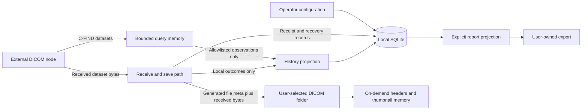
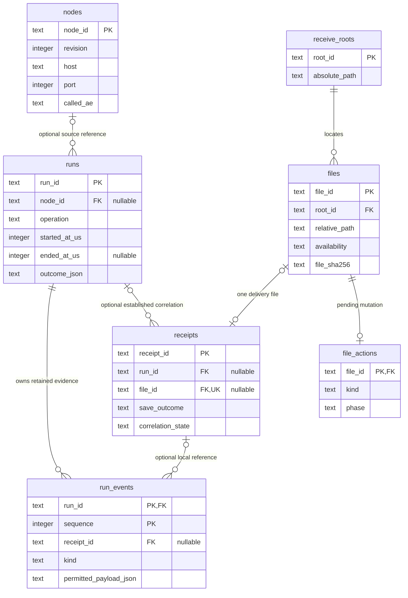
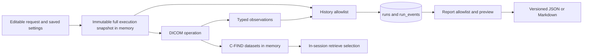
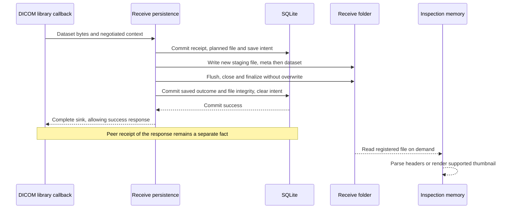
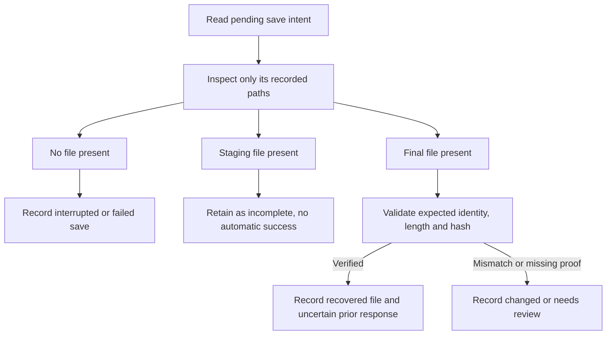
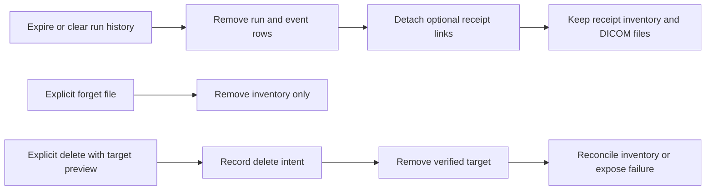

# DimseDash — Data Architecture

> Source: [PRD v0.9](../req/dimsedash-prd.md), approved storage/retention defaults and settled system boundaries · Date: 2026-10-18 · Mode: Design · Data system: Hybrid — local OLTP database plus DICOM files
> See also: [System & OOP Architecture](01-system-architecture.md) · [Surface Architecture](03-surface-architecture.md) · [Codebase Blueprint](../structure/01-codebase-blueprint.md)

**Status: data design with three settled implementation choices (2026-10-18), S0 configuration schema implemented; remaining data families planned.** SQLite/files, session-only query results/thumbnails, independent cleanup, root Flutter/private Dart core, Riverpod confined to Flutter and one active outbound retrieve are settled inputs. Drift/native SQLite, separate opaque-ID files per delivery and the additional evidence limits below are also approved. Table/field names and algorithms below are proposed logical contracts. Surface architecture is now drafted. No production data or live interoperability evidence is used here.

## 1. Overview

DimseDash manages reusable connection settings, short-lived query datasets, bounded diagnostic history and user-owned received objects. Its database records what the app observed and saved; received DICOM files contain the actual datasets. These sources answer different questions and must not overwrite one another's meaning.

This is a **hybrid** data system: SQLite serves transactional settings/history/inventory, while ordinary Part 10 files hold potentially large DICOM payloads. Memory holds the working query/inspection data and derived thumbnails. There is no patient archive, warehouse, message broker, remote database or cloud synchronization in the first preview.

**Settled — database layer:** use Drift over native SQLite in a persistence adapter outside the pure-Dart core. Keep generated database rows and Drift APIs inside that adapter. Drift trades code generation for typed queries and migration tooling.

Drift documents a native backend for desktop and migration/schema-test facilities. Exact dependency versions and packaged macOS/Linux compatibility are implementation checks, not inferred from platform listings. [Native Drift](https://drift.simonbinder.eu/platforms/vm/), [migration tooling](https://drift.simonbinder.eu/migrations/).

## 2. Data landscape



| Store | Holds | Writer | Reader |
|---|---|---|---|
| Application-support SQLite database | Preferences, nodes, receive roots, runs/events, receipt/file inventory, pending file actions | Configuration and persistence adapters through one database owner | Core/presentation through focused queries |
| Selected receive folder | Staged writes and finalized Part 10 files | Receive persistence; explicit file deletion | Header/thumbnail workers and other local tools |
| Session memory | Editable criteria, full resolved requests, C-FIND datasets, live receiver observations | User commands and protocol observations | Current workspace, query navigation and operation execution |
| Thumbnail/header memory | Parsed metadata and supported rendered previews | Bounded inspection jobs | Current inspection views |
| User-selected report/configuration exports | Reviewed projections, with their own format versions | Explicit export action | Humans and external tools; configuration import is later scope |
| Temporary migration snapshot | One recovery copy during a database upgrade | Migration procedure | Recovery only; cleanup rules in §7 |

The PACS remains the authority for its remote inventory. A C-FIND row is an observation at a time, not a synchronized local study record. A selected row's identifiers can feed a retrieve while the session is alive; ordinary history does not persist them for later replay.

## 3. Data models — data at rest

### 3.1 Entities and relationships

The initial model deliberately has no `patients`, `studies` or `series` archive tables. Patient/study metadata is inspected from session datasets or files. Only the identifiers needed for receipt identity and conflict detection are indexed persistently.



`app_settings` is an independent singleton configuration record and is omitted from the relationship diagram. A file record can exist without its original receipt after metadata repair; a receipt can exist without a file after a failed save. Initial physical deduplication is excluded, so a file belongs to at most one delivery record. The nullable uniqueness constraint on `receipts.file_id` enforces this while permitting multiple fileless failures.

### 3.2 Proposed table contracts

Names below are logical schema names for blueprint/migration work. SQLite stores UUIDs as text, UTC instants as integer microseconds, durations as integer microseconds and validated enumerations as text. Counts are non-negative integers or NULL when unavailable. Explicitly versioned JSON is used only for bounded typed structures, never as an unrestricted dataset dump.

| Table | Significant fields beyond the ERD | Contract |
|---|---|---|
| `app_settings` | Singleton key, UI preferences, current local AE/listener configuration, timeout/limit settings, retention settings, settings-format version | Calling AE (default `DIMSE_DASH`) and listening port belong here; called AE and PACS IP/port belong to `nodes`. The initial local AE also serves the receiver and Move destination. Separate preference fields from operational fields so resetting appearance cannot erase receiver policy. No saved patient search text. Initial single local identity does not imply a multi-profile UI. |
| `nodes` | Display label, environment designation, supported user-configured options, update time | Increment revision on edit. Treat labels/endpoints as sensitive local configuration. No assumption that the peer's advertised capabilities are permanently true. |
| `receive_roots` | Selected path, platform access reference if required, last checked availability | Stable local ID, immutable location for existing files. Selecting another folder creates another root. Do not silently repoint old receipts to a different directory. |
| `runs` | Session ID, source node revision, permitted settings snapshot/version, app/library versions, lifecycle state, duration, protocol outcome, local aggregate outcomes, evidence completeness and dropped-event counters | Starting a run freezes its permitted settings. Store full execution criteria only in memory. Node removal does not delete history. Terminal aggregates preserve observed counts even after files are forgotten. |
| `run_events` | Observation time, elapsed time, association ID when available, evidence source, status/counter-presence fields, serialized payload byte count | Composite key `(run_id, sequence)` orders app observation, not global wire causality. Typed allowlist per event kind; original numeric status and unknowns survive. |
| `receipts` | Receipt time, session/association context, source AE, originator fields when present, correlation basis, SOP class/instance UID, transfer syntax, received byte count, save outcome, local failure code, acknowledgement observation | Minimal sensitive local inventory. Keep source facts distinct from derived correlation. No patient demographics/private-tag dump. If SQLite itself fails, the app cannot promise a durable failure receipt. |
| `files` | Expected/final byte length, dataset fingerprint, hash version, finalized time, last availability check | Path/integrity inventory, not a second DICOM dataset. Finalized length/hash/time are NULL until established; planned or incomplete files are not shown as saved. Availability changes do not rewrite the original receipt outcome. Hashes/UIDs are local identifiers and excluded from default reports. |
| `file_actions` | Save/delete kind, action phase, staging path, expected identity/length/hash when known, start/update time, structured failure code | Durable intent for interrupted filesystem work; one outstanding mutation per file. Remove after reconciliation completes. Do not use it as a permanent audit log. |

Template storage is not added speculatively: the PRD keeps reusable workspace/import features in later scope. When templates are introduced, persist matching-key structure and permitted defaults; sensitive literal criteria need a separately explicit feature. JSON as an interchange format does not mean arbitrary import into the live schema.

### 3.3 Referential and identity rules

- App IDs (`node_id`, `run_id`, `receipt_id`, `file_id`, `root_id`, session/association IDs) are opaque local identities. DICOM UIDs are peer-supplied identities and are never the database primary key or the filename.
- Deleting a run cascades only to its `run_events`. `receipts.run_id` becomes NULL; a retained correlation state still distinguishes previously linked evidence from never-correlated traffic. Store no copied run trace in the receipt to bypass history expiry.
- Deleting a node sets `runs.node_id` to NULL. Historical permitted snapshots and source revision remain immutable; do not join today's node settings and present them as historical facts. A rerun with changed/missing configuration requires resolution before execution.
- Receive roots cannot be deleted while registered files reference them. File actions block ordinary file/receipt removal until resolved. Explicit forget/delete removes the file's registration and receipt detail together after pending work finishes; event references become NULL rather than deleting the run.
- A reconciled failure with neither staging nor final bytes drops its planned `files` row after resolving the action; `receipts.file_id` becomes NULL and the failure receipt becomes eligible for its own retention policy. An incomplete file that still exists keeps its inventory link until explicit cleanup. A file row disappearing never turns a failure into success.
- Enforce foreign keys on every connection and verify them after migration. SQLite requires foreign-key enforcement to be enabled explicitly. [SQLite foreign keys](https://www.sqlite.org/foreignkeys.html).

### 3.4 Live, historical and export representations

| Representation | Permitted contents | Deliberately absent |
|---|---|---|
| Live execution snapshot | Resolved node/local identity, query values and selected UIDs, destination and operation options | Mutation by later form/node edits |
| Persistent run projection | Operation, model/level, timeouts, requested SOP classes/transfer syntaxes, versioned omissions list, local references, numeric outcomes and completeness | Patient/accession/study-instance identifiers, matching values that may identify a person, endpoint strings, local paths, arbitrary peer comments |
| Receipt inventory | Minimal SOP/transfer identities, source/originator evidence, file link and local save facts | Full metadata tree, pixel bytes and unbounded raw trace |
| Report projection | Explicit allowlisted subset with generated node aliases and limitations | Implicit joins that reveal receipt UIDs, configuration endpoints or paths |

SOP-class and transfer-syntax UIDs identify protocol types; they differ from patient-linked study/series/instance UIDs. Allowlisting must be by field semantics, not a rule that accepts or removes every string called a UID. Raw errors and trace strings remain transient unless converted to supported structured facts. Reduced evidence is never labeled de-identified DICOM.

An event envelope contains `run_id`, `sequence`, `kind`, observation time, optional elapsed time, optional association context, provenance and a versioned permitted payload. Counter absence remains NULL with an availability reason, not zero. Elapsed durations use a monotonic source within one process session; wall-clock values support display/retention and cannot order every concurrent network event reliably. Unknown event payloads are not persisted verbatim.

**Amended — [blueprint B-01/B-06](../structure/01-codebase-blueprint.md#1-reconciliation-findings):** execution snapshots use a deeply owned immutable Identifier value tree, not a mutable upstream Dataset alias. Session disclosure state resets to masked and is not serialized with UI preferences. History/report projections remain separate types with explicit omissions.

### 3.5 Tag paths, request values and optional local predicates

The full request specification for [PRD R-19](../req/dimsedash-prd.md#query-criteria-and-exact-identifiers) belongs to the live draft and immutable execution snapshot, not a new persistent metadata catalogue. Proposed logical fields:

| Field group | Meaning and constraint |
|---|---|
| Operation context | Find/Move/Get, information model and query/retrieve level; command parameters such as Move Destination AE are separate from dataset entries |
| Entry identity and path | Stable draft-local ID; ordered numeric tags, sequence nesting and private-creator context where applicable. Dictionary keywords are display aids, not identifiers |
| Value representation | VR and typed value or explicit return-key intent; preserve empty values, multiplicity and sequence-item structure. Disabled, absent, empty and invalid entries are distinct |
| Matching form | Explicit applicable DICOM matching form; no generic list-to-wire conversion. Keep same-item sequence groups intact |
| Resolution evidence | Source field or advanced entry, local validation outcome, peer-support evidence/unknown state and omitted-input markers for history |

Retrieve entries preserve the complete required unique-key hierarchy from selection. Editing a target updates that hierarchy and the visible effective scope; display labels never reconstruct missing UIDs. A sequence path such as `(0040,0275) → (0040,1001)` means Request Attributes Sequence → Requested Procedure ID. A custom label such as “ExamCode” does not change the tag's dictionary meaning or make it remotely searchable.

For the explicitly deferred local rule engine, its specification adds evaluation stage (`findResult` or `receivedInstance`), operator, accepted values, sequence quantifier/item grouping and handling of unknown results. Evaluation retains the distinction between absent tag, empty value, decode failure and incomplete data. Local accepted-value lists and case handling are local semantics, not reusable as arbitrary DICOM matching syntax. The result includes rule identity, dataset/receipt reference, outcome and reason; actual extracted values stay transient. These are proposed session representations, not additional approved tables or persistent rule history.

Full paths, private creators, labels, literal values, resolved datasets and rule JSON must not bypass the history allowlist by being called “configuration.” Only explicitly permitted structural fields may persist in ordinary run evidence; arbitrary values/text are omitted with visible rerun gaps. Saved reusable templates and JSON interchange retain their later product scope and require their own reviewed projection. Proposed local checks on a saved file can be rerun from that file while its rule is available; they do not justify persisting complete received headers or changing receipt retention.

## 4. Dataflow and lineage — data in motion

### 4.1 Query, run and report projections



There is no path from complete query rows into ordinary history. A persisted run records which inputs were omitted; rerun creates a new draft with those gaps. It never guesses missing identifiers from presentation labels. A report is its own immutable exported copy and is not removed by later app cleanup.

### 4.2 C-MOVE correlation versus C-GET ownership

For C-GET the requesting operation owns its receive sink, so a delivery can carry that run context directly. For C-MOVE the listener receives a new association; correlation is an evidence-based join, not an assumption about the current tab.

The proposed correlation states are `direct` (C-GET context), `matched` (sufficient move evidence), `unmatched` (no established candidate), and `ambiguous` (multiple or insufficiently distinguishable candidates). Store the observed originator fields and a reason code separately from the derived state. Missing originator fields are absent, not empty strings meaning a known sender.

Matching needs the outbound operation handle/message ID, calling AE, peer scope and session/association context with a bounded lifetime. A DIMSE message ID is not globally unique and can be reused. Arrival time, source AE, selected instance UID or one active retrieve alone is insufficient. Late/unrelated traffic stays in receipt inventory; do not attach it to whichever run happens to be active.

The pinned library exposes incoming originator fields but lacks the complete typed outbound handle/observation contract. This is an upstream prerequisite. Persist enough structured basis to explain an established link, but do not promise retroactive correlation after required context has expired. Correcting a live link updates both affected run aggregates transactionally while their evidence exists; it never invents an expired run.

### 4.3 Receive → persist → inspect

The upstream object contains negotiated **dataset bytes**, not an original file container. Saving prepends generated Part 10 file meta and preserves those dataset bytes. No image decode or full header parse is required to acknowledge a save. [Public receipt contract](https://github.com/Lightbridge-KS/dartdicom/blob/v0.1.0-dev.1/dartdicom_net/lib/src/sink/instance_sink.dart).



Detailed steps for the proposed save contract:

1. Validate the chosen root and admission budgets; allocate fresh receipt/file IDs. Commit intent before writing payload bytes. If this commit fails, fail the sink and stop admitting more receive work until storage is healthy.
2. Create a new staging target under the selected root. Stream generated file meta and the already-buffered dataset to it, computing length/hash without making another full-size copy. Do not hold a SQLite transaction across the file write.
3. Flush/close the file and finalize on the same filesystem with a verified no-overwrite primitive. Persist any pre-finalization length/hash facts needed to validate a crash-recovered target. The platform adapter must account for directory-entry durability; plain rename is not by itself a promise of power-loss safety.
4. Commit `receipts.save_outcome = saved`, finalized file facts and local aggregate updates, and remove the save action in one transaction. Only then return successful sink completion. A later report/history-detail write or thumbnail failure cannot undo the save.
5. If file finalization succeeds but the database commit fails, preserve the final file and pending intent, fail the sink and mark the storage subsystem degraded. A peer retry may produce another delivery; that is handled explicitly rather than by overwrite.

The current library waits for sink completion before returning a storage response. It does not tell this app that the remote peer consumed that response. `acknowledgement_observation` therefore distinguishes unknown, locally observed response-send information (if exposed upstream), and failure; none proves remote receipt.

**Amended — [blueprint B-05/B-08/B-09](../structure/01-codebase-blueprint.md#1-reconciliation-findings):** LocalInstanceStore owns the DB/file save and recovery sequence. Inspection holds a lease; file-action previews carry expected record identities revalidated at execution. Typed persistence failure is mapped to the upstream failure acknowledgement mechanism by the DICOM adapter, never converted to successful receipt.

### 4.4 Crash recovery is reconciliation



| Crash window / observation | Recovery action | Claim withheld |
|---|---|---|
| Intent committed, no payload written | Mark interrupted attempt, remove empty planned-file registration and resolve action; retain a fileless failure receipt | No saved object |
| Partial write, including a seemingly complete `.part` | Keep incomplete and visible for explicit cleanup; no implicit resend or promotion | No completed save from filename/size alone |
| Final file exists, saved transaction absent | Verify against intent integrity facts; register as recovered with original attempt uncertain | No proof that a successful storage response was sent or received |
| Saved transaction committed, process ended before response | Preserve saved fact; response state stays unknown unless observed | No exactly-once delivery guarantee |
| File removed/modified externally | Update availability/check time; keep original historical save outcome | No claim that present bytes are still the original content |

Recovery is idempotent and restricted to recorded paths. It does not recursively ingest arbitrary files in a chosen folder; independent file import is later scope. An unreadable/missing removable volume is unavailable, not evidence that its files were deleted. Unresolved actions remain visible and block cleanup of their records; a cap on pending actions must stop admission rather than accumulate forever.

## 5. System of record and ownership

| Information | Authority | Derived copy / limit |
|---|---|---|
| Current settings/node | SQLite configuration | An execution snapshot fixes the settings used by one run |
| Historical protocol/local observations | Retained run projection and receipt records, with explicit completeness | Diagnostic advice is derived and versioned; it cannot replace the facts |
| Remote patient/study content | External node | Session query datasets are temporary observations, never a synchronized archive |
| Saved dataset bytes | The finalized file, checked against saved integrity facts | Parsed headers/thumbnails are disposable derivatives |
| Whether/when the app saved a delivery | Receipt record and recovery state | Re-reading a file cannot reconstruct its network timing or original acknowledgement |
| Current file availability | Latest checked filesystem observation | Database availability is a timestamped observation, not continuous monitoring |
| Run totals at completion | Stored aggregate outcomes and their observation scope | Expiring detail/forgetting files does not recalculate historical totals as zero |
| Export contents | The exported copy with its declared format/omissions | Later app cleanup cannot revoke an independent copy |

Database and filesystem are two authorities for different facts, not duplicate sources of truth for the same object. The recovery journal bridges their non-atomic updates. No transaction or two-phase-commit claim spans the peer, local filesystem and database.

## 6. Storage and access

### 6.1 File layout and repeated deliveries

**Settled — file layout and duplicates:** preserve each delivery as its own file named with an opaque local file ID, sharded by an ID prefix. Do not physically deduplicate in the first preview. This makes retries/conflicts inspectable at the cost of disk space; keep logical duplicate classification separate.

```text
<application-support>/
  dimsedash.sqlite
  dimsedash.sqlite-wal       when WAL is active
  dimsedash.sqlite-shm       when WAL is active

<selected-receive-folder>/
  <file-id-prefix>/
    <file-id>.part           recorded incomplete write
    <file-id>.dcm            finalized Part 10 object
```

Only the final file remains after successful finalization. Paths are generated from local IDs, never peer-supplied filenames, patient names or raw UIDs. The full path shown before receiving includes this layout. The selected folder is user-owned; only exact recorded app-created files are eligible for app deletion.

The supplied upstream `DirectorySink` uses study/series/SOP UID paths and retains a list of stored files. DimseDash needs its own `InstanceSink` implementation for this inventory, lifetime and duplicate policy. This is application persistence policy, not a replacement DICOM encoder. Generate file meta through public upstream APIs.

For comparison, store a fingerprint of the negotiated transfer-syntax UID and exact dataset bytes, using a versioned encoding, plus a separate hash of the full saved file. Generated file meta can differ independently of dataset bytes. Hash equality is a practical integrity/deduplication signal; it is not a de-identification operation or proof of clinical equivalence.

Count **deliveries**, **successful local saves**, **distinct reported SOP Instance UIDs**, and **identical received representations** separately. The same SOP Instance UID with different class/content/encoding is a visible conflict or representation difference, not automatic corruption. Missing/invalid identity stays unknown. No UID or content hash has a uniqueness constraint that rejects a legitimate repeated delivery. Byte-identical repeats still get distinct files under this policy.

### 6.2 Database access and indexes

Use one serialized database owner for writes, with short transactions and bounded batches. Concurrent receive callbacks enqueue independent intents/save commits; they must not hold a database lock while decoding or writing payloads. Riverpod observes projected state and does not open its own competing store. A second app instance must not mutate the same database/receive-root session concurrently; enforce a process ownership guard and explain an already-open store rather than relying on chance.

Proposed indexes follow actual access patterns:

| Access | Key/index |
|---|---|
| Node selection | Primary key; normalized display-label index if needed |
| Recent history and expiry | `(ended_at_us, run_id)` with terminal-state filtering |
| Ordered run evidence | Primary key `(run_id, sequence)` |
| Receipt list and run receipts | `(received_at_us, receipt_id)` and `(run_id, received_at_us)` |
| Duplicate/conflict lookup | Non-unique SOP Instance UID and versioned representation fingerprint indexes |
| Locate/check a registered file | Unique `(root_id, relative_path)`; file ID primary key |
| Recovery work | Action phase/update-time index; one action per file |

Use keyset pagination for history/receipt lists. Do not load all rows, thumbnails or DICOM headers into a provider. Index only fields needed for the agreed workflow; a full DICOM-tag search index is outside scope. No sharding of the database is needed.

Recommend WAL for the local database, foreign keys enabled, bounded busy timeout and `synchronous=FULL` for acknowledged save records. Validate these with the packaged SQLite build; storage durability also depends on the filesystem/OS. WAL uses adjacent files and is unsuitable for a database shared across hosts on a network filesystem. [SQLite WAL](https://www.sqlite.org/wal.html), [synchronous settings](https://www.sqlite.org/pragma.html#pragma_synchronous).

Application state stays on local application-support storage. For received files, the adapter must verify the required finalization/access guarantees for the selected volume; shared/cloud/removable folders are not implicitly equivalent to a tested local filesystem. Unsupported guarantees are exposed before transfer. The supported-volume contract remains a packaging verification item.

### 6.3 Memory and event budgets

**Settled — additional evidence limits:** 4 MiB of serialized detailed-event payload per run and 64 MiB across retained run events, with a 16 KiB maximum event. Also retain terminal fileless failure receipts for at most 30 days and at most 1,000 records. These are approved initial defaults, separate from the 30-day / 1,000-run history policy. Benchmark their behavior; changing them requires an explicit design revision.

Keep the latest bounded detail window, record how many events/bytes were omitted and retain first/last omitted sequence ranges compactly. Critical outcomes/counters and evidence-incomplete flags live in run summaries, not solely in evictable events. When the global budget is reached, evict eligible old detail first; if active detail alone reaches the cap, truncate detail while still admitting bounded critical outcome updates. Never silently label a truncated trace complete. Limits describe accounted payload bytes, not an exact SQLite file-size ceiling.

Fileless failure receipts need a separate bound because an independent sender can generate them without an outbound run. Pending actions and file-backed receipt inventory are exempt from that failure-history purge. Their growth is instead bounded by receive admission/disk quotas; no quota automatically deletes finalized DICOM files.

Query memory, decoded thumbnail bytes, in-flight instance bytes and action-count limits require explicit measured limits before implementation acceptance. Limit by bytes as well as count; evict thumbnails on demand. Key a thumbnail by file ID/content fingerprint, frame and render parameters/version so changed content cannot reuse an old image. Do not spill full queries or decoded thumbnails to disk as a fallback.

The existing library buffers an entire incoming instance before the sink. A sink byte check does not prevent that allocation; pre-allocation bounds/streaming require upstream support. Document the tested workload instead of promising that app-level budgets cap all library memory.

## 7. Lifecycle and governance

### 7.1 Retention and explicit cleanup

| Data | Trigger | Effect and protection |
|---|---|---|
| Terminal runs | Approved default: age ≥30 days or outside newest 1,000 eligible runs; startup and periodic cleanup | Delete run/events, detach receipt links; preserve files/inventory. Use `(ended_at_us, run_id)` for deterministic ties. |
| Active/interrupted runs | Active work or unresolved recovery | No ordinary purge. Reconcile interruption first; set terminal time from observed evidence or recovery time with provenance, not a guessed completion time. |
| Detailed events | Approved per-run/global byte limits | Remove detail with explicit truncation metadata; summaries remain under run retention |
| Fileless failed receipts | Approved separate age/count limits | Purge terminal failures with no pending action; retained run aggregates do not change |
| Registered files and receipts | No default age expiry | Remain until explicit forget/delete, even when originating run expires |
| Incomplete `.part` files | Pending or failed save recovery | Visible incomplete state; explicit cleanup after active write is finished, no hidden successful-file deletion |
| Query/inspection memory | View/query clear, eviction or process exit | Release working content; retained source file may be read again |
| Settings | Explicit edit/reset/remove | UI reset affects UI settings only; node removal is independent |

Age uses stored UTC end times and current wall clock. Clock changes can delay/accelerate age eligibility, so tests inject time and cleanup records its cutoff. There is no timer guarantee while the app is closed. A restored database applies cleanup before exposing old history; snapshots can contain older data until restored/removed.

The explicit **forget** action removes a file's receipt/registration without touching bytes. Historical event references become unavailable; existing run aggregate counts stay historical. Do not forget while a save/delete action or inspection job holds the file; cancel/drain that work first. Removing a node or clearing history never invokes file deletion.

The explicit **delete** action previews exact recorded targets and writes a delete intent before removal. Recheck path containment, file identity and non-symlink expectations at execution time; hold the relevant access/ownership guard and refuse changed targets. A naive string-prefix check is insufficient. Delete only the selected finalized file or identified incomplete staging file, never recursively delete arbitrary root contents. On success remove the registration/receipt/action transactionally; on failure retain the record and a structured error. A crash after unlink but before database cleanup is reconciled as an already-absent target. Platform-safe handling of path replacement races is a release check, not assumed from a prior existence check.



### 7.2 Schema evolution and recovery copies

Version the database schema independently of the app version and of JSON export/event payload formats. Export immutable schema snapshots and test each supported upgrade path with synthetic records, pending actions and nullable links. Newer-than-supported schemas fail with an explanation; no automatic downgrade or destructive database reset.

Before a migration, quiesce writes and create one consistent app-managed recovery snapshot using a supported SQLite snapshot/backup mechanism. Do not blindly copy only the main database file while WAL is active. Remove this temporary snapshot after migration and integrity validation succeed; retain at most that one snapshot on failure, show its presence and require recovery before further writes. Do not accumulate backup generations that silently defeat history retention. SQLite documents its consistent online backup API. [SQLite backup](https://www.sqlite.org/backup.html).

A database snapshot does not include DICOM files. Restoring one cannot restore missing payloads or reconstruct expired network evidence. A future complete workspace export would need a manifest and consistent file copy boundary; it is not implied by this design. A repaired/reindexed file must be labeled reconstructed inventory, not reconstructed proof of receipt.

### 7.3 Classification and export boundaries

Treat the whole database, its WAL, recovery snapshot and the receive folder as potentially sensitive. Even absent patient demographics, UIDs, endpoints, paths and source AE labels can identify people/sites. Full DICOM files can contain identifiers in metadata and pixels. Opaque paths, hashes and UI masking do not de-identify them.

Use per-user application directories and platform permissions appropriate to that user. No shared accounts, authentication server, role model or encrypted-database promise is introduced. App-level encryption/key recovery is separate future design if required. Future secrets/private keys must not enter plaintext configuration exports.

Reports have a versioned schema with explicit omissions and evidence completeness. Configuration interchange likewise carries only defined fields and a format version, excludes runtime history/files/secrets, validates lengths/types/ranges and never executes code or imports arbitrary paths into active storage. Adding a field to an internal row does not automatically add it to an export. Unsupported import versions fail before any partial changes. These are format boundaries for later configuration interchange, not a new P0 feature commitment.

Logical deletion is not secure erasure of WAL pages, free database pages, independent exports, OS backups or external copies. The app states which copy it removed. No automatic upload, cloud sync or backup service is part of this model.

### 7.4 Verification obligations

| Claim | Required check before implementation acceptance |
|---|---|
| Independent lifetimes | Foreign-key tests: run/node deletion preserves expected receipts/files; forget leaves bytes; cleanup never invokes filesystem deletion |
| Accurate identity/correlation | C-GET direct context; C-MOVE absent/reused originator IDs, late unrelated receipt, ambiguous peers; no match from temporal proximity alone |
| Concurrent receives | Same UID/same bytes and same UID/different bytes delivered concurrently create distinct files and truthful counts |
| Recoverable save contract | Fault injection before/after intent commit, staging flush, finalization, save commit and response; repeated recovery is idempotent |
| Failed storage | Full/unwritable disk, SQLite busy/corrupt/unavailable, missing volume and failed hash/finalization never produce clean save success |
| Safe cleanup | Exact age/count/byte boundaries, clock changes, active/pending records, changed paths/symlinks, external deletion and interrupted delete |
| Privacy projections | Synthetic identifying canaries in query values, tags, error comments, filenames and raw traces do not reach run/report persistence |
| Exact request representation | Flat/nested paths, private-creator context, value multiplicity and empty return keys survive composition; conflicting or invalid enabled entries fail; preview equals executed Identifier; arbitrary advanced values do not leak through settings/history |
| Migration/restore | All supported versions upgrade without data loss; newer schema rejected; snapshot cleanup and retained-file reconciliation verified |
| Platform claims | Packaged macOS/Linux file access, no-overwrite finalization, shutdown and selected-volume behavior tested |

S0 configuration persistence and failure handling are assessed in the [configuration runbook](../tests/s0-configuration.md). The remaining schema families, migrations and receive/retention behaviors are **not assessed** yet. Diagram validation checks document syntax, not persistence correctness. Tests should target these invariants, not mirror generated accessors.

## 8. Decisions needed and external assumptions

| Settled decision | Approved choice (2026-10-18) | Location |
|---|---|---|
| Database layer | Drift/native SQLite adapter, generated rows confined to infrastructure | §1 |
| File layout/duplicate storage | Opaque ID paths, one file per delivery, no physical deduplication initially | §6.1 |
| Additional evidence limits | 4 MiB/run, 64 MiB total event payload, 16 KiB/event; 30 days/1,000 fileless failures | §6.3 |

All three choices above are approved; their review markers have been removed. SQLite itself, history's 30-day/1,000-run default, receipt/file independence, session-only queries/thumbnails and the three system architecture choices are already settled. PRD §3 confirms the advanced Identifier editor for P0 and defers the local rule engine; §3.5 retains a future rule representation without introducing a rule store.

Remaining engineering work: choose/pin compatible database/runtime packages; benchmark byte budgets and other memory/admission caps; implement/test no-overwrite finalization and path-race protection on supported volumes; settle the exact save flush/durability contract; obtain typed upstream lifecycle/correlation/counter-presence observations. A packaged desktop acceptance run is required before claiming any of those properties.

External assumptions remain explicit: a PACS may omit originator fields or counters, return unsupported encodings or send unexpected objects; a user may move/change files; the OS/storage stack can fail. None is converted into a guaranteed local invariant. No hospital-network reachability is assumed.

The [surface draft](03-surface-architecture.md) now shows file-versus-run lifetimes, unavailable/recovered/ambiguous states, query omissions on rerun, trace truncation and explicit cleanup targets within the approved workbench. The [codebase blueprint](../structure/01-codebase-blueprint.md) now assigns these contracts to conceptual types, interfaces and source modules; concrete migrations remain implementation work. No application scaffold or ADR is introduced here.

| Revision | Date | Change |
|---|---|---|
| 0.1 | 2026-10-18 | Initial logical schema, lineage, systems of record, save/recovery protocol, correlation and retention design; three new implementation choices proposed |
| 0.2 | 2026-10-18 | Record approval of Drift/native SQLite, per-delivery opaque-ID files and additional evidence limits; retain unimplemented schema/recovery details as design contracts |
| 0.3 | 2026-10-18 | Add transient exact-Identifier specification and conditional local-rule representation; preserve privacy, template scope and retention boundaries |
| 0.4 | 2026-10-18 | Record editor approval and rule-engine deferral; link surface contracts without adding persistent query/rule tables |
| 0.5 | 2026-10-19 | Reconcile snapshot ownership, disclosure lifetime, file-action leases and acknowledgement mapping with the codebase blueprint |
| 0.6 | 2026-10-19 | Clarify ownership of the approved Settings connection fields and local AE default |
