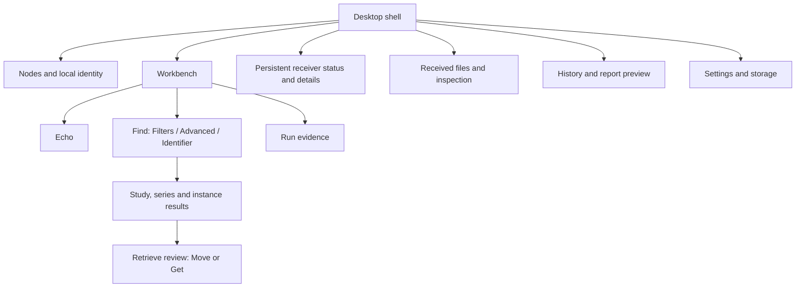
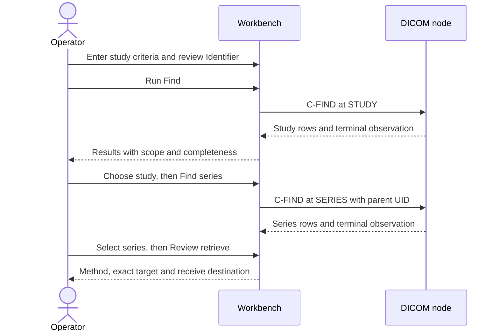
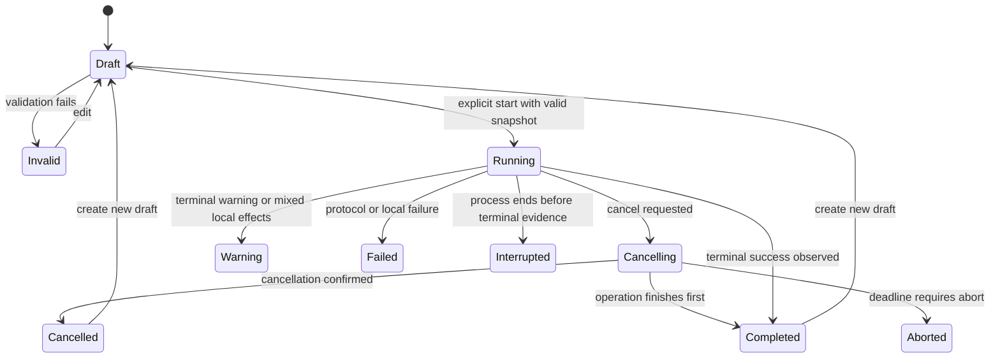

# DimseDash — Surface Architecture

> Source: [PRD v0.9](../req/dimsedash-prd.md), approved blue workbench and confirmed architecture/storage decisions · Date: 2026-10-18 · Mode: Design · Surface: Desktop GUI
>
> See also: [System Architecture](01-system-architecture.md) · [Data Architecture](02-data-architecture.md) · [Codebase Blueprint](../structure/01-codebase-blueprint.md)

**Status: approved surface design; S0 shell and Settings implemented, remaining workflows planned.** The advanced Identifier editor is confirmed for the first preview; the local dataset rule engine is deferred. Existing package, Riverpod, concurrency and storage decisions remain settled. The three surface choices are approved (2026-10-19): single study/series/instance selection without batching, structured nested editing, and masked-on-launch values with separate thumbnail reveal. No CLI, public HTTP API, background daemon or automation interface is introduced.

The [refined interactive mockup](assets/workbench-v2.html) demonstrates the primary workflow with synthetic data and simulated outcomes. It is a proposal refining the [approved original](../req/assets/approved-workbench.html), not a replacement approval or interoperability result. The original remains unchanged. Captured [query](assets/workbench-v2-query.png), [dark appearance](assets/workbench-v2-dark.png) and [inspection](assets/workbench-v2-inspection.png) views show the composer, masked headers and synthetic thumbnail. The added [single-instance review](assets/workbench-v2-instance.png) shows IMAGE scope with the complete study/series/SOP instance UID hierarchy. Mockup coverage and limitations are listed in §8.

## Cheat Sheet

| Task | Entry point | Visible result |
|---|---|---|
| Find studies | Workbench → Find → Filters → Run Find | Streaming result rows, scope and terminal/partial status |
| Configure exact tags | Find or Retrieve → Advanced Identifier | Tag paths, VRs, purposes, values and validation |
| Check what will be sent | Resolved Identifier | Exact dataset tree plus separate command settings |
| Retrieve a study, series or instance | Select result → Review retrieve | Effective target, Move/Get method, destination and validation |
| Investigate a failure | Evidence → Summary, Timeline, Negotiation or Trace | Observed facts separate from possible causes |
| Inspect a saved object | Received files → Inspect | Header tree and supported basic thumbnail |
| Manage receiving | Persistent Receiver strip → Details | Bound/stopped state, peer rules and receive folder |
| Revisit a run | History → Inspect / Create new draft | Retained evidence and explicit missing-input fields |

## 1. Overview and users

The primary user is a PACS/integration engineer answering: “What did this node accept, what did it return, and what actually arrived here?” The surface provides a guided path without hiding exact DICOM identifiers. Normal controls and advanced editing are two views of the same draft, never competing configurations.

The intended product is a macOS/Linux Flutter desktop GUI. All labels, numbers and state transitions below are proposed product contracts grounded in the PRD; S0 implements the shell and Settings; subsequent workflows remain planned. Platform menus/file pickers use native conventions. UI strings are localizable English. Account creation, login and cloud setup do not apply.

The workbench separates four kinds of information:

- **Draft:** mutable criteria and settings for a future operation.
- **Run:** immutable executed settings and observed progress/outcome.
- **Query results:** transient datasets from a specific query, not a persisted patient catalogue.
- **Received files:** independently retained delivery/file records, not children deleted with history.

## 2. Surface map

| Touchpoint | Actions and content | Boundary / requirement |
|---|---|---|
| Node sidebar | Search saved nodes; add/edit/duplicate/remove; select target; show local calling identity and environment | Selecting a node sends nothing. Edits affect future runs; R-01 |
| Workbench operation header | Echo, Find, Retrieve; resolved target and calling AE; explicit run/cancel control | Changing operation does not terminate a run; R-02–R-06, R-12 |
| Find composer | Model/level, friendly filters, advanced entries, resolved Identifier and query-plan limitations | P0 advanced editing, no local rule builder; R-03, R-19 |
| Hierarchical result pane | Study → series → instance navigation, parent identifiers, row inspection and retrieval selection | Expanding a level issues an explicit Find action; R-04, R-09 |
| Retrieve review | Target level/UIDs, method, destination, folder, validation and advanced Identifier | One active outbound retrieve, no unattended queue; R-05, R-06, R-19 |
| Evidence pane | Summary, Timeline, Negotiation, Trace, Report preview | Payload-limited observations; source and unknowns visible; R-11, R-14 |
| Receiver strip and details | Start/stop, bound address, local AE, peer policy, active receives, folder | Independent of active screen; bind is not remote reachability; R-07 |
| Received files | Browse delivery records; correlation and save/availability states; inspect/reveal/forget/delete | Survives history cleanup; no general external-file browser in P0; R-08–R-10, R-16 |
| History | Inspect retained runs, create draft, clear eligible history | Missing inputs must be re-entered; R-13 |
| Settings and storage | Appearance, masking, local identity, listener, folder, declared timeouts/limits, retention and cleanup | No TLS, local rules or template/import-export controls in P0; R-15–R-18 |

### Shell and panel behavior

Preserve the approved compact blue shell: node/navigation rail on the left, operation workspace in the center, persistent receiver status, and run evidence below the workspace. Header inspection can open as a right-hand pane. There is one active composition context; editing another node does not overwrite the executed run being inspected.

Use labeled navigation destinations **Workbench**, **Received files**, **History** and **Settings**. Echo/Find/Retrieve are operations inside Workbench, not top-level data stores. C-MOVE/C-GET are method choices within Retrieve; each remains explicitly named in execution and evidence.

Pane dividers are resizable and keyboard operable. A collapsed pane has a visible reopen action. Proposed comfortable width is 1280 px; at narrower desktop widths the inspector becomes a sheet and the sidebar collapses before the main table loses essential columns. Tables scroll horizontally within their pane. Exact minimum dimensions and divider defaults require native prototype testing, not an invented release guarantee.

### Settings: DICOM connection

**Approved Settings design (2026-10-19):** Settings contains an editable DICOM connection section, grouped by ownership:

| Group | Field | Behavior |
|---|---|---|
| Client node | Calling AE Title | Default `DIMSE_DASH`, editable for testing another client identity; also the local receiver and C-MOVE destination AE in the initial single-identity setup |
| Client node | Client listening port | Explicit local C-MOVE callback listener port; C-GET does not require this listener |
| Selected remote node | Called AE Title | Remote PACS AE title; edits update the selected node, not a second global copy |
| Selected remote node | PACS IP address and port | Remote connection endpoint; the prototype accepts IPv4/IPv6 literals |

Apply validates values and commits the draft explicitly; Discard restores the applied values. Applying never starts a listener, probes a node or updates the PACS configuration. The app persists these fields through ConfigStore as specified in the data design; the mockup keeps edits only for its browser session. Prototype listener port `11112` is an editable fixture, not a mandated deployment port.

The prototype requires an idle retrieve and stopped receiver before applying connection changes. Applied changes invalidate earlier query results/target selection without removing received files or retained history. Execution still freezes its connection configuration. Sidebar, workbench and retrieve review use the applied values. For C-MOVE, the PACS must independently map the destination AE to the reachable client address and port; a local listening port alone cannot establish that route.

The [Settings screenshot](assets/workbench-v2-settings.png) captures the field grouping and default client identity.

## 3. Entry and onboarding

First launch shows an empty node list and **Add node**, with a short explanation of Find → Retrieve → Inspect. No preconfigured real endpoint, startup probe, automatic listener or resumed association is present.

1. **Add a node:** name, host, port, called AE and test/production designation. Show the currently configured calling AE. Validate syntax locally; do not call this a connectivity check.
2. **Run Echo or Find:** Echo is optional, not an access gate. Offer a useful study filter; do not run an unbounded default query simply because a node was saved. Before an intentionally broad query, show its scope and the fact that a client cap cannot bound PACS work.
3. **Prepare receiving when needed:** choose a receive folder before Retrieve or Start receiver. Display it and any local access error. C-GET does not require the separate listener; C-MOVE review explains remote destination registration.
4. **Inspect the result:** show exact operation status and which stages were observed. Empty results are a valid outcome, not an onboarding failure.

Restart restores saved configuration, retained history and the independent file inventory. Query results, sensitive draft criteria and thumbnails do not return. Listener stays stopped. Interrupted runs and pending saves show recovery outcomes; the app never automatically reissues a request. A database/migration failure presents a recovery error with a useful local diagnosis, not an automatic reset button that discards records.

## 4. Key journeys

### 4.1 Search → inspect → select

The common search starts at Study Root / STUDY. Filters are labeled by their clinical/operational meaning and expose the corresponding tag beside the input or in the advanced view.

| Friendly field | DICOM representation | Scope and feedback |
|---|---|---|
| Study date range | Study Date `(0008,0020)` | Inclusive date range; display resolved DA expression |
| Study time | Study Time `(0008,0030)` | Advanced by default; explain independent DA/TM ranges. Do not claim a continuous timestamp interval without applicable negotiated behavior |
| Patient ID | `(0010,0020)` | STUDY-level patient attribute in Study Root; no automatic wildcard insertion |
| Patient name | `(0010,0010)` | Preserve entered PN syntax; expose matching limitations |
| Accession number | `(0008,0050)` | Study matching; retain exact entered value |
| Modality | STUDY `(0008,0061)` Modalities in Study; SERIES `(0008,0060)` Modality | Label which is sent. Optional study-key matching may be unknown; do not relabel it as confirmed filtering |
| Body part | SERIES `(0018,0015)` Body Part Examined | Series-level, peer-dependent filter. A study search cannot silently treat it as a universally supported study key |

If body part or exact series modality is needed, show a plan: **Find studies → choose study → Find series with these keys**. The user explicitly runs each query; there is no automatic fan-out across every study in P0. Criteria requiring another level remain visibly pending, never silently ignored or evaluated by a hidden local rule engine. A series query can also start from advanced input with its required parent identifiers. If the peer cannot establish matching support, show **Matching support unknown** or the actual rejection/warning; never claim an exact subset merely because a tag was returned.

Results show the originating node, model/level, executed criteria summary, row count and completeness. Changing the draft adds **Draft changed — results belong to the previous run**; it does not refilter those rows. A new run replaces that result context after any selected target is cleared deliberately. Navigation breadcrumbs preserve required UIDs; descriptions are display labels only. A child-query failure leaves parent results usable.

**Retrieve selection baseline:** one study, series or instance at a time. A row highlight for inspection is distinct from the selected retrieve target. Selecting a parent means all its instances, regardless of visible child rows. Changing level or target must update the review summary; hidden selections are not retained across unrelated query contexts.

**Settled — selection scope (2026-10-19):** select one study, series or instance for retrieval in the first preview; multi-target batching is deferred. An instance uses IMAGE level with StudyInstanceUID, SeriesInstanceUID and SOPInstanceUID. Selecting an instance never broadens to its series. R-04 and the mockup now include instance-row retrieval.

### 4.2 Friendly filters and advanced Identifier

Use three views within the composer: **Filters**, **Advanced Identifier**, **Resolved Identifier**. Switching views preserves the same draft. Friendly controls are conveniences for representable entries. An advanced expression that cannot round-trip to a simple control marks that control **Custom — edit in Advanced**, rather than overwriting it when switching views.

The advanced table has **Enabled**, **Tag path**, **Dictionary name**, **VR**, **Purpose**, **Value**, and **Validation**. Purpose distinguishes matching, return key and service-required entries. Return keys have explicit intent; a blank matching cell cannot accidentally disable an entry. A numeric tag path is canonical; keyword lookup assists entry. For unknown/private tags require VR and relevant private-creator context. Invalid enabled entries block execution and link focus to the offending cell; disabling an entry is explicit and visible in the draft.

**Settled — nested editor shape (2026-10-19):** use a structured expandable sequence tree with tag-path entry and same-item grouping, plus a read-only resolved tree. Defer free-form JSON/XML editing and arbitrary item-index syntax. This gives exact dataset control without introducing another editable serialization format in P0.

Sequence items show their nesting and matching group. A remote sequence query is a template, not a request for a known remote item index. Multiple values display their matching form; the editor does not assume every list is a remote OR expression. Syntax validity and peer support use separate status columns/messages. Model/level changes show incompatible entries and require correction; no hidden key deletion or silent change of evaluation stage.

Resolved Identifier displays numeric tags, dictionary names, VRs, values and SQ structure from the same snapshot used for execution. Command parameters, target identity, model/SOP class and limitations appear alongside it, outside the dataset tree. It is an application request preview, not a raw-PDU capture. All request/response text is untrusted text, never executable markup. Copying values is explicit and follows the reveal behavior in §7.

### 4.3 Retrieve review → receive → inspect

Review presents a concise target: **Series 2 within study … — all instances in this series**, with complete unique identifiers available. Counts from query metadata are estimates with a source, not proof of what will be sent. Manual UID editing marks the target **Edited identifier** and invalidates the old selection description until revalidated. It must never keep saying “Series 2” while sending different UIDs.

| Review field | C-MOVE | C-GET |
|---|---|---|
| Request path | Outbound request; separate inbound C-STORE associations | C-STORE sub-operations on the requesting association |
| Destination | Local destination AE and receiver details; peer must have registration | Selected receive folder and negotiated Storage roles/contexts |
| Listener | Start explicitly if stopped; local bind shown separately from remote reachability | Separate listener not required; independent receiver may still run |
| Identifier | Level and required unique keys; advanced editing validated | Same target contract, service-specific Identifier validation |
| Start action | **Start C-MOVE** | **Start C-GET** |

No new retrieve starts while one is active; the disabled action explains **Another retrieve is active — inspect or cancel it**. There is no queue, hidden retry or automatic alternative-method fallback. Switching method updates the review before execution. Choosing another folder affects future deliveries, not existing file paths; an active run's destination remains frozen.

The progress area separates **Peer reported** completed/failed/warning/remaining from **Local** received/saved/failed/unlinked. Missing peer counters read **Unknown**, not `0`. Run-linked receipts and unrelated receiver activity have distinct counts. Protocol terminal status can appear while local effects are still being accounted for; the UI does not declare complete success prematurely. “No callback observed” remains an observation, not a firewall diagnosis.

After a save, **Inspect** opens the header tree and a supported first-frame grayscale thumbnail. The thumbnail is supplementary: loading, unsupported codec, non-image object, decode failure and unavailable source are distinct states. No window/level, diagnostic measurement or multi-frame viewer is implied. Received files also remain accessible outside the originating run.

## 5. Interaction and state contracts

### Runs and independent receiver state

The diagram is a user-visible lifecycle sketch, not a single enum replacing independent protocol/local outcomes. Cancel is a request, not an immediate terminal state. Failed/warning outcomes can also occur while cancellation is pending. Preserve partial data and saved files on every terminal path. Aborted, interrupted and cancelled remain distinguishable.

| Situation | Surface contract |
|---|---|
| Query streaming | Rows arrive without stealing focus; announce progress coarsely; do not reorder under keyboard focus |
| No matches | “No matches returned” with executed scope and final observation; distinguish unknown final status |
| Client result cap | “Partial results — client limit reached; cancellation requested/confirmed”; no claim of a PACS work limit |
| Missing key or encoding | Distinguish absent, empty, unsupported decoding and unavailable support evidence |
| Rejection/timeout | Name the observed stage, numeric reason/status when available, and a separately labeled suggested check |
| Evidence unavailable/truncated | Identify unobserved stages and truncation; never fill gaps from a text trace or fabricate timings |
| Receiver stopped/binding/bound/failed | Always visible; bound is “Listening locally; remote reachability unverified” |
| Stop receiver with active work | Explicit interruption warning and confirmation. Current upstream stop aborts open associations; do not promise graceful drain |
| Window close with active work | Show active runs/receives and offer Stay or Stop and quit; bounded cancellation/abort with recovery of unfinished saves |
| File missing or volume unavailable | Keep historical save fact; show current availability and next useful action separately |
| Recovered file with unknown acknowledgement | “Recovered locally; peer acknowledgement unknown”; do not synthesize a successful network exchange |

**Amended — [blueprint B-02/B-03/B-10](../structure/01-codebase-blueprint.md#1-reconciliation-findings):** view unsubscription never owns protocol cancellation; cancellation completion needs evidence beyond an upstream future. Cancelable OS exit invokes the shutdown coordinator; forced termination may skip the prompt and is recovered on restart. Navigation, closing an inspector and changing tabs never cancel networking. Escape dismisses a sheet/menu or moves focus out of an editor; it does not abort networking. Cancel/Stop controls name their target run or listener. Keyboard activation never skips the retrieve review or triggers destructive cleanup accidentally.

### Inspection, history and cleanup

| Surface | Required behavior |
|---|---|
| Header inspector | Search tag/keyword, expand sequence items, display VR/value/charset context; query results are read-only; no file editing |
| Received inventory | One delivery per row; distinguish repeated deliveries from unique SOP instances; show source/correlation/save/current availability; re-read headers on demand |
| History | Read-only retained summary and permitted event detail; expired query rows are unavailable, not an empty result set |
| Create new draft | Restore only permitted configuration; list omitted criteria/UIDs and missing or changed node configuration; require resolution before Run |
| Report preview | Show the exact projected Markdown/JSON before saving; omissions and evidence completeness are visible; exporting never includes raw datasets/pixels implicitly |
| Clear history | Preview eligible run count and protected active/recovery records; explain that receipt inventory and DICOM files remain |
| Forget file records | Explicit preview of selected registrations; leaves bytes; independent action from Delete |
| Delete received files | Preview exact registered files and locations; explicit confirmation; report per-file failure; exclude active/pending actions |

No “Clear everything” action conflates histories, node settings and files. External changes, path mismatches and incomplete recovery disable unsafe file actions with reasons. A successful old save and a currently unavailable file can both be true.

## 6. Information architecture, accessibility and visual identity

Use consistent nouns: **node** for remote configuration, **Identifier** for the DICOM request dataset, **run** for one operation, **receipt** for a delivery, and **file** for the saved local object. Labels distinguish **selected target**, **inspected row** and **executed request**. “Success” always names its scope; “Unknown” and “Not observed” are first-class states.

Preserve blue Material roles: light primary `#415F91`, dark primary `#AAC7FF`, light surface `#F9F9FF`, dark surface `#111318`, primary containers `#D6E3FF` / `#284777`. Use neutral panels, restrained blue selection, amber warnings and explicit status icons/text. Avoid green implying complete study receipt merely because one file saved. System fonts keep the mockup offline; final font/token decisions can be captured in root `DESIGN.md` after this surface review.

Dense tables use tabular numerals and monospace for tags, AE titles and UIDs, with full-value disclosure instead of irreversible ellipsis. Body text remains readable; horizontal overflow belongs inside tables. Light/dark and increased text size must preserve contrast and hierarchy. A diagram or color chip never carries the only status meaning.

Keyboard and assistive behavior:

- Every control has a visible or accessible name; validation identifies the field and corrective action. Focus moves to the first invalid input on attempted execution.
- Tab traverses controls; arrows navigate rows/tree items; Enter inspects or activates a focused explicit action; Space selects a target. Do not intercept text-editor keys globally.
- Proposed shortcuts: platform primary modifier + Enter invokes the visible safe Run/Review action; primary modifier + comma opens Settings. No global one-key delete or cancel. Shortcut availability is shown in menus and disabled states explain why.
- Sheets/dialogs trap focus, have explicit close controls and restore focus to their launcher. Table selection and live progress have accessible announcements without per-event chatter.
- Destructive actions require their preview/confirmation via keyboard too. Reduced motion suppresses decorative transitions. Essential status stays visible without hover.

The first preview exposes no public agent API. Accessibility semantics and deterministic explicit actions help assistive tools and UI automation, but are not a promise of a stable MCP/CLI contract. Contributor setup belongs in development documentation; no unimplemented command names are invented here.

## 7. Configuration, masking and data lifetimes

| Setting/data | Where it is changed | Lifetime communicated to the user |
|---|---|---|
| Saved nodes, calling AE and listener policy | Nodes / Settings / Receiver details | Persist until edited or removed; target changes do not alter old runs |
| Receive folder | Retrieve review / Settings and storage | Ordinary retained files; changing folder does not move prior files |
| Query criteria and exact Identifier | Composer | Session only; ordinary history does not preserve arbitrary values |
| Result rows and decoded thumbnails | Workbench / Inspector | Session memory, clearable/evictable; no reopened query catalogue |
| History | History / Settings | 30 days or 1,000 terminal runs by default; protected recovery records explained |
| Detailed events | Evidence / Settings information | 4 MiB/run, 64 MiB total, 16 KiB/event; visible truncation |
| Fileless terminal failure receipts | Received files / Settings information | 30 days or 1,000 by default; unresolved recovery protected |
| Received DICOM files | Received files | No automatic deletion; explicit Forget and Delete differ |

**Settled — masking default (2026-10-19):** use masked patient-identifying values on launch, with an explicit session-wide Reveal control and a separate per-object Show thumbnail action. Literal request editing reveals the focused value intentionally. Masks cover displayed values and copy behavior, not underlying data or burned-in pixels. Do not label arbitrary DICOM data de-identified.

Masked values copied from lists/headers copy their masked form; **Copy original value** requires explicit reveal. Raw Identifier values are not exported via a hidden copy shortcut. Reports use their own allowlist regardless of reveal state. The surface must not silently persist a sensitive value because it was entered in the advanced “configuration” table. Node labels/endpoints and local paths are legitimate local settings but are excluded from default diagnostic reports.

Resource limits require honest labels: distinguish configured limit, observed usage and unknown availability. A buffer cap or full disk never deletes old DICOM files to make room. Exact adjustable range/cap controls await measured implementation limits. UI preferences can reset independently of network configuration and data.

## 8. Settled decisions, prototype coverage and verification

| Settled choice | Approved behavior (2026-10-19) | Binding scope |
|---|---|---|
| Selection granularity (§4.1) | Single study, series or instance; defer multi-target batches | R-04, R-19; one active retrieve |
| Nested editor (§4.2) | Structured sequence tree/path entry; read-only resolved tree | No free-form JSON/XML editor or arbitrary item-index syntax in P0 |
| Masking (§7) | Mask on launch, session reveal, separate thumbnail reveal | Copy follows masking; report allowlist stays independent |

The Study Root-only PRD scope is approved (2026-10-19); the platform/release baseline is also approved (2026-10-19). This document does not approve broader operations, a minimum OS version, packaging/signing requirements or numeric performance guarantees. The three data choices and the editor/local-rule split are settled and need no repeat approval.

The refined mockup demonstrates friendly/advanced shared values, a resolved Identifier, explicit study/series/instance navigation, single study/series/instance target review, editable connection settings, Move/Get differences, receiver status, simulated terminal outcomes, independent received-file inspection, a synthetic grayscale thumbnail pattern, history omissions and light/dark appearance. It uses no real patient data or network operations. Mock session content is not saved to browser storage.

It deliberately omits full node CRUD, native folder access, actual tag-dictionary/VR validation, arbitrary sequence-tree authoring, networking, report-file writing, destructive file actions, resizable Flutter panes and production accessibility behavior. Any unavailable controls are absent or explicitly labeled illustrative. Screenshots and browser interaction checks establish only mockup behavior. The 2026-10-19 check followed Study → Series → Instance, reviewed the three-UID IMAGE Identifier, and completed a simulated C-GET with exactly one saved delivery whose SOP Instance UID matched the selection. C-MOVE review remained blocked while the simulated receiver was stopped.

| Verification before implementation acceptance | Requirement links |
|---|---|
| Equivalent friendly/advanced edits, custom-expression round trip, nested groups, empty return keys, invalid entries, preview/execution equality | R-03, R-19 |
| Study/series/instance scope, complete IMAGE UID hierarchy, missing parent UID, changed draft, failed child query, unknown optional matching, no implicit broadening | R-03, R-04 |
| Move/Get review, frozen destination, listener readiness, single retrieve, unknown counters, unrelated/late receipts | R-05–R-08, R-12 |
| No matches versus failure/partial/unknown; cancel versus abort; stop/close/recovery without false completion | R-03, R-11, R-12 |
| Header/thumbnail fallback, unavailable file, duplicate deliveries and inventory surviving history cleanup | R-08–R-10, R-13, R-16 |
| Reveal/copy/report boundaries and synthetic sensitive canaries; no local predicates executed in P0 | R-14, R-15, R-19 |
| Keyboard/screen-reader focus, text scaling, contrast, narrow desktop layout and packaged macOS/Linux workflows | R-17, R-18 |

The [codebase blueprint](../structure/01-codebase-blueprint.md#8-verb--action--data-traceability) maps the surface verbs to action owners and stored/session representations across the three lenses. No new persistent query catalogue, batch scheduler or rule store should emerge merely to implement a mockup control. The [first-preview implementation tracker](../progress/overview-first-preview.md) now assigns vertical slices, acceptance gates and pending evidence; the test hub will hold reusable verification scenarios. No ADR is needed for this greenfield draft.

| Revision | Date | Change |
|---|---|---|
| 0.1 | 2026-10-18 | Initial desktop surface contract and refined synthetic workbench; preserve confirmed P0 Identifier editor and deferred local rules |
| 0.2 | 2026-10-19 | Settle selection, nested-editor and masking choices; add single-instance retrieve to the prototype |
| 0.3 | 2026-10-19 | Link the blueprint and clarify subscription ownership, cancellation evidence and forced-exit recovery |
| 0.4 | 2026-10-19 | Add client and selected-PACS Settings fields, explicit apply/discard behavior and client default identity |
| 0.5 | 2026-10-19 | Record Settings design approval and link the vertical-slice implementation tracker |
