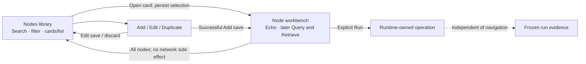

# One entry, two views

Status: Option A approved, 2026-10-20. This supersedes the separate Workbench destination and picker in the [previous dashboard proposal](04-node-library-options.md). Option B remains a comparison alternative.

[Interactive draft](assets/navigation-options.html) · [Surface architecture](03-surface-architecture.md) · [System architecture](01-system-architecture.md) · [Data architecture](02-data-architecture.md) · [S1 tracker](../progress/s1-echo.md)

The node library and workbench form one journey: choose a destination, perform an explicit operation, then return to the library. Separate top-level destinations and a second node picker duplicate that journey. Both proposals remove the standalone Workbench sidebar item and Change node dialog.

## Two options

| | A — Nodes with a nested workbench (approved) | B — Focused workbench |
|---|---|---|
| Sidebar entry | **Nodes** | **Workbench** |
| Initial view | DICOM nodes library | DICOM nodes library |
| Card activation | Opens that node's workbench; sidebar stays visible | Opens that node's workbench; sidebar is hidden |
| Return | **← All nodes**, above the node title | **← All nodes**, in the workspace header |
| Global destinations | Received files, History and Settings stay one click away | Return to the library to access global destinations |
| Space | Stable navigation; slightly narrower diagnostics | More horizontal space for future query tables |
| Main cost | Fixed sidebar consumes width | Navigation moves; global destinations require an extra step |

**Settled:** use A, using **Nodes** for the single sidebar entry and **All nodes** for the return action. “Workbench” remains the name of the node's working view, rather than another destination.

A fits the current labeled-sidebar baseline and keeps receiver visibility and access to received files stable. B is a deliberate focus-mode alternative, not a recommendation to introduce multiple workspaces or simultaneous operations. Neither option adds a second node-switching mechanism.

## Surface and entry points

The app launches into the library with its saved selection restored and no traffic. The existing card action menu and editor contracts remain: persistence succeeds before opening, no redundant write for the selected node, edits retain identity/revision, and removal requires confirmation. No schema changes or additional stored navigation preferences are proposed.

In A, Nodes remains highlighted in both inner views. Clicking its sidebar entry always opens the library. Returning from Settings through Nodes also opens the library; the explicit card remains the entry to a workspace. Back preserves the library's search, environment filter, density, scroll and initiating card focus. Navigating away does not clear selection or stop a run.

In B, the library retains the global sidebar; the node view replaces it with a full-width workbench and compact informational receiver status. All nodes restores the library and sidebar. This departs from the current always-visible navigation baseline and would require explicit approval.

## Workbench header and common simplification

The node label becomes the heading, beside a Test/Production designation. Show called AE and endpoint once below it, then the local calling AE. Put labeled timeout values in an expandable **Connection details** section. The environment is configuration, never a connectivity claim. Preserve the app-wide masking/reveal behavior.

Remove the repeated target-selection card and Change node button. Keep operation controls below the node header. Echo is available now; Query and Retrieve are future slice capabilities. The prototype labels these as planned, rather than simulating their implementation.

A run's evidence still identifies its frozen destination and effective settings. Header simplification must not erase provenance. If settings change after Run, a notice states that current settings apply to the next run while the displayed evidence retains the original settings.

## Back, other nodes and active work

Back is navigation, never Stop. The app continues to admit only one Echo. A compact **Echo running · [frozen node] — View run** strip remains available away from its evidence. A different node may be opened while it runs, but Run stays disabled until cleanup completes.

Evidence must not appear to follow the selected node. Opening node B while the retained run belongs to A shows B's composer and a clearly separate link to A's run, not A's summary underneath B's heading. The current/latest run remains app-owned; this does not add per-node history or preserve multiple run details. After completion, keep a **Latest Echo · [frozen node] — View run** link when that evidence is outside the current workspace.

View run opens an evidence inspection view labeled with the frozen node, independently of the selected target. It does not select a node, restore deleted configuration, or send traffic. Its Back action returns to the originating view. If the saved node was removed, its frozen evidence is still inspectable. Stop Echo remains available for an active run from its evidence view. Explicit retry happens in a node workbench with current valid configuration.

This separation is the approved presentation change from S1's global latest evidence embedded beneath whichever target is selected. Navigation/evidence tests cover this refinement; the existing runtime ownership and retention stay unchanged.

## Interaction and accessibility

- Preserve the 760 × 600 minimum; A retains labeled navigation and reduces card columns. Workbench and library content scroll independently of the sidebar.
- All nodes is a labeled button with a back arrow. Enter/Space activates cards; menus remain separate focus targets. Back restores card focus, or the library heading if the card no longer exists.
- Escape dismisses menus/dialogs; it does not leave a workspace or stop a run. No new Back keyboard shortcut is assumed.
- The receiver remains informational and left-aligned. B must retain receiver status in the focused view, even though its sidebar disappears.
- Settings explicitly saves global client settings only and keeps discard-on-navigation behavior; remote-node editing belongs to Nodes. Library navigation state is session-only.
- Future Query/Retrieve drafts and result retention need their slice-specific behavior; this proposal does not promise per-node query sessions. Any later reuse must identify the originating node and frozen query settings.

## Prototype scope and implementation

The HTML compares A/B, library search, card navigation, Back, light/dark appearance, simulated Echo ownership and a separate frozen-run view. Synthetic endpoints only; no DICOM requests, persistent writes or app configuration access. Add/Edit, filtering, density and other global screens are labeled outside this draft's scope; their existing Flutter implementation is retained. Simulation outcomes are not diagnostic evidence.

Implementation follows Option A and is tracked in S1. The earlier dashboard verification does not validate this refinement; the tracker records its own dry/native and UI evidence. The comparison prototype retains B for reference and uses demonstration-only operation tabs; Flutter does not add inactive Query/Retrieve controls. Manual desktop acceptance remains pending.
