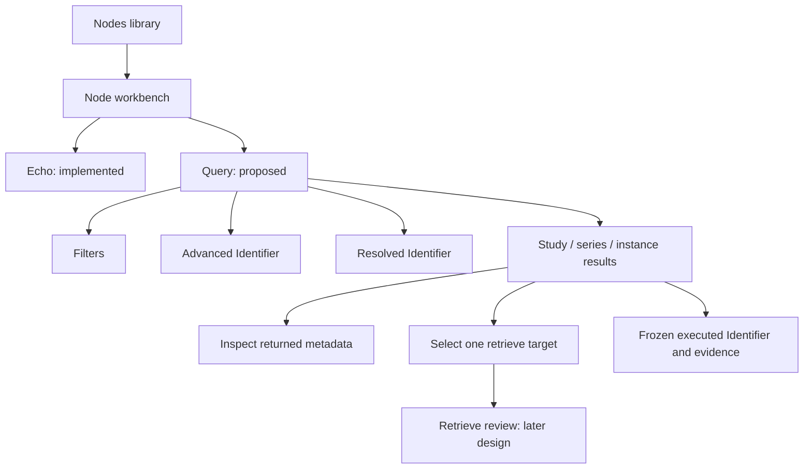

# Query workbench — design options

> Date: 2026-10-22 · Mode: design · Surface: desktop GUI · Status: Option A approved; Flutter UI preview implemented and locally verified; production S2 pending
>
> See also: [Surface](03-surface-architecture.md) · [System](01-system-architecture.md) · [Data](02-data-architecture.md) · [Blueprint](../structure/01-codebase-blueprint.md) · [S2 tracker](../progress/overview-first-preview.md#s2--query-with-friendly-and-exact-identifiers)
>
> Interactive comparison: [Query options](assets/query-options.html). Screenshots: [A](assets/query-option-a.png) · [B](assets/query-option-b.png). Historical source: [Workbench v2](assets/workbench-v2.html).

## Cheat sheet

| Task | Proposed touchpoint |
|---|---|
| Enter common criteria | Query → Filters |
| Edit exact matching / return keys | Advanced Identifier |
| Inspect the next request | Resolved Identifier |
| Execute | Run Query; no automatic search |
| Inspect a response | Row → Inspect |
| Query a child level | Open series / instances → review → explicitly run |
| Prepare retrieval | Select one row → Review retrieve |
| Return to saved nodes | All nodes |

## 1. Overview and reconciliation

The primary user remains a PACS/integration engineer. This proposal adds Query to the existing node workbench; it does not replace the app's navigation or change the approved Study Root scope. Flutter implements node management and real Echo. An explicitly labeled synthetic Query UI preview now exercises the chosen surface; real Query and Retrieve remain pending.

The source comparison was made against `lib/app/shell.dart`, `lib/features/echo/echo_view.dart`, `lib/features/echo/echo_evidence.dart`, `lib/features/settings/settings_view.dart`, the PRD, surface architecture and blueprint.

| Area | Historical `workbench-v2.html` | Actual Flutter baseline / proposed reconciliation |
|---|---|---|
| Entry | Sidebar node plus top-level Workbench | Keep four destinations: Nodes, Received files, History, Settings. Library → nested node workbench → All nodes. |
| Heading | Marketing heading and separate connection context | Keep node name, environment, called AE/endpoint, calling AE and collapsed Connection details. |
| Operations | Find / Retrieve / Echo | Propose Echo / Query within the node workbench. Retrieval starts from a selected target; its full surface is a later review. |
| Configuration | Combined local and remote Settings | Keep global-only Settings. Remote configuration stays in Nodes. |
| Receiver | Interactive mock Start/Stop | Preserve implemented informational Stopped row until the receiving slice exists. Query does not require a listener. |
| Query editor | Filters / Advanced / Resolved | Retain the shared request concept. Improve date entry, scope explanation, hierarchy and results provenance. |
| Child navigation | A child button calls the mock `runFind` immediately; breadcrumbs also rerun | Separate **Open series** from **Find series**. Returning to parent rows restores them without traffic. |
| Results | Compact fixture rows; radio target and limited inspection | Expose patient ID/name, accession, study date, modalities and returned counts; distinguish Inspect, Open child and Select. |
| Evidence | Generic mock evidence | Reuse the implemented evidence vocabulary and frozen-run ownership, extended to Find. Never attach another node's results to this workspace. |
| Query matching | Small local fixture filter | New mock uses explicitly fixed scenarios, never claims to emulate remote matching. Real S2 needs a C-FIND adapter. |

The initial HTML proposal changed no Flutter code. Its approved follow-on now adds the UI-only preview described in the [preview tracker](../progress/query-ui-preview.md); schema, dependencies and core public APIs are unchanged. Existing verification receipts remain historical; this design is not S2 acceptance.

## 2. Surface map and layout choices

### Option A — full-width composer above results (recommended)

A compact two-row filter grid leads into the results table. Filters, Advanced Identifier and Resolved Identifier share the full composer width. **Collapse** reduces the composer to a criteria summary; **Edit criteria** expands it. Collapse is explicit, not an automatic reaction to arriving rows, so focus and layout do not jump during a query.

This leaves more room for numeric tag paths, nested sequence items and wide result columns. At narrow widths fields stack and tables scroll internally. The tradeoff is vertical space before the table; the collapsed state is the result-review mode.

**Settled (2026-10-22):** Option A is selected. Option B remains a comparison alternative; no layout preference ships.

### Option B — persistent composer beside results

A roughly 360–390 px criteria pane stays beside the results on wide windows. This suits repeated edit → run → compare work. It consumes result width and gives the advanced table/tree less room; a production version should expand advanced editing to the full content width. Below the wide breakpoint it stacks vertically, preserving the same fields and actions.

Both options retain system fonts, the blue Material palette, labeled sidebar and left-aligned receiver status. At the 760 × 600 baseline, local scrolling and keyboard focus must work; the HTML sketch is not a Flutter layout/accessibility acceptance test.

## 3. Entry and onboarding

Open a node from the library without traffic. The node heading stays stable; the proposed operation switch adds **Query** beside the existing **Echo**. Keep Echo as the initial operation for a new node entry to avoid changing the current default; remember the chosen operation during the current node visit. The comparison opens directly in Query only to make review convenient.

A first Query visit has no result rows: explain that a request must be run explicitly. The design-review HTML starts with clearly labeled synthetic example rows so table layout can be evaluated immediately. It never reads the application's database or contacts a DICOM node.

## 4. Key journeys

### Common study search

1. Enter any combination of Patient ID, Patient name and Accession number in separate labeled fields. One filled field is enough; multiple keys combine without an inferred cross-field OR.
2. Add inclusive Study date From/Through and optional Modalities in study. Support an unconstrained date and open-ended range in the eventual app; the sketch demonstrates a closed range only. Do not insert wildcards or convert name syntax silently.
3. If Body part is entered at STUDY level, show **Pending for series query** with the actual plan. Keep it out of the study Identifier. Do not claim the resulting studies match that body part.
4. Review Resolved Identifier, then Run Query. Typed observations produce streaming rows and a terminal outcome; edits never refilter earlier rows locally.
5. Inspect metadata or open a study to prepare its SERIES query. Opening alone sends no request. Explicitly Find series with the parent UID and series-level keys.
6. Open a series to prepare IMAGE querying. Preserve both parent UIDs. Inspect or select one instance without broadening its target.

Study Root places patient attributes at study level; Modalities in Study is an optional study key. Series attributes belong to the series level. These scope distinctions follow [DICOM PS3.4 Study Root](https://dicom.nema.org/medical/dicom/current/output/chtml/part04/sect_C.6.2.html). Return of a tag alone is not evidence that an optional matching constraint was applied.

### Exact identifiers without conflicting editors

Filters and Advanced Identifier edit one draft. Advanced rows expose enabled state, canonical numeric path, name, VR, purpose, value and validation. Purpose distinguishes match, return and service-required keys. Disabled means omitted; Return means present with an empty value. A value that cannot round-trip to a friendly control marks it **Custom — edit in Advanced**, rather than being erased.

Keep the approved structured SQ/item editor, same-item grouping and private-creator requirements. Do not substitute free-form JSON for them. The prototype edits common keys and shows an illustrative sequence sketch; arbitrary tag entry and real VR validation are not implemented in it.

**Resolved Identifier** is the next request preview. **Executed Identifier** belongs to the frozen run beneath results. Changing date, node revision or local settings must not change the latter. Show target identity, model, level and timeouts separately from dataset elements. Invalid enabled entries block Run and link back to their editor errors.

### Inspection and retrieval handoff

Use **Inspect** for returned metadata and **Select** for the single retrieval target. Opening child rows is a third, explicit action. Display absent attributes as Not returned; never replace them with guessed values or zero counts. Missing required UIDs block child/retrieve actions with an explanation.

A selection summary states study/series/all instances or single instance. **Review retrieve** will open method and destination review in the later Retrieve design. Find criteria are not copied into a retrieve Identifier. The sketch shows only the target and UID handoff, not C-GET/C-MOVE execution.

## 5. Interaction and state

| State | Required feedback |
|---|---|
| Never run | No results yet; review criteria and run explicitly |
| Running | Receiving responses; bounded count, Cancel query and ongoing evidence; do not sort under keyboard focus |
| Completed | Final observed status, row count and executed context |
| No matches | Completed with zero responses; distinct from failure |
| Partial / local limit | Reason and retained-row count; cancellation intent separate from final peer confirmation |
| Failed | Numeric association/DIMSE outcome and retained partial rows when present; parent results remain usable |
| Cancel requested | Request intent visible; show confirmation only if observed |
| Draft changed | Existing rows belong to the previous run; no hidden local filtering |
| Settings changed | Next request uses current settings; run evidence retains its snapshot |
| Missing parent UID | Child query/retrieve disabled; no broader fallback query |

Node/operation navigation must not stop active work. Extend the existing runtime-owned active/latest run affordance to Find when implemented, with frozen node ownership and explicit View run. This is required behavior, not implemented by the HTML's simplified navigation.

Study/series breadcrumbs restore retained parent context without rerunning it. New parent selection clears incompatible child context and retrieval selection. A new query deliberately replaces its current result context; no per-node persistent patient catalogue or hidden background fan-out is introduced. Result caps and retention remain the approved bounded session model.

## 6. Information architecture and ergonomics

Use **Query** as the user-facing task name and **C-FIND** as its protocol subtitle. Keep **Filters**, **Advanced Identifier**, **Resolved Identifier** and **Executed Identifier** explicit. Separate protocol facts from suggested checks. Provide keyboard focus restoration, Escape dismissal for inspection, accessible row actions and coarse live announcements without taking focus as rows stream.

Avoid adding a third permanent inspector column at the minimum width. Metadata inspection can use a bounded dialog or a full-width panel. The prototype uses a dialog; final inspector treatment can follow the selected layout.

## 7. Configuration and customization

Client identity, timeouts and appearance remain in Settings; node configuration stays in Nodes. Query drafts and returned datasets are session-only, sensitive data. Mask returned values on launch and honor explicit reveal in identifiers/inspection. No browser storage, query templates, local predicate engine or persistent query preferences are added.

The comparison's A/B switch, scenario selector, theme toggle and simulation labels are design-review controls, not proposed production app controls. Fixed fixtures illustrate complete, empty, limit and rejection cases; they deliberately do not apply entered criteria. Exact Date/Time and multi-value matching are protocol concerns for S2 validation, not inferred from fixture behavior.

## 8. Decisions needed and verification limits

- **Layout:** A is approved; B remains a historical comparison alternative.
- Proposed operation labels: Echo / Query, with retrieval reached from a selected target. This fits the requested workflow without reviving a sidebar Workbench destination.
- Full arbitrary tag/SQ editing, streaming, comprehensive validation, real cancellation, run navigation, masking of every arbitrary returned value and production focus restoration are not established by the mock.
- Desktop prototype checks are recorded in the overview tracker. The subsequent Flutter implementation and passing dry/native gates are recorded in the [Query preview tracker](../progress/query-ui-preview.md). Hosted checks for that change and manual desktop acceptance remain pending.
