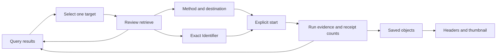
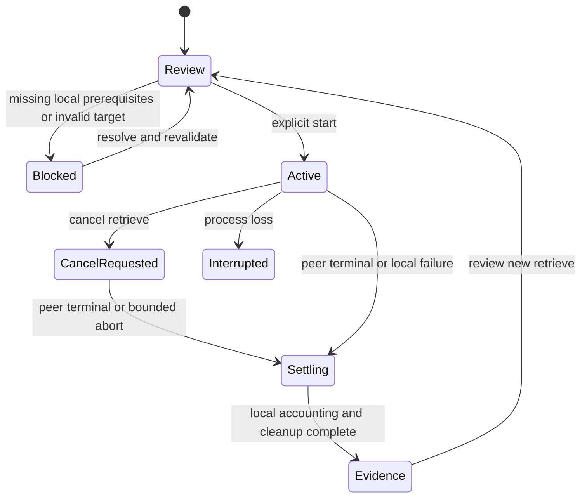

# Retrieve workbench — design options

> Date: 2026-10-22 · Mode: design · Surface: desktop GUI · Status: Option A and initial C-GET approved; synthetic Flutter preview implemented and locally verified
>
> See also: [Surface](03-surface-architecture.md) · [System](01-system-architecture.md) · [Data](02-data-architecture.md) · [Blueprint](../structure/01-codebase-blueprint.md) · [Query design](06-query-workbench-options.md) · [Progress](../progress/overview-first-preview.md)
>
> [Interactive comparison](assets/retrieve-options.html) · Screenshots: [A](assets/retrieve-option-a.png), [B](assets/retrieve-option-b.png) · [Original workbench](assets/workbench-v2.html)

## Cheat sheet

| Task | Proposed touchpoint |
|---|---|
| Retrieve a selected study, series or instance | Query result → Select → Review retrieve |
| Check scope | Selected target card and required UIDs |
| Choose transport | C-GET / C-MOVE method cards |
| Check local destination | Receive destination; C-MOVE adds receiver readiness |
| Check exact request | Advanced Identifier / Resolved request disclosures |
| Start | Explicit Start C-GET or Start C-MOVE after review |
| Compare remote and local results | Peer reported / Local counts and receipt links |
| Inspect a saved object | Saved objects → Inspect headers / thumbnail |
| Return | Back to results, preserving Query state |

## 1. Overview and current baseline

The user is a PACS/integration engineer moving from an exact Query selection to a reviewed retrieval and inspectable local result. This proposal refines the standing retrieve contract; it does not implement networking or settle a new navigation design without review.

Flutter at `9d1fb4b` implements the four-item sidebar, nested node workspace, real Echo and synthetic Query. At that baseline, `lib/features/query/query_view.dart` opened a read-only **Retrieve handoff · preview** dialog containing scope and required UIDs. It explicitly labeled retrieval unavailable. The approved synthetic replacement is described in §8; a production receive-folder picker, listener, save pipeline and retrieval run remain unimplemented. The original HTML has broader illustrative controls; it is not implementation evidence.

Both options replace that small handoff with a useful review and progress surface. Neither adds a sidebar destination or a permanent Retrieve tab. Entry stays attached to a selected Query target. The blue palette, system fonts, nested Nodes ownership and global-only Settings remain unchanged.

## 2. Surface map and layout options

### Option A — full-width nested Retrieve workspace (recommended)

**Review retrieve** replaces the Query content area with **Back to results**, target, method, destination and two expandable Identifier disclosures. A short Review → Receive → Inspect cue describes the journey; it is not a wizard with forced intermediate pages. Start transitions the same workspace to run evidence. The node header and Nodes highlight stay stable.

On wide windows, method and destination sit side by side. At narrow widths they stack. Exact UID editing and diagnostic evidence get the full workspace width. The tradeoff is that Query rows are one Back action away, rather than continuously visible.

**Settled:** Option A is approved for consistency with the full-width Query editor and space for C-MOVE diagnostics. Option B remains comparison history.

### Option B — side sheet beside Query results

The selected row remains visible on the left while review opens on the right; after Start, the sheet becomes the run view. This makes source context easy to compare and keeps the handoff lightweight. It also reduces space for long identifiers, receipts and evidence and introduces two competing content regions.

Below a proposed 1100 px window breakpoint, the sheet becomes full-width with **Back to results**. It is a nonmodal wide-screen pane; the full-width treatment excludes the hidden Query view from keyboard focus. Closing it navigates only; it must not cancel a run. The comparison's breakpoint is illustrative, not a settled Flutter constant.

## 3. Entry and onboarding

The source Query result supplies its originating node, model/level, required UIDs and provenance. The review states **all instances in this study**, **all instances in this series**, or **this instance only**. Selecting a parent includes instances not currently shown. Query counts are labeled query-reported estimates; they never become a transfer completion denominator. Missing UIDs block review/start without broader fallback.

The first real run requires a selected receive folder; no OS folder is silently invented. Readiness distinguishes local prerequisites from unknown peer support. Choosing a method, opening review or selecting a folder sends no DIMSE request. Starting the listener is a separate explicit action and does open a socket in the eventual app.

**Settled initial method:** C-GET for a fresh retrieve draft because it has fewer local callback prerequisites. It is a UI convenience, not a claim that PACS support is more likely. Keep the choice for the current draft; do not auto-fallback or silently reuse a different target's method.

## 4. Key journeys

### C-GET

Review the target, choose a receive folder, inspect the resolved request and explicitly **Start C-GET**. Show Storage role/context negotiation in evidence; a local folder being ready does not prove peer support. A standalone receiver can remain stopped.

C-GET carries its C-STORE sub-operations on the requesting association. C-MOVE uses a separate association and names the destination AE in its command parameters. These differences justify method-specific review fields, rather than two identical buttons. [DICOM C-GET](https://dicom.nema.org/medical/dicom/current/output/chtml/part04/sect_C.4.3.html), [DICOM C-MOVE](https://dicom.nema.org/medical/dicom/current/output/chtml/part04/sect_C.4.2.html).

### C-MOVE

Review the same target and folder. Show the local move destination **DIMSE_DASH**, listening port and receiver state. A stopped receiver blocks Start C-MOVE and offers the explicit receiver setup/start action, including applicable peer policy. The final implementation must coordinate the receiver's registered receive root with the reviewed destination; it must not silently redirect an already-running listener.

Use **Listening locally; remote reachability unverified** after a successful bind. Remind the operator that the PACS owns the destination AE → reachable address/port registration; editing local Settings does not update it. Third-party move destinations remain deferred. Do not require an arbitrary “reachability confirmed” checkbox that would manufacture evidence.

After Start, distinguish no callback, unlinked deliveries and correlated receipts. A peer rejection of `0xA801` can be labeled **Move Destination unknown**. A local timeout with no callback cannot establish a firewall cause. Suggested checks stay beneath observed facts. [DICOM C-MOVE status table](https://dicom.nema.org/medical/dicom/current/output/chtml/part04/sect_C.4.2.html).

### Exact identifiers and inspection

Advanced Identifier contains level and the unique keys appropriate to the reviewed scope. IMAGE includes StudyInstanceUID, SeriesInstanceUID and SOPInstanceUID. Date, body part, modality and patient-name Find predicates are not copied to retrieval. Move destination and connection settings appear outside the dataset.

Editing UIDs marks the request **Edited identifier** and drops the old descriptive label/count claim. The remote match remains unverified. Changing scope requires returning to Query rather than silently widening the target. Resolved request is the next draft; executed evidence is frozen at explicit Start.

Saved-object inspection is distinct from Query metadata inspection. It presents header fields and a basic first-frame grayscale thumbnail, with separate unsupported codec, non-image, decode error and missing-file states. The comparison uses a thumbnail placeholder and never fabricates a diagnostic image. No export/copy-original shortcuts are added in this design step.

## 5. Interaction and state

| State | Visible behavior |
|---|---|
| Ready for local start | Local prerequisites satisfied; peer support still unverified |
| Receiver stopped / folder missing | Explain the prerequisite next to the disabled action |
| Running | Method, frozen target/folder, peer counters, local received/saved/failed counts |
| Missing peer count | Unknown or Not reported; never zero by default |
| Peer terminal but local accounting incomplete | Final peer status plus local processing state; admission remains occupied until cleanup settles |
| Local save failure | Preserve successfully saved files; show failed save separately from response status |
| No callback observed | State the observation window and request termination; no invented cause |
| Unlinked receiver delivery | Separate receiver activity, excluded from run-linked totals |
| Cancel requested | Intent visible; no immediate claim of confirmed cancellation |
| Cancel confirmed / aborted / interrupted | Distinct terminal evidence and provenance; saved files retained |
| New settings or node revision | Next draft must revalidate; executed target/folder never changes |
| Retry | Review new retrieve; fresh explicit start with current configuration, no automatic queue |

Peer **completed / failed / warning / remaining** and local **received / saved / save failed** are separate groups. Unlinked receipt counts are receiver-wide context, even when placed nearby. No percentage or ETA is derived from query estimates. A known pending peer total can support a labeled progress indicator; unknown totals remain indeterminate. Saved count alone does not establish successful acknowledgement or unique SOP count; repeated deliveries remain distinct records.

The diagram summarizes the journey, not a replacement for independent protocol/local observations. Navigation, Back and Escape do not cancel networking. Restore Query criteria, result context, selection, scroll and initiating focus on return. Keep active/latest View run available when evidence is elsewhere. Deleted nodes must not destroy frozen evidence. Stale source selections require explicit resolution before Start; never silently retarget another node.

Receiver lifetime stays independent: completion or cancellation of C-MOVE does not automatically stop a listener that was explicitly started. Stopping the receiver needs the existing active-work interruption handling. Only one outbound retrieve is allowed; no automatic retries, queue or fallback. The implementation plan must reconcile admission with concurrent Echo/Query rather than infer a new concurrency rule from this sketch.

## 6. Information architecture and ergonomics

Use **Retrieve** as the task, **C-GET / C-MOVE** as explicit methods, and **Receive destination** for storage. “Connect” is too vague. Default review is concise; long UIDs, timeouts and evidence expand on demand. The important scope statement stays visible without expanding identifiers.

Preserve mask/reveal for patient labels, UIDs, paths, inspection and snapshots. Use semantic buttons, labeled fields, visible focus, Escape dismissal and focus restoration. No role/color alone conveys success. At 760 × 600, stack fields and scroll within the content area; tables can scroll internally. Keyboard focus must not enter hidden panes. A browser comparison cannot establish native accessibility or platform acceptance.

## 7. Configuration and preview boundary

Global calling AE, listen port and timeouts remain in Settings; remote node fields remain in Nodes. The review consumes those values and shows applicable readiness, rather than duplicating Settings editors. Selecting a receive root is part of the receiving design, backed eventually by the S3 registry and save pipeline.

The HTML opens directly into a masked SERIES review for quick comparison. **Back to results** demonstrates its origin. Preview controls allow STUDY/SERIES/IMAGE and fixed complete, receiving, save-failure, no-callback, unknown-destination, cancel-requested and interrupted snapshots. A sample folder is prefilled only in the sketch. **Show C-GET/C-MOVE sample run** freezes a synthetic request immediately; no timers, transport, socket binding, filesystem access, durable records or actual cancellation occur. The simulated listener action is explicitly labeled.

The HTML remains separate from Flutter; its synthetic presentation now has a Flutter counterpart tracked in §8. Production receiver policy/configuration, actual folder selection, service-specific Identifier validation, negotiation, receipt reconciliation, retrieval runtime ownership, restart recovery and decoded thumbnails remain unimplemented. Production dependencies stay S3 → S4/C-GET and S3 → S5/C-MOVE; these pages do not complete any slice.

## 8. Settled preview boundary and verification limits

Option A and initial C-GET are approved. The Flutter preview implements a nested
review/evidence workspace, sample-folder alias, simulated receiver readiness,
required UID editing, frozen snapshots and receipt/header/thumbnail placeholders.
The first sample requires explicitly choosing its fictional folder. Global
Received files and the actual receiver remain unchanged. Each new target resets
the method to C-GET; the same source preserves its draft.

Preview state is shell-owned and in memory, distinct from real Echo. Fixed
snapshot transitions perform no networking, cancellation, filesystem access or
history writes. Real Echo activity disables sample execution/transitions until
cleanup finishes. The latest sample remains available during same-node
navigation; node changes, deletion, selection loss and restart clear it.

[Implementation tracker](../progress/retrieve-ui-preview.md) records current
verification. The earlier HTML and screenshots remain design comparisons; their
prefilled sample folder differs from Flutter's explicit selection. Production
receiving/retrieval and native acceptance remain pending.
