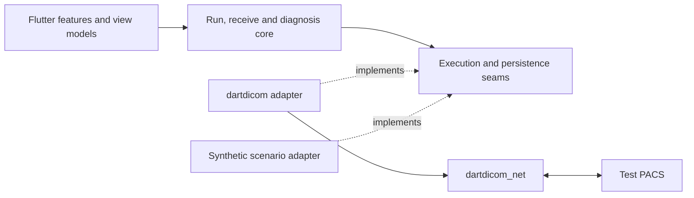

# DimseDash exploration — 2026-10-18

Status: retained exploration evidence and architecture candidates. The [PRD](../req/dimsedash-prd.md) is now authoritative for product scope and remaining product decisions. This review is not a settled architecture or implementation plan. Original inventory: [archived draft](../archive/dimsedash-initial-ideas-2026-10-18.md).

## Confirmed product direction

MIT; initial owner Lightbridge-KS. Primary audience: PACS and integration engineers, with advanced details available. First preview must complete Find → Move/Get → receive. macOS and Linux have equal acceptance criteria from that preview; Windows timing remains open. FVM and just are selected. The PRD now records these decisions; system and data design are drafted, with surface design to follow.

Basic image thumbnails are included in the first preview. TLS can wait, and legacy Thai character-set support is not required initially. These are confirmed scope decisions, not pending upstream prerequisites. The blue compact workbench mockup was subsequently approved; its durable reference and interpretation are recorded in the PRD.

## Product recommendation

Position the app as **a DIMSE diagnostic workbench**. Its useful output is a defensible account of what succeeded, what failed, what is still unknown, and what to check next. The receiver is a visible, independent part of the product, not a hidden helper attached to the Run button.

Borrow API Dash's saved targets, operation editor, inspection panes and history. Use DICOM-specific interaction where the model differs: C-FIND has many responses, C-GET receives C-STORE on the same association, and C-MOVE causes a separate incoming association. API Dash's current collection notifier also coordinates several protocols and persistence; do not copy that concentration of responsibility.

Proposed first-preview boundary:

| Include | Keep for a later slice |
|---|---|
| Saved nodes and a local AE/listener profile; C-ECHO preflight | Variable templates, nested collections, import of external workspace formats |
| Study Root C-FIND, study → series → instance navigation, explicit matching/return keys, cancel; validated exact tag-path/value editor added in PRD R-19 | Patient Root, MWL and unrestricted malformed identifier/PDU editing; local rule engine explicitly deferred |
| Selected study or series retrieval by both C-MOVE and C-GET | Arbitrary third-party move destinations and standalone bulk C-STORE sending |
| Verification + Storage listener; bind/stop state; receive ledger; explicit output folder | General mock SCP policies, tiny PACS/query server |
| Metadata/header inspection, basic image thumbnails, and comparison of peer counters with local saves | Interactive viewer controls, full raw-PDU hex tree, compressed-pixel decoding |
| Structured summary, supported failure explanations, small sanitized Markdown/JSON report | PDF, code generators for three ecosystems, automated conformance/health probing |
| Local configuration and bounded metadata history | Headless CLI, monitors, mobile, DICOMweb, LLM assistant |

Build incrementally inside that release boundary: Echo and evidence → Find and navigation → listener and C-MOVE → C-GET → basic thumbnails → cross-platform end-to-end acceptance. These are implementation slices, not Echo-only public releases.

Recommended thumbnail boundary: a representative first-frame preview for supported grayscale images using the existing renderer. Interactive window/level and frame scrubbing can follow later. Unsupported images and non-image objects show an explicit preview-unavailable state; thumbnail generation failure must not overwrite successful receipt/storage evidence. Verify both a supported thumbnail and an unsupported-preview case in first-preview acceptance.

## Library reality at the inspected release

Inspected the clean `dartdicom` checkout at `7f9a80d3a257a6936011250ce3e701b47b717385`, which matches `v0.1.0-dev.1`. The [release](https://github.com/Lightbridge-KS/dartdicom/releases/tag/v0.1.0-dev.1) records prior live interoperability and a macOS Flutter consumer check. This exploration read source; it did not rerun those gates or establish Linux application support.

| Capability | Evidence and consequence |
|---|---|
| C-ECHO/FIND/MOVE/GET/STORE, cancellation, timeouts | Present in the public association API. Basic protocol execution is not the main blocker. |
| Receiving | `StorageScp` supports Verification and known Storage SOP classes, with peer allowlists and a configurable bind address. `InstanceSink` is a useful real seam for a receipt ledger and file persistence. |
| Move correlation | `ReceivedInstance` exposes move-originator AE and message ID. However, the high-level outgoing operation API does not expose its message ID as a typed run handle. Add structured correlation upstream before concurrent retrieves. |
| Trace | `TraceSink.record` receives `DimseTrace` and `PduTrace`, but command fields are formatted strings; PDU summaries and transitions are text. No event timestamps or association IDs. App receipt timestamps are possible, but cannot invent unobserved DNS/TCP stages. |
| Negotiation/errors | Accepted contexts and structured association rejection fields are public. Full rejected-context results and peer information are not exposed through a complete public result; abort details are reduced to a message. |
| Status | Typed success/pending/cancel/warning/failure categories exist. A service-specific meaning registry and structured error-detail exposure remain separate needs. |
| Images | Native pixels can render; compressed decoding is unavailable. Receiving/storing a compressed instance does not require displaying it. Image preview must not gate network success. |
| Text | Default repertoire, Latin-1 and UTF-8 are implemented. Thai `ISO_IR 166` / TIS-620 is not; unknown encodings currently fall back on read. Do not promise correct Thai decoding from this release. |
| Deferred facilities | TLS, user identity, MWL support, richer character sets, full de-identification, and streaming one large instance to disk need further upstream work. Existing API holds each received instance's bytes, even though it avoids keeping an entire study. |

Source anchors: [association](https://github.com/Lightbridge-KS/dartdicom/blob/v0.1.0-dev.1/dartdicom_net/lib/src/association/association.dart), [trace](https://github.com/Lightbridge-KS/dartdicom/blob/v0.1.0-dev.1/dartdicom_net/lib/src/trace/trace.dart), [errors](https://github.com/Lightbridge-KS/dartdicom/blob/v0.1.0-dev.1/dartdicom_net/lib/src/errors.dart), [receipt contract](https://github.com/Lightbridge-KS/dartdicom/blob/v0.1.0-dev.1/dartdicom_net/lib/src/sink/instance_sink.dart), [character sets](https://github.com/Lightbridge-KS/dartdicom/blob/v0.1.0-dev.1/dartdicom/lib/src/charset/charset.dart).

Proposed upstream prerequisite: versioned, structured lifecycle/negotiation/status observations, association and operation correlation, numeric abort details, and safe retention defaults. Keep protocol interpretation upstream; keep diagnostic advice, product policy and presentation in DimseDash. Do not import `lib/src`, parse display strings, or implement a second PDU decoder in the app. Keep the existing text trace as a developer view.

## Corrections to carry into the PRD

1. **Observed outcome versus suspected cause.** A timeout establishes a timeout. Refusal, routing, firewall, remote load and application policy are candidates, not proven explanations. Show observed evidence, possible causes and next checks separately; preserve unknown/unobserved states. Prefer explicit peer-reported facts to numerical confidence scores.
2. **Two ledgers for retrieval.** Peer-reported completed/failed/warning counters and locally received/saved/failed/duplicate counts are different evidence. A DIMSE success plus a local disk error is not overall success. Missing counters remain unknown, not zero. The current library coalesces some missing counts to zero; preserving presence requires an upstream change.
3. **C-MOVE callback proof.** Local listener binding and a request for a nonexistent study do not prove that the PACS can reach the listener. No matches can complete without storage sub-operations. Use an explicit known synthetic instance for an end-to-end callback test. [C-MOVE](https://dicom.nema.org/medical/dicom/current/output/chtml/part04/sect_C.4.2.html) uses a separate association; the [SCP behavior](https://dicom.nema.org/medical/dicom/current/output/chtml/part04/sect_C.4.2.3.html) permits immediate success for no matches.
4. **Query bounds.** Standard C-FIND has no general SQL-style LIMIT/page-size field. A client stop-after-N uses C-CANCEL and is not a guaranteed bound on server work. Require useful matching keys and label truncated/cancelled results. [Service parameters](https://dicom.nema.org/medical/dicom/current/output/chtml/part04/sect_C.4.html).
5. **Model-valid levels.** [Study Root starts at STUDY](https://dicom.nema.org/medical/dicom/current/output/chtml/part04/sect_C.3.2.html), so PATIENT is not a valid level for that model. Matching behavior and key requirements depend on the model, level and attribute; a generic wildcard editor cannot imply all combinations are valid.
6. **Privacy has several boundaries.** UI masking is not dataset de-identification. Query identifiers, free text, private tags, UIDs, filenames, raw PDU bytes and images can carry sensitive information. Use a deliberately limited report schema; keep raw payloads and received files out of normal history. Re-running a sanitized record may require re-entering sensitive query keys. Never promise exact replay of data intentionally not retained.
7. **Read-only is still an operation.** C-FIND can disclose data or load the PACS; C-MOVE and C-GET both transfer data, including retrieval to the local app. Use endpoint risk labels, constrained queries and explicit receive destinations instead of treating only C-STORE as consequential.
8. **Negotiation is not conformance certification.** An accepted presentation context establishes acceptance in that association, not that every SOP instance or operation will work. Peer implementation names are self-reported, not verified vendor identity. Exported commands describe equivalent intent, not a guarantee of identical outcomes across clients.
9. **Fix upstream IDs.** Original §10's requirement references are stale: current trace is N-14, user identity N-16, TLS N-19, MWL N-18, de-identification C-22. Re-map from current library PRD when creating an actual upstream work list.

## Hybrid Cleanish shape promoted to system design

The package split, Riverpod boundary and one-active-retrieve policy below were approved on 2026-10-18 and are now owned by the [system design](../design/01-system-architecture.md). Other details remain candidates. Tier: **Modular**, with minimal DDD. Most protocol complexity is already in a library; the app's own substantial rules are run lifecycle, evidence, retrieval reconciliation and retention. Full Clean layers and one class per button would add ceremony.

Start with a Flutter app at the repository root plus one private pure-Dart package, `packages/dimsedash_core`. The root is also the pub workspace. Keep UI/platform adapters in the app, and operation orchestration, run records and diagnostic policy in the core. Feature-oriented app modules: nodes, operations, runs, receiver, settings. The core may use stable `dartdicom` value types; do not mirror every tag/dataset into app DTOs.

Use a small operation runner and receiver controller with explicit cancellation/close lifetimes. Separate editable operation drafts from immutable resolved run snapshots. One active retrieve initially makes correlation and resource ownership manageable. Do not bind listener lifetime to whichever tab is currently visible.

Approved state-management boundary: Riverpod in the Flutter layer, ordinary constructor injection and streams in core. No provider reference in protocol or diagnostic code. Disable automatic retry for operation execution; any retry must be an explicit run. [Riverpod's code-generation and hooks packages are optional](https://riverpod.dev/docs/introduction/getting_started).

Separate reusable configuration, run history, receipt inventory and received instances. **Superseded storage proposal:** the initial JSON/JSONL approach was replaced by the approved SQLite application database plus ordinary DICOM files; JSON remains the configuration interchange format. [PRD §6](../req/dimsedash-prd.md#6-outcome-and-data-handling-contracts) owns the approved lifetimes. Secrets use platform credential facilities when first needed. Export shareable configuration deliberately; do not place all runtime state in a git workspace. A rules table in Dart is sufficient initially; YAML rule interpretation and plugins are not needed.

The immutable run record should hold resolved settings, software versions, ordered structured events and final outcomes. Receive bytes live separately; history holds references only when retention permits. Timestamp monotonic durations separately from wall-clock times. Diagnostic advice can be recomputed against retained evidence, but sanitized evidence is intentionally incomplete.

Responsiveness is the requirement; isolate count is an implementation decision. [Async I/O uses Dart's event loop](https://dart.dev/language/concurrency); move heavy parse/render work off the UI isolate, and consider one long-lived network worker when profiling or listener ownership justifies it. Avoid precommitting to one isolate per association. Bound result batches, trace bytes, received bytes and disk usage.

## Surface direction

Retain the supplied blue Material roles: light primary `#415f91`, dark primary `#AAC7FF`, cool neutral surfaces. Keep tables compact and status text explicit. The approved direction uses a node sidebar, operation workspace and evidence pane; receiver state stays visible across tasks. Show a prominent factual outcome, then timeline, negotiated contexts, received objects and optional trace.

For C-MOVE, explicitly show the two paths: outgoing request and incoming storage. For C-GET, show storage returning over the same association. Never equate “listener running” with “reachable from PACS”. The design study uses synthetic records and fabricated timings; it is not a running Flutter app or network evidence.

The exported sample selects Barlow through `google_fonts`. Bundle any selected fonts and disable runtime fetching to uphold offline/no-telemetry expectations. The workbench direction is approved; exact font, density variants and remaining design tokens still belong in surface design and a root `DESIGN.md`. The theme export alone is not a complete design system.

## Tooling and verification proposal

- FVM: choose a concrete Flutter stable version during scaffold, record `.fvmrc`, commit the app lockfile, invoke Flutter/Dart through FVM. No floating `stable` pin in CI.
- Just: `get`, `fmt`, `analyze`, `test`, `dry`, `live`, and platform build recipes. Keep the portable core of orchestration in Dart; avoid making Windows depend on Bash. No Melos until workspace orchestration needs exceed just/pub workspaces.
- Package dependencies: current release is GitHub-only. Use the same pinned tag/SHA for core/net and any pixel package, including the documented core override; ignored local overrides allow simultaneous library work.
- Dry gates: format/analyze, core lifecycle and diagnosis tests, replay scenarios, relevant widget tests, secret scan, and desktop builds. Fake evidence tests cannot establish interoperability.
- Live gates: explicit manual/pre-release job against actual synthetic peers, separate from dry PR CI. Start with Orthanc; deterministic failure peers in pynetdicom/DCMTK cover rejection, timeout, unsupported contexts, cancellation, partial receipt, bind conflict and local disk failure. Test warnings and uncertainty as carefully as success.
- `orthanc-test-bundle`: add a `dimsedash` consumer profile later, with `.env` registration and `.toml` fixture contract. Required packs/counts come from its catalog. This is a development integration; a clean DimseDash checkout must not require a sibling local path.
- Ship a minimal pinned Compose demo/test fixture with loopback-only published ports, unique project/port settings and redistributable synthetic data. Reuse fixture generation where practical; do not fork the whole bench. Explicitly configure the C-MOVE callback address as seen from the PACS container.
- macOS and Linux both need packaged-application checks: launch, file selection, storage, listener, cancel/close and the full retrieval flow. A containerized protocol test or a successful Linux compile alone does not prove a usable Linux desktop. Name the supported distro/version/architecture baseline before the PRD makes a broad Linux claim.
- The macOS release entitlements need both network client and server capabilities; test the release artifact, not only Flutter debug. Distribution channels and signing are separate decisions from whether source builds run.

## Promotion and next design work

Product decisions and the proposed architecture-document sequence are centralized in
[PRD §12](../req/dimsedash-prd.md#12-decisions-and-next-documents). The approved visual
direction and storage/retention defaults are no longer open questions. The
[system architecture draft](../design/01-system-architecture.md) develops the remaining
architecture mechanics; the [data draft](../design/02-data-architecture.md) follows those boundaries, with surface design still to come.

Recommended order: system architecture → data architecture → surface architecture,
then codebase blueprint and implementation planning. Edit early decisions in place;
no ADR is needed at this stage.
