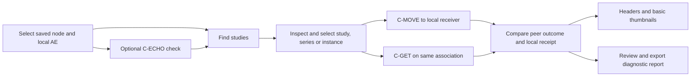

# DimseDash — Product Requirements

| | |
|---|---|
| Status | PRD draft for review; explicitly confirmed decisions are listed below |
| Date | 2026-10-18 |
| Product | Cross-platform Flutter desktop workbench for testing and diagnosing DICOM DIMSE communication |
| Ownership / license | Repository `Lightbridge-KS/dimsedash`; MIT |
| First public preview | Find → Move/Get → receive → inspect headers and basic thumbnails, on macOS and Linux |
| Evidence baseline | `dartdicom` `v0.1.0-dev.1`, commit `7f9a80d3a257a6936011250ce3e701b47b717385`; source review, not new application verification |

This is the active product requirements document. It supersedes the [initial inventory](../archive/dimsedash-initial-ideas-2026-10-18.md). The [exploration review](../ideas/2026-10-18-exploration.md) retains source findings and architecture candidates. This PRD defines product behavior, acceptance and approved technical constraints; package layout, database schema, event contracts and class design belong in the architecture documents. The [system architecture draft](../design/01-system-architecture.md) develops the first design lens. No SRS or ADR is introduced at this stage.

## 1. Problem and users

PACS connectivity failures span endpoint configuration, transport, association negotiation, DIMSE service responses and local receiving/storage. Current workflows often combine command-line tools, server logs and manually recorded node settings. A successful echo does not establish that a query or retrieve will work. C-MOVE is particularly confusing because the PACS sends objects over a separate association to a destination registered on the PACS.

DimseDash gives an operator one place to configure a target, perform an intentional operation, inspect the evidence, and identify the next useful check. It explains the limits of that evidence as carefully as it explains success.

| Audience | Need | Priority |
|---|---|---|
| PACS administrators and integration engineers | Diagnose communication, register endpoints correctly, query and retrieve known objects, produce useful evidence | Primary |
| DICOM developers and QA engineers | Inspect protocol details, reproduce problems and verify interoperability | Secondary; advanced detail remains accessible |
| Modality engineers | Worklist, send and commitment workflows | Later expansion |
| Educators and learners | Understand association, query and retrieval behavior | Beneficiary; no separate teaching mode initially |

Typical as-is story: an operator can echo a PACS but cannot retrieve a series. A move response reports failed sub-operations, yet there is no clear record of whether an inbound association arrived or whether local storage failed. DimseDash makes those observations separate and visible.

## 2. Confirmed direction and goals

Confirmed decisions:

- Open source, MIT, initially under Lightbridge-KS; inspired by API Dash with an independent identity.
- Flutter desktop, FVM for SDK management, justfile for command orchestration, and the `dartdicom` family for DICOM capabilities.
- Primary audience is PACS/integration engineers, with advanced detail available.
- The first public preview completes Find → Move/Get → receive. Echo is an implementation slice within that release, not its complete public value proposition.
- The advanced Identifier editor is included in the first preview; the local dataset rule engine is deferred. Friendly filters and advanced entries share one request model.
- Surface choices are approved: one study/series/instance retrieve target, structured nested Identifier editing with a read-only preview, and masked-on-launch values with separate thumbnail reveal. Multi-target batching remains deferred.
- Basic image thumbnails are included. TLS is deferred; legacy Thai character-set support is not required initially.
- macOS and Linux are equally supported from the first preview. Windows remains a goal with timing open.
- The blue, compact diagnostic workbench mockup is the approved visual and interaction direction; §4 records it durably.
- Data implementation choices are approved: Drift/native SQLite, opaque-ID paths with one file per delivery and no initial physical deduplication, plus the detailed-event and fileless-failure limits in the data architecture.
- Architecture decisions are approved: root Flutter app plus private pure-Dart core, Riverpod confined to Flutter, and one active outbound retrieve initially. Bounded independent receiving remains available; concurrency alone does not establish correlation.
- Structural choices are approved: typed command results and run events/outcomes, feature UI with capability core and shared adapters, and a conceptual blueprint with enforceable invariants rather than pinned Dart signatures.
- Storage and retention defaults are approved: one local SQLite database for settings, saved nodes, permitted templates, run summaries and receipt inventory; ordinary DICOM files in a user-selected folder; bounded session memory for query results and thumbnails; independent history/file cleanup. §6 defines the lifetimes and limits.

Goals:

1. Complete a useful query/retrieve task without requiring command-line protocol knowledge.
2. Distinguish observed facts, peer-reported outcomes, local effects, possible causes and unobserved stages.
3. Preserve enough configuration and evidence to investigate a run, without silently persisting all patient data.
4. Keep the UI responsive and make cancellation, partial results and receiver state understandable.
5. Exercise the libraries as a real desktop consumer and return protocol defects to upstream with regression evidence.

Non-goals: clinical image interpretation, measurements or hanging protocols; a production PACS/router/archive; DICOM conformance certification; a browser DIMSE client; cloud accounts or telemetry; OS packet capture; DICOMweb, HL7 or FHIR in the first preview. Thumbnail availability is not a clinical quality claim.

## 3. Scope and priorities

**P0** is the proposed first-preview acceptance baseline. **P1** is a candidate subsequent product slice. **P2** is a longer-term direction, not a release commitment. Later ideas are preserved in §10 without the old speculative version schedule.

**Approved scope boundary (2026-10-19):** the first preview uses Study Root, both retrieve methods and local receipt; Patient Root, MWL, arbitrary third-party move destinations and standalone C-STORE sending are deferred. The complete retrieval workflow and basic thumbnails remain required.

### P0 capabilities

IDs are introduced here because the acceptance scenarios below reference them. They identify product capabilities, not a formal SRS or implementation classes.

| ID | Capability | Product behavior and boundary |
|---|---|---|
| R-01 | Saved nodes and local identity | Add, edit, duplicate, find and remove saved nodes; configure remote host/port/called AE and local calling AE. Nodes owns remote called AE, PACS IP/port, label and environment editing. Settings owns local calling AE, the client listening port for C-MOVE, global timeouts and appearance. Saving Settings preserves node content, revisions and selection. The editable local AE defaults to `DIMSE_DASH` and also identifies the local receiver/Move destination in the initial single-identity setup. Validate endpoint and AE-title input before execution. Display the resolved target and test/production designation. Listener bind address, port and accepted peers are explicit. |
| R-02 | Echo | Run C-ECHO and show connection/association/DIMSE outcomes. Echo success establishes only that verification exchange, not query, storage or callback capability. |
| R-03 | Find | Study Root C-FIND at STUDY, SERIES and IMAGE levels with level-appropriate matching keys and return keys. Stream results; distinguish no matches, failed query, cancellation and deliberately limited results. |
| R-04 | Result navigation | Inspect study matches, find their series and instances, and select one study, series or instance for retrieval. Instance retrieval carries the complete Study/Series/SOP Instance UID hierarchy; multi-target batching is deferred. Retain the necessary parent identifiers rather than reconstructing a request from displayed labels. |
| R-05 | C-MOVE to DimseDash | Request retrieval to the local destination AE, show peer sub-operation progress, and observe separate inbound storage associations. Explain that the PACS must know the destination's reachable address and port. A local bind check does not establish remote reachability. |
| R-06 | C-GET | Receive C-STORE sub-operations over the requesting association with appropriate storage contexts and roles. No separate listening endpoint is required for this receive path. Clearly report unavailable negotiated capabilities. |
| R-07 | Local receiver | Explicitly start/stop Verification and Storage SCP service; show bound/stopped/failed state and incoming association evidence. Declare supported SOP classes/transfer syntaxes rather than claim universal support. Switching tabs does not stop the receiver. |
| R-08 | Receive ledger | For each observed instance, distinguish receipt, successful persistence, local failure and duplicate handling. Keep PACS counters separate from local counts. Missing counters remain unknown; ambiguous inbound traffic is not silently credited to a run. |
| R-09 | Header inspection | Inspect received-object and query-result metadata, including nested sequences, tag/VR/keyword/value, search and character-set context. Unsupported character sets are explicit; no promise of faithful legacy Thai decoding. |
| R-10 | Basic thumbnails | Display a basic thumbnail for supported received images using `dartdicom_pixel`. Recommended first scope: representative first frame of supported grayscale images. Non-image objects, unsupported codecs and render failures have a clear preview-unavailable state independent of transfer/storage status. |
| R-11 | Diagnostic evidence | Present a factual summary, ordered stage/operation observations, presentation-context negotiation and a payload-limited protocol trace. Decode supported rejection/abort/status information by service. Show unknown or not observed when the library cannot establish a fact. |
| R-12 | Lifecycle and cancellation | Expose running, cancelling, cancelled, completed, warning and failed outcomes. Use C-CANCEL where supported and distinguish it from abort. Account for in-flight receives and already saved files. Timeouts and closing the app terminate work predictably; retries are explicit new runs. |
| R-13 | History and rerun | Persist bounded run metadata and permitted evidence under §6's approved retention defaults; inspect past outcomes and create a new run from retained configuration. Separate editable drafts from executed settings. Re-enter omitted sensitive query input when necessary; query results are session-only and exact replay is not promised. Clearing history preserves received files and their independent inventory. |
| R-14 | Diagnostic report | Preview and export a small Markdown/JSON report with operation, sanitized settings, observed evidence, outcome, software/library versions and limitations. Default export omits payloads, identifying values, free-text comments, site endpoints and local paths. Export is deliberate, with its contents inspectable beforehand. |
| R-15 | Privacy and local operation | No account or telemetry; application traffic is limited to explicitly configured operations and receiving. No runtime font downloads or automatic update checks. Provide masking for sensitive displayed values; masking does not de-identify source files or image pixels. Raw payloads are excluded from normal persistent logs and report exports. |
| R-16 | Explicit storage and resource bounds | Require a user-selected receive folder, show it before transfer and reveal saved locations afterward. Retain files until explicitly deleted; do not silently evict old files to admit new transfers. Handle unwritable/full storage, interrupted writes and oversized workloads without declaring success. Bound result buffers, trace retention, thumbnail work and receive resources; expose limits and partial outcomes. |
| R-17 | Desktop usability | Approved workbench layout; resizable panes, light/dark appearance, keyboard access, accessible labels and status conveyed by text/icon as well as color. English first, with localizable UI strings. Inspection remains usable while results and receipt events arrive. |
| R-18 | Reproducible desktop delivery | The supported macOS and Linux baselines run the complete packaged-application workflow. A clean checkout has a documented setup and synthetic demo/test path without requiring private services or sibling local paths. Document supported formats and known limits. |
| R-19 | Advanced DICOM identifiers | Configure exact numeric tag paths, VRs and values through a validated advanced editor sharing the normal query/retrieve request model. Distinguish matching keys from return keys; preview the resolved outbound Identifier, including supported sequence structure. Validate by operation, information model and level. Retrieve identifiers remain UID-based; arbitrary Find predicates are not silently copied into Move/Get. No unrestricted malformed-PDU editor or guarantee that a peer supports every tag. |

No implicit probe or automatic retrieve runs when a node is selected. A query result cap is a client cancellation/display policy, not a promise to limit the PACS's work. Do not infer C-MOVE callback health from a nonexistent-object request. A context accepted during negotiation is evidence for that association, not proof of all subsequent service behavior.

### Query criteria and exact identifiers

The intended search workflow covers study date/time, modality, body part, patient ID/name and accession number. Friendly fields and advanced tag entries must resolve to the same request, with no hidden override precedence. Study Root patient attributes can be searched at STUDY level. Modality requires distinguishing study-level `ModalitiesInStudy` from series-level `Modality`; body-part matching may require series queries and peer support. The app exposes the actual level, keys, extra query steps and limitations before execution. A date/time interval must not silently become a different predicate through independent date/time ranges.

Exact configuration has three distinct meanings:

| Purpose | Contract |
|---|---|
| Remote C-FIND Identifier | Matching values and return keys at the selected model/level; nested sequence keys where the model and peer support them. An empty return value is not an inactive filter rule. Optional-key matching support may remain unknown even when a response includes the tag. |
| C-MOVE/C-GET Identifier | Query/retrieve level and the required unique identifiers, normally populated from selected results. Advanced edits validate the complete identifier hierarchy and visibly change the effective target. Move Destination AE is a command parameter, not a dataset matching tag. |
| Local dataset evaluation | A deferred feature for testing returned or received datasets; it cannot make the remote peer filter by unsupported keys or reduce bytes already received. |

**Settled — editor and rule scope (2026-10-18):** the advanced Identifier editor is P0; the local dataset rule engine is deferred. No first-preview controls evaluate custom predicates on Find results or received files. The later candidate keeps explicit stages and match / no match / unknown outcomes; received-instance checks would annotate saved objects without discarding deliveries or changing storage acknowledgements.

Tag paths describe sequence structure, not guaranteed searchable fields. Multiple local accepted values must not silently become a backslash-separated remote OR predicate; matching depends on VR, service and supported negotiation. Enabled invalid entries fail validation instead of being skipped. Full configured values and Identifier previews remain sensitive session data under §6; advanced editing does not promote saved templates or configuration import/export into P0.

## 4. Approved workbench direction

The approved concept is preserved as [standalone reference](assets/approved-workbench.html) and [source fragment](assets/approved-workbench.fragment.html). It contains synthetic scenarios, not a Flutter implementation. Its simulated controls and fabricated history are illustrative. Basic thumbnails were added to the requirements after the original mock was drawn; their absence from that mock does not defer R-10. The [refined workbench proposal](../design/assets/workbench-v2.html) accompanies the [surface draft](../design/03-surface-architecture.md), adding query composition, advanced identifiers, retrieve review and received-object inspection. It remains a review proposal; the original approval is preserved.

| Area | Approved direction | Detail to resolve in surface design |
|---|---|---|
| Shell | Compact desktop workbench with stable navigation, a Nodes library opening a nested node workbench with Back navigation, and evidence tied to its executed target | Future pane resizing and shortcuts; initial minimum 760 × 600 |
| Receiver | Persistent local receiver identity/state; reachable across operations | Close/stop behavior with active transfers and preflight feedback |
| Operation | Target and calling identity are legible; Find, C-MOVE and C-GET are distinct tasks | Query editor, result navigation and destination selection details |
| Evidence | Prominent factual outcome; sequence beside peer counters and local receipt | Context-table placement and advanced-detail disclosure |
| Inspection | Diagnostics, query results/received objects, protocol trace and report preview | Header and thumbnail composition within received-object inspection |
| Path explanation | C-MOVE displays outgoing request and separate incoming storage; C-GET displays one association carrying both | Progress states, cancellation and ambiguous correlation |
| Color and density | Supplied blue Material light/dark roles, cool neutral surfaces, compact tables, restrained color | Accessible density variants, high-contrast treatment and complete token set |

Approved palette anchors: light primary `#415F91`, dark primary `#AAC7FF`; light surface `#F9F9FF`, dark surface `#111318`; light primary container `#D6E3FF`, dark primary container `#284777`. The mock uses system-font fallbacks. The exported theme sample's Barlow selection does not establish a final font decision. Fonts selected later are bundled for offline operation.

The following is the product journey, not a component diagram:

## 5. Key user journeys

1. **First successful exchange:** configure a synthetic test node and local calling identity, run Echo, inspect the result, then Find. Failure at an earlier step remains inspectable rather than replaced by a generic connection error.
2. **Find and retrieve:** query a known study, drill into a series or instance, review selection/destination, and choose Move or Get. Show receive progress, local saves and basic thumbnails. A missing thumbnail does not erase a successful transfer.
3. **Diagnose a missing callback:** inspect the move response alongside inbound association/receipt observations. Explain a peer-reported unknown destination when present; otherwise offer possible checks without claiming the network cause is proven.
4. **Receive an external test send:** start the local receiver with explicit peer and storage settings, receive known synthetic objects, and inspect the independent receive ledger. Treat traffic without reliable originator correlation as receiver activity, not automatic evidence for a selected retrieve.
5. **Cancel and investigate:** cancel a query or retrieve, retain partial results and already saved files, wait for protocol completion or a bounded abort, then inspect the terminal evidence.
6. **Share useful evidence:** inspect a report preview, export the permitted fields and clearly identify omissions. Restoring a historical operation never silently restores discarded patient identifiers.

## 6. Outcome and data-handling contracts

### Evidence semantics

| Observation | Permitted conclusion | Unjustified conclusion |
|---|---|---|
| C-ECHO success | Verification exchange succeeded | Query/retrieve is supported or callback is reachable |
| Connection timeout | Connection did not complete within its configured deadline | A firewall is definitely blocking it |
| Association rejected with structured reason | The peer reported that rejection reason | An independently verified root cause or vendor identity |
| Listener bound | Local socket is listening | PACS can connect to it |
| C-MOVE warning and no observed receipt | Peer reported failures; local receipt was not observed | Every failure was caused by callback routing |
| Peer success plus local write failure | Transfer report and local effects disagree; overall task is not a clean success | All selected objects are safely available |
| Missing count | Count is unknown | Count is zero |
| Stored object with unsupported thumbnail | Receipt/storage succeeded; preview is unavailable | DICOM transfer failed |

Preserve association/operation context, original status values, event order, elapsed durations and software versions. Local save completion and thumbnail completion are separate events. Receipt counts, unique-object counts and repeated deliveries need distinct meanings. Never infer study completeness from a count whose scope or presence is unknown.

### Storage and privacy

**Approved storage and retention defaults (2026-10-18):** data categories have independent lifetimes even when they share a database. Query identifiers, UIDs, free text, private tags, filenames and pixels may contain identifying information. A UI mask or sanitized summary is not a PS3.15 de-identification claim.

| Data category | Storage | Retention and ownership |
|---|---|---|
| UI preferences and operational configuration | One local SQLite database in application-support storage | Keep until explicitly edited, reset or removed. Resetting UI preferences does not remove nodes, history or DICOM files. |
| Reusable query templates, when offered | Same database; JSON for configuration interchange | Persist permitted query structure/defaults; omit sensitive literal identifiers by default. Selecting JSON does not promote the later workspace/import-export features in §10 into P0. |
| C-FIND results and inspected datasets | Bounded session memory; received-file headers can be reread | Discard on clearing the relevant query/view or ending the session. Previous query rows do not reopen after restart. |
| Run summaries and permitted evidence | Same SQLite database | Retain terminal run history for at most 30 days and at most 1,000 runs by default, pruning oldest first when either limit applies. Detailed-event payload is bounded to 4 MiB per run, 64 MiB across retained events and 16 KiB per event; truncation is explicit and preserves summary outcomes. |
| Receipt inventory | Same database, independently of run-history records | Keep minimal records while files remain registered. History expiry must not cascade-delete receipts or files; the originating run may be shown as no longer retained. |
| Fileless failure receipts | Same SQLite database | Retain at most 30 days / 1,000 terminal records; protect unresolved recovery actions. |
| Received DICOM objects | Ordinary Part 10 files in an explicitly selected, user-owned receive folder | Keep until explicitly deleted. No age-based deletion or automatic eviction to make room in the first preview. |
| Decoded thumbnails | Bounded memory cache | Evict as needed and regenerate from retained files; no persistent thumbnail cache by default. |
| Exported reports | User-selected destination | Independent user-owned copies; app history cleanup does not delete them. |

Apply history cleanup on startup and during use; no expiry guarantee while the app is closed. Active operations and unresolved save/recovery records are protected from routine history pruning. Terminal history includes completed, warning, failed and cancelled runs; interrupted records become eligible only after recovery no longer needs them. Resource limits must still bound active work rather than allow protected records to grow indefinitely.

Reopening restores configuration, retained summaries and registered files, not active associations or discarded query results. A sanitized history snapshot is intentionally reduced: rerun creates a new operation and requires missing sensitive inputs to be re-entered. Do not silently retry interrupted work. UI masking must account for thumbnails that may expose burned-in identifiers, not only metadata text.

Ordinary persistent history uses an allowlist of operation kind, app-generated IDs, timing, numeric status, known counters and permitted configuration/evidence. Query datasets, pixels, arbitrary error comments and raw PDU dumps are excluded. Receipt inventory may legitimately hold sensitive identifiers and file references; the database is potentially sensitive and must not be described as PHI-free. The chosen formats do not provide automatic encryption or secure erasure.

Cleanup actions have distinct effects: clearing queries discards session results; clearing history preserves the file inventory; forgetting a file removes its inventory entry but leaves the file; deleting received files explicitly previews its targets and reports failures. Missing or externally changed files are reported as unavailable/changed without rewriting a successful historical save as a failed receipt. File deletion must not affect unrelated files or silently follow changed references.

Receipt counts, unique objects and duplicate deliveries remain separate. Never silently overwrite an existing object. Repeated SOP Instance UID alone does not prove identical content; a differing representation is preserved and reported without declaring corruption from byte inequality alone. The approved first implementation preserves each delivery in a separate opaque-ID file, with no physical deduplication. Exact staging/recovery rules and masking presentation remain data/surface design details.

## 7. Technical and delivery constraints

| Area | Constraint |
|---|---|
| DICOM implementation | Use public `dartdicom`, `dartdicom_net` and `dartdicom_pixel` APIs. Protocol parsing/encoding and standards-defined status interpretation stay upstream; the app owns orchestration, product policy and presentation. |
| Dependency baseline | The inspected prerelease is GitHub-only. Pin all package refs consistently, use its documented core override, and commit the app lockfile. Local development overrides are untracked. Refresh this baseline before implementation. |
| Persistence | Approved Drift/native SQLite application state plus separate per-delivery DICOM files; JSON configuration interchange. Event/failure-history budgets are settled in data design; migrations and file/index recovery remain engineering work. A database transaction does not cover a separate DICOM file write. |
| Toolchain | FVM pins a concrete Flutter SDK; just exposes repeatable commands. Exact versions are selected during scaffold, not guessed in this PRD. |
| Responsiveness | Asynchronous I/O, expensive decoding and resource buffering must not block essential UI interaction. Isolate placement and batching are design choices, not a one-isolate-per-association requirement. |
| Reliability | Bound connection/association/operation waits and shutdown. Preserve partial outcomes; no silent automatic rerun. Malformed peers and local storage failures must not take down the whole app. |
| Text | English UI first; supported text encoding is declared. Unknown encodings are visibly unsupported/limited. Legacy Thai support is deferred. |
| Transport | Plaintext DIMSE first; TLS deferred. Do not present unsupported TLS settings as functional. |
| Packaging | Test the actual desktop release artifact, including file access and inbound/outbound networking. macOS release entitlements must cover the implemented networking behavior. |
| Open source | MIT app license and appropriate third-party notices. Synthetic demo data must be redistributable; public dataset availability alone is insufficient. No institutional network details in shipped examples. |

**Settled platform/release contract (2026-10-19):** macOS 15+ on Apple Silicon arm64, with exact tested releases listed, and Ubuntu Desktop 24.04 LTS amd64 with stock GNOME Wayland/Xorg coverage. Distribute Developer ID-signed/notarized/stapled DMG and Ubuntu DEB via GitHub Releases. Intel Macs, Linux ARM64, other distributions and store/package-repository channels are deferred. See the tracker for evidence; future OS versions are not automatically supported.

The approved Hybrid Cleanish direction uses a root Flutter app plus a private pure-Dart core, Riverpod at the UI boundary, and one active outbound retrieve initially. A Dart diagnostic rules table remains a design recommendation; approval of the three architecture choices does not settle every implementation detail. SQLite plus files supersedes the earlier JSON/JSONL persistence proposal; JSON remains the configuration interchange format. The architecture documents will resolve the remaining implementation choices.

## 8. Upstream readiness and boundaries

The baseline already supports the five DIMSE SCU operations, cancellation, timeouts, Storage/Verification SCP receiving, native pixel rendering and some trace output. The missing work is primarily structured observation and accurate evidence exposure. The prior [release](https://github.com/Lightbridge-KS/dartdicom/releases/tag/v0.1.0-dev.1) reports library interoperability and a macOS Flutter consumer check; it does not prove this application's acceptance or Linux support.

| Need | Requirement affected | Planning consequence |
|---|---|---|
| Structured lifecycle observations and available transport milestones | R-11, R-12 | Do not parse formatted trace strings or manufacture DNS/TCP timings. Specify the public event contract in system/data design. |
| Complete negotiation results, numeric rejection/abort fields and service-specific status details | R-02, R-05, R-06, R-11 | Expose evidence upstream; distinguish unavailable details from a successful stage. Keep untrusted error comments out of default exports. |
| Association/operation IDs and move-originator correlation | R-05, R-07, R-08 | Design reliable correlation; one active retrieve is the approved first-preview concurrency limit, not sufficient correlation proof by itself. |
| Counter presence | R-08 | Current retrieve-progress code defaults some absent counts to zero. Preserve absence upstream before using those counts as evidence. |
| Per-instance persistence and resource limits | R-08, R-16 | The current receiver materializes each instance's bytes. Set realistic workload limits; streaming a large single instance is separate upstream work. |
| Supported grayscale thumbnail path | R-10 | Use current native renderer; compressed decoding and richer viewer controls are not prerequisite scope. |
| Explicit unsupported-character-set behavior | R-09 | Current fallback decoding must not become an unqualified claim of correct text in the app. No initial legacy Thai implementation commitment. |

Detailed evidence links are retained in the exploration review. Old ecosystem requirement numbers from the original draft are not authoritative; map to the current library requirements when defining upstream work. No upstream issue or implementation change is implied by this PRD.

## 9. Acceptance and success criteria

All scenarios below are **planned, not yet assessed**. They provide traceability for later tests without claiming a working app. Validate each supported macOS/Linux baseline; UI mocks and library-only checks do not satisfy application acceptance.

| Scenario | Expected evidence | Requirements |
|---|---|---|
| Configure and reopen | Saved target/local identity reopen correctly; invalid input is rejected before execution | R-01, R-13 |
| Echo success and rejection | Known peer succeeds; incorrect called/calling AE and unsupported context produce truthful, inspectable outcomes | R-02, R-11 |
| Query and navigate | Known synthetic study is found; study → series → instances remains correctly scoped; empty results differ from failure | R-03, R-04, R-09 |
| Exact identifier composition | Friendly and advanced inputs resolve identically; nested sequence structure and empty return keys survive composition; invalid VR/path/level combinations fail visibly; unsupported or unconfirmed peer matching is explicit. Retrieve uses the reviewed unique identifiers, never an implicit whole-study fallback or copied arbitrary predicates | R-03, R-05, R-06, R-19 |
| C-MOVE end to end | Known fixture arrives on a separate association; correlation, peer counters and local file records can be checked against fixture identities | R-05, R-07, R-08, R-16 |
| C-GET end to end | Same fixture is received without a separate listener; negotiated roles and locally saved objects are inspectable | R-06, R-08, R-16 |
| Receiver independently | External synthetic Echo/Store works under explicit peer rules; bind conflict, rejected peer and uncorrelated traffic are reported | R-07, R-08 |
| Partial, duplicate and local failure | Partial receipt, repeated instance, write failure or missing counters cannot yield misleading complete-success evidence | R-08, R-11, R-16 |
| Thumbnails and fallback | Supported grayscale object renders; unsupported or non-image object remains stored and inspectable with preview unavailable | R-09, R-10 |
| Cancel, timeout, close | Cancellation and abort are distinguishable; in-flight work and partial saves are accounted for; shutdown is bounded | R-03, R-05, R-06, R-12 |
| Unknown callback cause | No inbound evidence does not become a proven firewall diagnosis; unknown destination is distinguished when the peer explicitly reports it | R-05, R-08, R-11 |
| History/export privacy | Synthetic identifying canaries in queries, metadata, comments and paths are omitted from default persistent evidence/report; rerun requests missing input | R-13, R-14, R-15 |
| Restart and transient data | Settings/nodes, retained summaries and registered files reopen; query datasets and thumbnail cache do not persist; thumbnails regenerate from supported saved files; no automatic rerun | R-01, R-09, R-10, R-12, R-13, R-15 |
| Retention boundaries | Controlled clock/count tests exercise the default 30-day and 1,000-run limits; active/recovery work remains protected; clearing/expiring history preserves receipts and DICOM files | R-08, R-13, R-16 |
| Explicit file cleanup | Forget leaves the file; delete previews exact targets and reports failure; external removal is visible; quota exhaustion never deletes earlier files to admit a new receive | R-08, R-13, R-16 |
| Desktop usability and delivery | Packaged app launches, selects files/folders, receives, renders a thumbnail, handles cancellation and closes correctly on both platforms; essential workflow works by keyboard in light/dark appearance | R-10, R-12, R-17, R-18 |

Verification layers:

- **Dry:** format/lint/type analysis, core lifecycle/evidence tests, deterministic scenario replay, widget checks, clean platform builds and dependency/secrets checks. PR CI stays hermetic.
- **Live:** explicit manual/pre-release interoperability against synthetic Orthanc fixtures and controlled DCMTK/pynetdicom peers. Test success, rejection, timeout, cancellation and storage failures. Failures found in protocol behavior become upstream regression tests.
- **Native desktop:** actual packaged-app checks on supported macOS/Linux configurations. Container tests and successful compilation alone do not prove a usable desktop app.
- **Field evaluation:** subsequent interoperability and usability evidence against representative installations, with authorization and an agreed data boundary; not inferred from local fixtures.

The existing Orthanc test bundle can provide a consumer profile and richer fixture contract. A minimal pinned Compose/demo path should also work from a clean DimseDash checkout. Use documented synthetic fixture identities/counts; keep the development machine and local checkout paths out of the contributor contract.

Measure task completion and whether operators correctly identify the failing stage or the remaining uncertainty. The original under-two-minute diagnosis and ≥95% classification targets remain candidate evaluation goals, pending a defined case corpus and rubric. The original 10k-result responsiveness, <2-second startup and throughput comparison targets also need representative hardware/workloads before becoming release thresholds. Unknown causes are a correct answer when evidence cannot disambiguate them. Stars/downloads are optional adoption signals, not quality gates.

## 10. Preserved later scope

These are candidates, not scheduled promises. Their inclusion preserves the original product intent without loading the first preview with every idea.

| Priority | Capability family | Preserved ideas |
|---|---|---|
| P1 | Broader operations | Patient Root, MWL presets, standalone C-STORE files/folders with per-file outcome and throughput, third-party C-MOVE destinations, open local files independently of networking |
| P1 | Association controls | Custom contexts/transfer syntaxes, max PDU and timeouts beyond initial controls, implementation identity overrides, asynchronous window/role settings, user identity; TLS trust and client-certificate configuration |
| P1 | Local dataset rules | Explicit predicates on returned Find datasets or received objects, with sequence-item semantics and match / no match / unknown outcomes; deferred independently of the P0 Identifier editor |
| P1 | Workspace reuse | Multiple AE profiles, folders/tags/notes, saved operations, environments and variables, deliberate configuration import/export and git-friendly sharing |
| P1 | Richer evidence | Run comparison, full structured PDU/PDV and opt-in hex inspection, peer implementation information, detailed performance metrics, PDF reports |
| P1 | Reproduction | Copy equivalent DCMTK commands first, then pynetdicom/Dart snippets; record generator/tool assumptions. Equivalent intent does not guarantee identical results across implementations. |
| P1 | Probes | Explicit health-check sequences and SOP-class/transfer-syntax negotiation matrices. Negotiation is not conformance certification; callback tests need real, known synthetic objects. |
| P1 | Preview controls | Window/level, multi-frame navigation and additional codecs as upstream capabilities become available |
| P2 | Automation | Ordered suites/assertions, headless runner sharing core behavior, periodic checks and notifications |
| P2 | Developer peers | Mock rejection/status/delay/abort policies; optional test Q/R SCP over a local store |
| P2 | Additional services | Storage Commitment and MPPS; other N-services driven by actual use cases |
| P2 | Import/capture assistance | Parse DCMTK commands and AE configuration, synthetic pcapng export with explicit limits, optional local/cloud explanation assistant subject to a separately designed data boundary |
| P2 | Broader reach | Mobile feasibility, localization and richer character sets including legacy Thai; DICOMweb only after a separate scope decision |

Cross-platform distribution remains a product goal: Windows, signed/notarized builds and package-manager/store channels require explicit platform and release work. Field testing against at least two commercial PACS before a stable 1.0 remains a candidate future acceptance target, not a first-preview claim.

## 11. Principal risks

| Risk | Response |
|---|---|
| UI promises details the library cannot expose | Agree structured observation contracts first; maintain unknown states; test actual adapters as well as replay |
| Incoming traffic cannot be reliably correlated | Explicit identifiers and independent receive ledger; preserve ambiguity and duplicate semantics |
| Sensitive values escape through history, reports or thumbnails | Separate data classes, limited export schema, explicit retention/masking decisions and synthetic canary checks |
| Large instances/results exhaust resources | Document limits, bound buffers and rendering work, test local failure paths; promote upstream streaming when justified |
| Vendor behavior differs from diagnostic hints | Facts and possible causes remain separate; preserve original status values and evidence; update rules from reproducible cases |
| Platform build succeeds but desktop workflow fails | Packaged native checks for networking, file access, thumbnails, cancellation and shutdown |
| Scope expands into a viewer or PACS | Keep §3 as the preview boundary and §10 as deferred candidates |

## 12. Decisions and next documents

The Study Root-only preview scope and vertical-slice implementation plan are approved (2026-10-19). The platform/release contract (§7) is approved, with the [settled baseline in the tracker](../progress/overview-first-preview.md#settled-platformdistribution-baseline). UI direction, basic thumbnails, TLS deferral, initial charset scope, MIT, FVM, just, and §6's storage/retention defaults are settled. Drift, per-delivery opaque-ID files and additional evidence budgets are also settled. Exact query/retrieve tag configuration is confirmed for P0 in R-19, with the local rule engine deferred. The surface selection, nested-editor, masking and updated Settings design are approved; detailed implementation remains unverified. Recovery algorithms, measured memory/admission caps and masking presentation remain engineering/design work.

Design sequence:

1. **System architecture** — [draft](../design/01-system-architecture.md): application boundary, C4 views, run/receiver ownership, app/library responsibilities, operation lifecycle and adapter seams. Package boundary, state-management boundary and initial concurrency are settled; remaining implementation mechanics stay explicit.
2. **Data architecture** — [draft](../design/02-data-architecture.md): configuration, run snapshots, event evidence, receive records, DICOM files and thumbnail derivations; systems of record, correlation, duplicate handling, formats and lifecycle. Drift, per-delivery file layout and evidence budgets are settled; schema, cleanup and recovery contracts guide implementation.
3. **Surface architecture** — [draft](../design/03-surface-architecture.md): screen/state/action contracts for onboarding, query navigation, the advanced Identifier editor, retrieve review, evidence, received objects, history and cleanup. Includes a refined interactive mockup; selection, nested-editor and masking choices are settled.

4. **Codebase blueprint** — [source map and contracts](../structure/01-codebase-blueprint.md): framework reconciliation, approved typed-result/event failures, feature/capability/adapter layout, conceptual types, import enforcement and invariants.

Use C4 flowcharts, class sketches and sequence diagrams for system design; ER/dataflow/lifecycle diagrams for data; navigation and state diagrams for the surface. Cross-link the three lenses as they are written. A root `DESIGN.md` can capture the approved visual tokens alongside surface design. The codebase blueprint is approved; the [implementation plan and progress tracker](../progress/overview-first-preview.md) now record the approved vertical slices; early decisions are edited in place without ADRs.

## References and provenance

- [Archived initial inventory](../archive/dimsedash-initial-ideas-2026-10-18.md): original WS/OP/SCP/DX/RV/HX/SF/AU IDs, full diagnostic starter set and speculative examples. Those IDs are retired here; active capabilities use R-01–R-19. The retained snapshot is historical, including corrections recorded later.
- [Exploration review](../ideas/2026-10-18-exploration.md): source evidence, corrected assumptions and architecture candidates. Product scope in this PRD takes precedence.
- [Approved workbench reference](assets/approved-workbench.html): synthetic visual direction, approved 2026-10-18; neither a complete specification nor executable Flutter evidence.
- [dartdicom release](https://github.com/Lightbridge-KS/dartdicom/releases/tag/v0.1.0-dev.1) and its pinned source links in the exploration review.
- [API Dash](https://github.com/foss42/apidash): interaction inspiration; no affiliation or architectural dependency.
- [DICOM C-FIND](https://dicom.nema.org/medical/dicom/current/output/chtml/part04/sect_C.4.html), [C-MOVE](https://dicom.nema.org/medical/dicom/current/output/chtml/part04/sect_C.4.2.html), and [Study Root](https://dicom.nema.org/medical/dicom/current/output/chtml/part04/sect_C.3.2.html): protocol references previously reviewed; implementations must use the applicable standard and peer capabilities.
- [Sequence Matching](https://dicom.nema.org/medical/dicom/current/output/chtml/part04/sect_C.2.2.2.6.html) and [C-GET](https://dicom.nema.org/medical/dicom/current/output/chtml/part04/sect_C.4.3.html): nested Find keys and retrieve Identifier boundaries; reviewed for R-19. A configurable local dataset-filter toy informed the separation of tag paths, values and evaluation stages; local predicate semantics are not DIMSE wire semantics.

## Revision history

| Version | Date | Change |
|---|---|---|
| 0.1 | 2026-10-18 | Promote refined ideas into a PRD; preserve approved workbench, complete retrieval preview, thumbnails, macOS/Linux parity, deferred TLS/Thai scope, evidence contracts and later candidates |
| 0.2 | 2026-10-18 | Record approved SQLite/files storage and retention defaults; add restart, retention and file-cleanup acceptance; link the initial system architecture draft |
| 0.3 | 2026-10-18 | Record approved package, state-management and concurrency choices; link the data architecture draft |
| 0.4 | 2026-10-18 | Record approved data adapter, duplicate file storage and additional event/failure-history retention limits |
| 0.5 | 2026-10-18 | Add requested exact tag-path/value configuration, clarify search versus retrieve identifiers, and propose local predicates separately from P0 |
| 0.6 | 2026-10-18 | Confirm advanced Identifier editor in P0 and defer local rules; link the surface architecture and refined mockup |
| 0.7 | 2026-10-19 | Record approved surface and structural choices, single-instance retrieval with complete parent identifiers, and the linked codebase blueprint |
| 0.8 | 2026-10-19 | Record blueprint approval and explicit Settings connection fields with DIMSE_DASH as the client AE default |
| 0.9 | 2026-10-19 | Approve Study Root-only preview scope and vertical-slice plan; retain platform/distribution baseline as a pending recommendation |
| 0.10 | 2026-10-20 | Separate global Settings from remote-node editing in Nodes |
