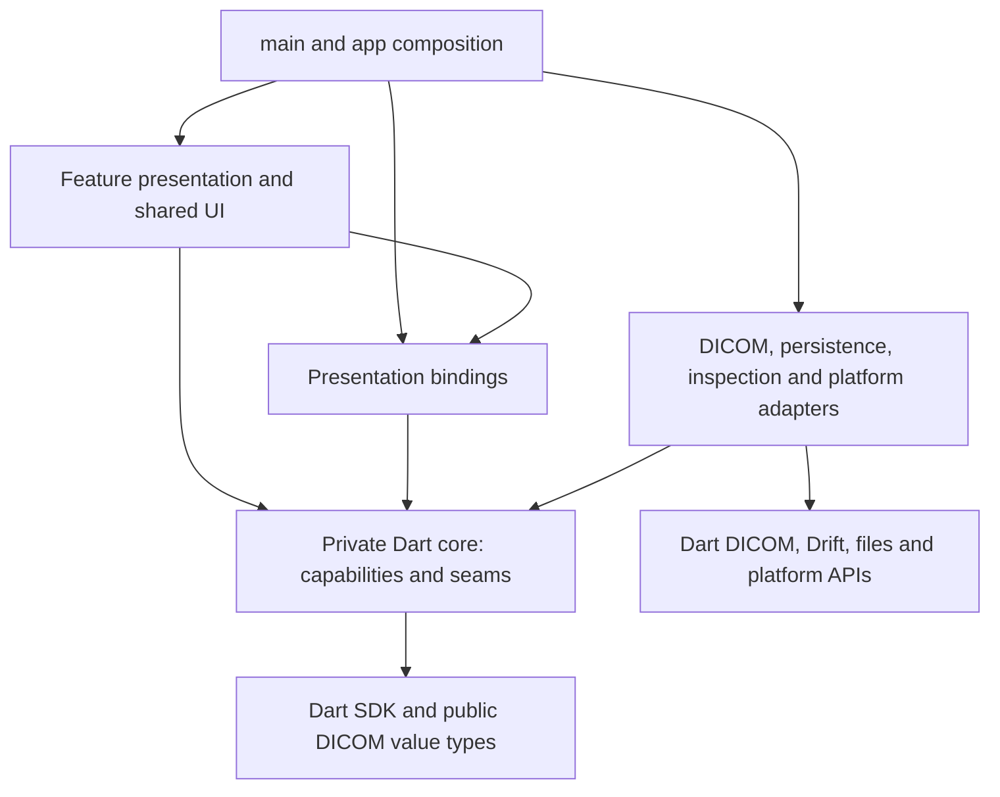
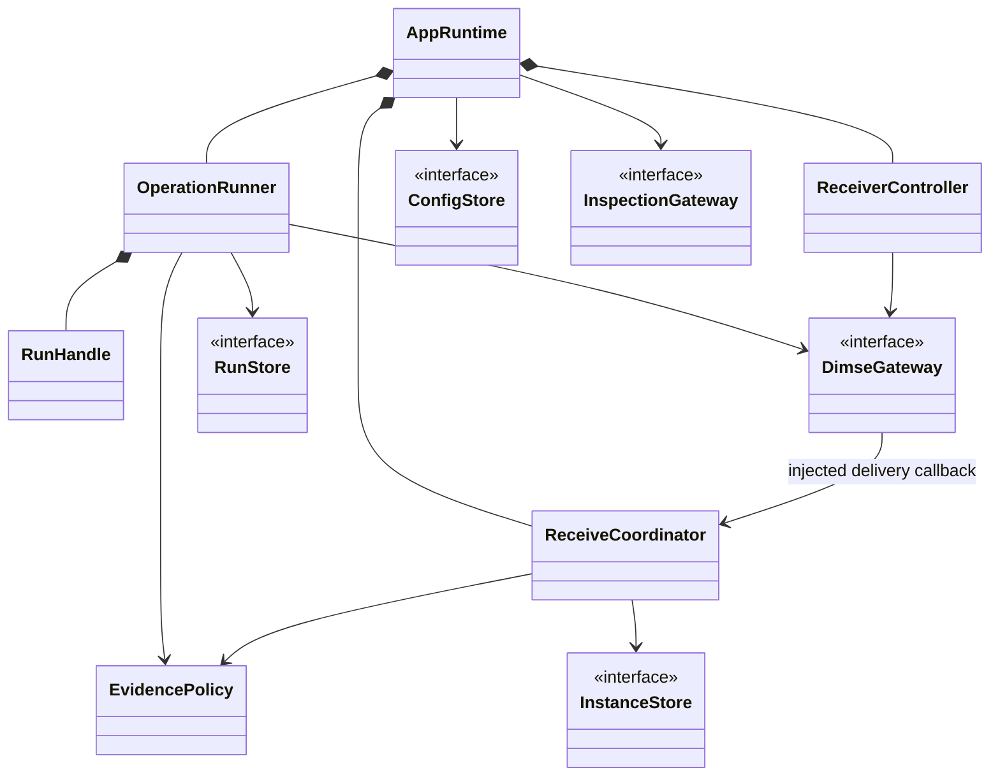
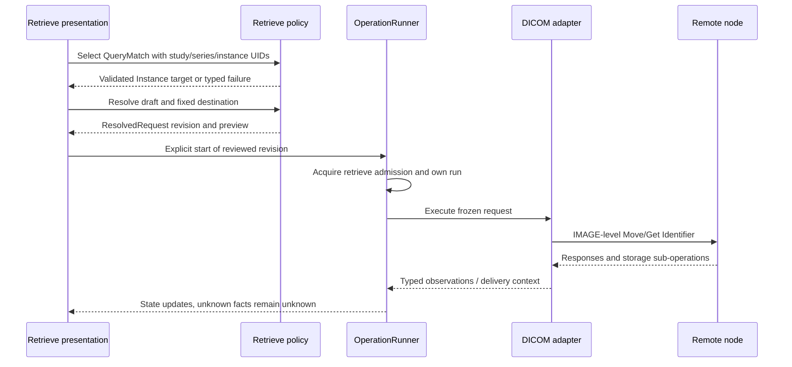
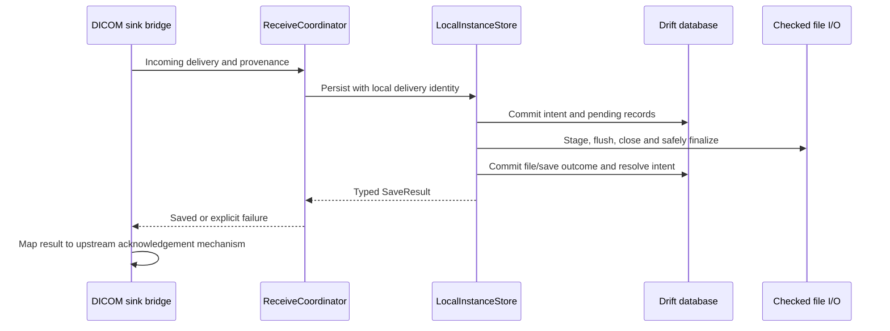

# DimseDash — Codebase Blueprint

> Date: 2026-10-19 · Mode: Design · Register: Conceptual model and enforceable invariants; exact Dart signatures are not pinned
>
> Inputs: [PRD v0.9](../req/dimsedash-prd.md) · [System Architecture](../design/01-system-architecture.md) · [Data Architecture](../design/02-data-architecture.md) · [Surface Architecture](../design/03-surface-architecture.md)

**Status: approved 2026-10-19.** The blueprint and its package/state/concurrency, storage, surface and structural forks are settled. This blueprint defines the complete intended code. S0 now supplies the Flutter scaffold, dependency lock, configuration slice, AST architecture checker and dry CI definition. The remaining modules are planned; implementation and verification status lives in the tracker. File names and illustrative type names establish responsibility and navigation; they may evolve without changing the contracts. A single document is sufficient at this scale.

## 1. Reconciliation findings

The project earns **Modular Hybrid Cleanish with minimal DDD**: substantive lifecycle and persistence rules, a small number of effect seams, and straightforward configuration CRUD. No domain aggregate framework or service-per-action layer is warranted.

| ID | Inputs in tension | Finding and structural resolution |
|---|---|---|
| B-01 | System §5 immutable execution vs public `dartdicom` Dataset/Sequence | Dataset is mutable, and unmodifiable sequence item lists still contain mutable datasets. Store the editable Identifier as an app-owned immutable value tree with defensive ownership of collections/bytes. Resolve it into a frozen request revision; the adapter builds a fresh private Dataset. No live editor reference enters an executing operation. |
| B-02 | Surface navigation independence vs Riverpod disposal and DICOM stream cancellation | The runner owns the upstream subscription and consumes it independently of widget subscriptions. UI subscriptions observe app-owned state. Neither view disposal nor provider recomputation may pause/cancel the DICOM stream. Explicit RunHandle cancellation is the only ordinary cancellation path. |
| B-03 | Surface cancelled/aborted states vs upstream cancel future | At the inspected release, subscription cancellation can complete normally after timeout/abort; final Find status is also not fully exposed by its row stream. Keep cancellation intent, completion, peer status and abort evidence distinct. Require typed upstream observations; do not synthesize cancellation confirmation from `cancel()` completion. |
| B-04 | System direct settings access vs data adapter isolation | Simple node/settings CRUD needs a ConfigStore seam returning core records. Presentation can call that seam without an extra service layer; it cannot import Drift rows or the database. App composition chooses the adapter. |
| B-05 | Surface file preview/forget/delete vs data save/recovery and inspection | A FileActionPlan identifies exact records and expected identities. InstanceStore owns mutation guards, durable intents and execution-time revalidation; inspection holds a read lease. A preview is not permission to act on a subsequently replaced file. No widget performs path deletion. |
| B-06 | Surface session Reveal vs persisted UI preferences and reports | DisclosureState is session-only, reset to masked on launch; thumbnail reveal is per inspected object. A separate projection generates reports and permitted history. Saving appearance preferences cannot serialize disclosure state, query criteria or an Identifier tree. |
| B-07 | Surface single-instance retrieve vs previous R-04 and generic selected row | Approval extends R-04 to IMAGE selection. Use a RetrieveTarget variant requiring study, series and SOP instance UIDs together; no inferred parent IDs and no fallback to SERIES when a key is absent. Query selection and inspector focus are separate values. |
| B-08 | One SQLite store vs separately durable DICOM files | One LocalInstanceStore coordinates journal, file and receipt effects through short DB transactions. Filesystem I/O does not become atomic with SQLite. Recovery is an explicit operation, not a catch-and-retry wrapper around an entire receive. |
| B-09 | Typed expected failures vs upstream exception-based sink acknowledgement | Core returns a typed save result. The DICOM sink bridge maps a failed result to the specific exception/failure mechanism required by upstream before a success acknowledgement can be sent. That translation stays inside the adapter; it must never swallow a failed save and return normally. |
| B-10 | Desktop quit prompt vs Flutter cancelable-exit callback | A platform lifecycle adapter requests bounded shutdown when the platform offers a cancelable exit. Forced process termination is recovered at next startup; it is not a path on which a prompt or final callback is guaranteed. |

These entries amend structure and clarify evidence; they do not remove product behavior. B-07 records an explicit product approval. The Study Root-only scope is approved (2026-10-19). The distribution baseline is approved in the implementation tracker (2026-10-19).

### Framework reality check

No framework documentation is vendored in this repository yet. The check read available package/SDK documentation and source plus official framework documentation; it did not infer capabilities from model memory. Evidence versions below are **not application dependency pins**.

| Evidence read | What it establishes | Blueprint consequence |
|---|---|---|
| Flutter SDK 3.32.6, `packages/flutter/lib/src/widgets/app_lifecycle_listener.dart`, `shortcuts.dart`, `actions.dart`, `focus_traversal.dart`; [architecture recommendations](https://docs.flutter.dev/app-architecture/recommendations) | View/presentation separation fits Flutter; keyboard/focus APIs exist; the exit callback covers cancelable exits | Keep Riverpod as approved. Compose editor/tree widgets from Flutter controls; no requirement for a vendor tree-grid. Verify desktop exit behavior in packaged tests. |
| Cached `riverpod` / `flutter_riverpod` 3.0.3 README, pubspec and `lib/src/core/ref.dart` / `provider_container.dart`; [disposal](https://riverpod.dev/docs/concepts2/auto_dispose), [retry](https://riverpod.dev/docs/concepts2/retry) | Provider lifecycle and retries are real behavior, not application operation policy | Bootstrap runtime once outside recomputing providers; inject it. Disable automatic retry for runtime/effect-bearing bindings. Presentation state can rebuild without replaying commands. |
| `dartdicom` v0.1.0-dev.1 at `7f9a80d3a257a6936011250ce3e701b47b717385`: `dartdicom/lib/src/dataset/{dataset,sequence}.dart`, `dartdicom_net/lib/src/association/association.dart`, `dartdicom_net/lib/src/sink/instance_sink.dart` | Mutable datasets, cancellation coupling, one operation per association, whole-instance bytes and sink acknowledgement sequencing | Resolve B-01–B-03/B-09. Parallel Echo/Find, if admitted, use separate owned associations; never multiplex a busy association. No hard pre-allocation receive limit is claimed. |
| Official Drift [transactions](https://drift.simonbinder.eu/dart_api/transactions/) and [isolates](https://drift.simonbinder.eu/isolates/) documentation; no local Drift package available | Await transaction work; DB objects are not ordinary transferable isolate values; background native execution is supported | One logical application database with adapter-owned execution. No DB object passed to image workers; no transaction spanning network receipt or long file writes. |

Installed SDKs and online documentation describe different versions. Scaffold work must select one concrete FVM SDK, resolve compatible Riverpod/Drift/native SQLite packages and commit the lockfile before calling any combination supported. Generic Flutter guidance suggesting ChangeNotifier or a repository/service pair does not override the settled Riverpod boundary and deep-module approach.

## 2. Settled forks and amendment authority

| Fork | Decision | Basis |
|---|---|---|
| Use-case ownership | OperationRunner owns execution state/subscriptions, ReceiverController owns listener lifetime, ReceiveCoordinator owns delivery policy; persistence adapters own atomic writes/recovery | System §§3–5; B-02/B-08 clarify boundaries |
| Failure model | Typed command results and run events/outcomes for expected failures; exceptions for unexpected defects, with upstream exception translation confined to adapters | Approved 2026-10-19 |
| Boundary thickness | Pure Dart core; public DICOM value types permitted; no Flutter/Riverpod, network handles, Drift rows or platform effects in core | System §3; B-01 distinguishes mutable datasets from snapshots |
| Wiring/substitution | Constructor DI, application composition root, real adapters plus deterministic fakes | System §§3–5 |
| Tree axis | Feature UI + capability core + shared adapters | Approved 2026-10-19 |
| Concurrency/atomicity | One active outbound retrieve; bounded independent receiving; short DB transactions plus journalled file effects | Settled system §4 and data §§4–7 |
| Artifact prescriptiveness | Conceptual types, responsibilities and checkable invariants; no pinned method signatures | Approved 2026-10-19 |
| Surface | One study/series/instance target; structured nested editor; mask on launch/session reveal/separate thumbnail reveal | Approved surface choices, 2026-10-19 |

Entries B-01–B-10 are indexed in the amended input documents. A subsequent structural refinement updates this document and the affected lens together. A change in product behavior requires a product decision; schema cost alone is not justification to delete a requirement.

The approved Settings refinement uses `ConfigStore.saveClientSettings`: calling AE (default `DIMSE_DASH`), client listening port, timeouts and appearance belong to global configuration. This revision-checked write preserves every node and selection. Remote fields are edited only through Nodes commands; the legacy combined `save` remains available for compatibility. A single local AE also identifies the receiver and Move destination in P0. No new package or persistence store is needed.

## 3. Source layers and import rules



The arrows are **source imports**, not runtime call direction. Widgets reach effects through injected interfaces and explicit commands. Core owns policy while adapters own protocol, storage and platform mechanisms. `lib/app/` is the only production place choosing concrete adapters.

Rows may import columns marked ✓; a dash forbids it. Internal imports within a module are permitted. SDK/framework dependencies are constrained by the notes below.

| Importer ↓ / target → | App composition | UI feature/shared | Presentation bindings | Core public exports | Adapters |
|---|---|---|---|---|---|
| App composition | ✓ | ✓ | ✓ | ✓ | ✓ |
| UI feature | — | Own feature + shared only | ✓ | ✓ | — |
| Shared UI | — | Shared only | — | ✓ | — |
| Presentation bindings | — | — | ✓ | ✓ | — |
| Core internals | — | — | — | Own capability/shared prerequisites | — |
| Adapters | — | — | — | ✓ | Explicit collaborators within their adapter module |

- Core may import `dart:async`, collections/typed data, and the public `dartdicom` value surface. It may not import `dart:io`, Flutter, Riverpod, Drift, `dartdicom_net`, pixel rendering or external `lib/src` paths.
- UI and bindings may use Flutter/Riverpod and core exports. Platform clipboard, folder selection and filesystem effects are injected; widgets cannot import effect plugins directly.
- DICOM adapters depend on public network/core library APIs; persistence adapters may combine their own DB/files submodules. Cross-adapter calls use an injected core seam, not private sibling implementations.
- Only the bootstrap reads platform paths and chooses real/fake dependencies. Tests may import concrete adapters for integration/contract tests and core internals within that package; production restrictions remain unchanged.

**Enforcing tool contract:** implement `tools/check_architecture.dart` at scaffold using Dart analyzer AST/URI resolution. Check imports **and exports**, conditional branches, package and normalized relative paths, `part` ownership, external `src` imports and declared dependencies in both pubspecs. It emits offending source/target with a stable nonzero exit and has allowed/forbidden fixture tests. An empty or missing application tree must report **not scaffolded**, not a passing architecture gate. Wire it into `just check-architecture` and dry CI; Dart analyzer alone does not enforce this matrix. S0 implements this checker and negative fixtures; the tracker records execution evidence.

## 4. Intended source tree

Paths below are targets for the scaffold and vertical slices, not empty files to generate immediately. Each line owns a change category; supporting files appear only when a slice earns them.

```text
.fvmrc                              Concrete SDK selection, chosen at scaffold
pubspec.yaml                        App version/dependencies and dev-tool pins
pubspec.lock                        Resolved application dependency graph
analysis_options.yaml               Analyzer rules for the Flutter package
justfile                            Formatting, analysis, architecture and test entry points
.pre-commit-config.yaml             Fast runner-backed hygiene/format/lint/secrets checks
lib/
  main.dart                         Calls bootstrap, then starts the Flutter shell
  app/
    bootstrap.dart                  Opens/reconciles stores and constructs one runtime
    app_runtime.dart                Owns shared controllers, workers and bounded shutdown
    app.dart                        Material shell/theme, top-level provider scope
    shell.dart                      Composes screens; private sidebar and workflow-placeholder widgets (amended)
  bindings/
    runtime_providers.dart          Injected runtime/seams and read-only observations
    disclosure_state.dart           Session masking/reveal state, never persisted
  ui/
    theme.dart                      Approved blue light/dark tokens
    node_fields.dart                Shared remote-node fields and environment badge (S1 refinement)
    shared/                         Reusable Identifier editor, table/tree/pane/status/focus widgets
  features/
    nodes/                          Dashboard and explicit Add/Edit dialog
    query/                          Query composition, Identifier binding, results/navigation
    retrieve/                       Selection review, method/destination and start action
    receiver/                       Persistent status/details and explicit start/stop
    evidence/                       Run summary, timeline, negotiation and trace views
    files/                          Inventory, header/thumbnail inspection, cleanup preview
    history/                        Retained run inspection, omitted-input draft restoration
    settings/                       Preferences, storage and retention views
      settings_view.dart            Stateful draft owner; private enum-field and connection-section widgets (amended)
    reports/                        Exact export preview and explicit save action
  adapters/
    dicom/
      dartdicom_gateway.dart        Association/operation ownership and observation mapping
      identifier_codec.dart        Resolved Identifier to private upstream Dataset
      receipt_sink.dart            Public InstanceSink bridge and acknowledgement mapping
    persistence/
      database.dart                 One Drift schema/connection, adapter-private rows
      migrations.dart               Consistent backup/migrate/validate/recovery procedure
      config_store.dart             ConfigStore implementation and record mapping
      run_store.dart                RunStore implementation and permitted projections
      local_instance_store.dart     Save/lease/delete/recovery sequence across DB and files
      file_io.dart                  Checked filesystem primitives and native capabilities
    inspection/
      inspection_worker.dart        Bounded header/pixel work and transferable replies
    platform/
      desktop_services.dart         Folder/export/clipboard/reveal and exit integration
packages/dimsedash_core/
  pubspec.yaml                      Private pure-Dart package; publish_to: none
  analysis_options.yaml            Core analyzer rules
  lib/
    dimsedash_core.dart             Curated external capability/value exports
    src/
      foundation/
        result.dart                 Typed command result and failure vocabulary
        identity.dart               Local IDs and injected clock/ID generation contracts
      configuration/
        configuration.dart          Node/local identity/preferences/receive-root records
        configuration_validation.dart  Shared configuration validation policy (amended)
        config_store.dart           Configuration CRUD seam, without a pass-through service
      query/
        identifier.dart             Immutable entry/sequence tree and matching purpose
        query_policy.dart           Model/level validation and friendly/advanced mapping
        query_results.dart          Bounded result context, hierarchy and completeness
      retrieve/
        retrieve_target.dart        Study/series/instance variants and UID validation
        retrieve_policy.dart        Exact target resolution and reviewed execution inputs
      runs/
        operation_runner.dart       Active run ownership, admission and explicit cancellation
        run_handle.dart             Observation, current state and completion contract
        run_model.dart              Frozen request, observations and independent outcomes
        dimse_gateway.dart          Protocol-effect seam, no network implementation
      receiving/
        receiver_controller.dart    Listener lifecycle independent of UI
        receive_coordinator.dart    Delivery IDs, correlation policy and save result handling
        instance_store.dart         Persistence/inventory/action/lease seam and record types
      evidence/
        evidence_policy.dart        Outcome reduction, history/report allowlists and omissions
        run_store.dart              Run/event persistence and retention seam
      desktop/
        desktop_services.dart       Pure-Dart chooser/export/copy/reveal/lifecycle seam
      inspection/
        inspection.dart            Header/thumbnail request and result seam
  tests/                            Package-local pure-Dart invariant tests (amended)
  test_support/                     Reusable fake peers/stores/time for root tests; not public lib
tests/                             Root test suites, grouped by execution gate and owner (amended)
  dry/                             App, bindings, adapters, feature widgets and tooling checks
  native/                          Explicit native configuration workflow
  support/                         Shared in-memory store and synthetic configuration input
integration_test -> tests/native   Flutter-compatible native runner alias; no duplicate source
tools/check_architecture.dart      Import/dependency gate and self-test fixtures
docs/structure/                    This map; no generated source inventory
```

A feature normally begins with `<feature>_view.dart` and `<feature>_controller.dart`; add a widget or state file when it hides real complexity. A controller here is a Flutter presentation object, distinct from the application-owned ReceiverController. Riverpod is the binding mechanism, not a second business-logic owner. Navigation composes features in the shell; a feature never imports a sibling controller to trigger work.

The [test suite map](../tests/README.md) records suite ownership, shared fixtures and explicit runner paths. `just test` includes only dry suites and package-local core tests; `just native-test` uses the root alias so Flutter selects native integration mode.

Use official Flutter/Dart tooling to create the app and private package when implementation is authorized. Exact workspace/path dependency setup and package versions are scaffold work; no assumption about a globally selected SDK enters contributor commands. The app manifest owns the app version; private core is not independently released. Prototype HTML stays design evidence, never production runtime code.

## 5. Domain values and ownership

| Conceptual type | Invariant / authority | Lifetime |
|---|---|---|
| IdentifierSpec / IdentifierEntry | Immutable structure, numeric path, VR, explicit matching/return/service-required purpose, typed values, SQ item groups and private context. Invalid draft input has a separate validation representation | Sensitive session memory |
| ResolvedRequest | Complete operation/model/level, fixed node/local settings, Identifier revision, destination and receive-root reference. No mutable Dataset alias or generic persistence serializer | One execution |
| RetrieveTarget | `Study(studyUid)`, `Series(studyUid, seriesUid)`, `Instance(studyUid, seriesUid, sopInstanceUid)`; validated unique-key hierarchy | Selected/reviewed target in session |
| QueryResultSet / QueryMatch | Originating query/node/revision, retained parent identifiers, bounded datasets and completeness. Missing/empty/decode-limited values remain distinct | Runner-owned bounded current query context |
| RunHandle / RunState | One operation owner; explicit cancellation intent; separate protocol outcome, local save outcome and evidence completeness | Active execution, then bounded live evidence/history projection |
| ObservedCounter | Present nonnegative value or unavailable with reason; zero is not absence | Observations and permitted history |
| IncomingDelivery / SaveResult | App ownership of received bytes and provenance; no upstream connection handle in core. Success means the agreed save contract, not thumbnail success | Receive processing; reduced receipt persists |
| ReceiptRecord / FileRecord | Per-delivery local IDs distinct from DICOM UIDs, original save facts distinct from current availability | Independent inventory |
| FileActionPlan / InspectionLease | Exact record/identity and current mutation guard; preview is revalidated; inspection prevents conflicting mutation until released | Bounded operation; mutation intent persists for recovery |
| HistoryProjection / ReportProjection | Allowlisted fields and explicit omissions; never a serialized ResolvedRequest, arbitrary error or dataset | Retained history / explicit exported file |
| DisclosureState | Masked on startup; session reveal plus per-object thumbnail permission; cannot alter report allowlist | Flutter session only |

The Identifier tree models **editing intent**, not a second DICOM parser/dictionary. Public Tag/VR/Uid types can remain library values. Received datasets may use upstream representations inside a read-owned transient inspection context; the immutable execution contract must not depend on callers politely avoiding mutation. Byte ownership at adapter ingress is explicit: exclusive ownership or defensive copy, with allocations included in budgets.

### Failure propagation

Expected command failures return `Result<T, AppFailure>` conceptually. Starting a valid operation returns its RunHandle; later protocol/local failures arrive as typed observations and terminal outcomes, not a second start-result channel. Invalid input before dispatch is not a failed network exchange.

| Family | Examples / useful payload | Surface behavior |
|---|---|---|
| Validation | Field/path, reason, unsupported model/level or missing UID | Focus offending input; preserve draft |
| Admission / capability | Active retrieve, unavailable folder, unmet receive capability, resource cap | Explain prerequisite; no hidden queue/probe |
| Transport / association / DIMSE | Observed stage, structured reason/status, counter presence | Preserve numeric facts; suggested cause separate |
| Storage / database | Save phase, structured local code, record/action reference | Distinguish received from saved; expose recovery state |
| Inspection | Unsupported codec/charset, non-image object, missing source | Keep stored-file/transfer outcome intact |
| Interrupted / internal | Interrupted context or unexpected defect code, no raw peer payload in default logs | Bounded cleanup and explicit uncertainty |

Cancellation is a lifecycle event, not a generic exception. Unknown observations are data, not automatically failures. Adapters catch known SDK/OS errors at their seams and map them; unexpected defects remain exceptions until the runtime boundary records a sanitized internal failure and protects cleanup. Never catch everything and return success. The sink's required upstream exception mapping is B-09, not permission to use exceptions throughout core interfaces. Original exception strings/stack context are not automatically reportable evidence.

## 6. Seams, collaborators and composition



The diagram omits method signatures intentionally. Gateway ownership prevents association objects and subscription semantics escaping into presentation. ConfigStore earns a seam through real SQLite and in-memory implementations; it does not earn a duplicate service/repository stack. LocalInstanceStore earns depth by hiding save/delete/recovery and inspection guards behind one coherent interface.

| Seam | Production adapter | Test substitute / contract |
|---|---|---|
| DimseGateway | DartdicomGateway + receipt sink bridge | Scripted peer observations, late/unknown outcomes, cancellation races and counted starts |
| ConfigStore | Drift record mapper | In-memory records with revisions and validated edits |
| RunStore | Drift summaries/events with allowlisted projection | Deterministic retention, failed writes and truncation |
| InstanceStore | LocalInstanceStore, shared DB and checked file primitives | Fault-injected in-memory state plus temp-filesystem integration for real rename/flush behavior |
| InspectionGateway | Bounded worker adapter using public DICOM/pixel APIs | Supported, unsupported, delayed/cancelled or failed inspection |
| Desktop services | Native folder, clipboard, export, reveal and lifecycle operations | Fake choices/cancellation/failure; never access the host from widget tests |
| Time/ID inputs | UTC/monotonic clock and opaque ID source | Fixed/manual time and deterministic IDs; no inheritance framework required |

Bootstrap opens configuration/database, reconciles pending file actions and interrupted runs, applies eligible cleanup, then exposes the runtime. Network work remains idle. It creates one logical database shared by store adapters, one receiver owner, one runner and bounded inspection resources. The runtime is injected through ProviderScope overrides/bindings; tests provide fakes at the same construction seam. There is no global service locator.

Shutdown rejects new commands, requests cancellation/stop, accounts for pending persistence, releases workers and closes the DB within the declared policy. UI unsubscription only detaches observation. Mandatory application shutdown is coordinated outside provider disposal callbacks so asynchronous work is actually awaited. OS-forced termination bypasses this path and relies on journalled recovery.

## 7. Two flows at object granularity

### Exact instance retrieval



Start rejects a stale/invalid review rather than combining yesterday's target with today's edited values. The adapter composes StudyInstanceUID, SeriesInstanceUID and SOPInstanceUID from the same resolved variant. Changing tabs cannot release admission. Release occurs when operation/local ownership has settled or been explicitly marked interrupted; a timeout is not permission for overlapping unaccounted work.

### Receive, save and acknowledge



Every file or DB step can fail; each failure preserves the data design's recovery evidence. The diagram's happy path is not a transaction across stores. Receipt acknowledgement observation remains separate from a local saved result. Thumbnail generation starts after save through InspectionGateway and cannot delay/change C-STORE success. During inspection, a lease prevents forget/delete from invalidating an actively used file; releasing a view cancels its inspection request and eventually releases the lease, not the receiver.

## 8. Verb → action → data traceability

These are action contracts, not a mandatory class per row. “Session” entries deliberately do not require database tables.

| Surface verbs | Action owner / contract | Fields or state reached |
|---|---|---|
| Add/edit/duplicate/remove/find node; global local identity/listen port/timeouts | Nodes → NodeStore commands; Settings → ConfigStore.saveClientSettings | `nodes` revision/label/endpoint/environment; `app_settings` identity/listener policy |
| Select node/operation, navigate/collapse/resize panes | Shell/presentation state | Selected node ID, operation, pane preferences; no network side effect |
| Edit friendly/advanced tags, add sequence groups, validate/preview | Query policy + query presentation | Session IdentifierSpec, required keys, validation issues and resolved revision |
| Run Echo/Find, navigate child query, clear results | OperationRunner + query policy | Run ID; immutable request; bounded QueryResultSet, parent UIDs and completeness; permitted `runs`/`run_events` |
| Highlight/inspect row vs select target | Query/files presentation + retrieve policy | Separate inspector reference and RetrieveTarget variant; no label-derived UID |
| Choose method/folder, edit UID, review/start retrieve | Retrieve policy → OperationRunner; folder choice via desktop services | Target hierarchy, method/destination, immutable receive-root ID, revision; `receive_roots` when explicitly selected |
| Cancel run; start/stop receiver; stop and quit | RunHandle / ReceiverController / AppRuntime | Cancellation intent, receiver state, active handles, pending save actions and typed terminal evidence |
| Inspect timeline/negotiation/trace, revisit history | Evidence/history presentation → RunStore | Permitted observations, numeric status, presence/reasons, truncation and versioned omissions |
| Inspect received headers/show thumbnail | InspectionGateway with InstanceStore lease | `receipts`/`files` reference and availability; transient dataset/render result and reveal state |
| Reveal/mask/copy values | Disclosure binding + injected clipboard | Session DisclosureState and explicit copy payload; no change to report projection |
| Reveal file location | Files presentation → desktop service | Validated registered location; no arbitrary folder scan |
| Create new draft from history | History presentation + query/retrieve policy | Permitted snapshot and omissions; empty required fields, node revision mismatch; no automatic execute |
| Preview/export Markdown or JSON report | EvidencePolicy + report presentation + desktop export | ReportProjection and exact preview; explicit user-owned output |
| Clear/prune history, change retention | RunStore + ConfigStore | Eligible terminal rows/events, protected active/recovery IDs, cutoff and budgets; receipts retained |
| Preview/forget/delete file records/files | InstanceStore action plan and execute | File IDs/identity guards; `file_actions`, `files`, `receipts`; independent historical aggregates |
| Change/reset appearance and settings | Settings presentation → ConfigStore | Only designated `app_settings` fields; no saved query literals or reveal session |

No promised P0 verb requires a saved query catalogue, local predicate engine, batch scheduler or persistence of full Identifiers. Startup migration/recovery is an internal action with visible outcomes rather than a user-facing command or a new table family.

## 9. Where a change lands

Paths are primary entry points; tests sit beside the corresponding capability or adapter tests.

| Requested change | Primary location |
|---|---|
| Add a friendly Find field or level-aware validation | `packages/dimsedash_core/lib/src/query/query_policy.dart` |
| Change nested Identifier structure or empty/disabled semantics | `packages/dimsedash_core/lib/src/query/identifier.dart` |
| Render a sequence tree or query-table interaction | `lib/features/query/` |
| Fix selected instance/parent UID scope | `packages/dimsedash_core/lib/src/retrieve/retrieve_target.dart` |
| Change admission/cancellation/operation lifecycle | `packages/dimsedash_core/lib/src/runs/operation_runner.dart` |
| Map a new upstream structured observation | `lib/adapters/dicom/dartdicom_gateway.dart` |
| Fix save-failure acknowledgement translation | `lib/adapters/dicom/receipt_sink.dart` |
| Change receive correlation policy | `packages/dimsedash_core/lib/src/receiving/receive_coordinator.dart` |
| Change durable save/delete/recovery sequence | `lib/adapters/persistence/local_instance_store.dart` |
| Add schema fields or upgrade handling | `lib/adapters/persistence/database.dart` and `migrations.dart` |
| Change retained/reportable evidence | `packages/dimsedash_core/lib/src/evidence/evidence_policy.dart` |
| Change masking/copy/thumbnail reveal | `lib/bindings/disclosure_state.dart`; shared widgets receive its display projection |
| Add a supported thumbnail result or worker limit | `lib/adapters/inspection/inspection_worker.dart` |
| Fix native folder/quit/export integration | `lib/adapters/platform/desktop_services.dart` |
| Change module import policy | `tools/check_architecture.dart` plus its failing/passing fixtures |

Protocol defects belong upstream with regression evidence. A missing public observation is not fixed by importing upstream internals, parsing trace strings or manufacturing an app-only PDU decoder.

## 10. Invariants and enforcement

**★ = a specified automated check required in the implementation dry gate, not a check already implemented or passed.** Native/live obligations are explicit. The current repository can validate documents/mockups only.

| Invariant | Enforcement target |
|---|---|
| ★ Imports follow §3; no upstream `src` access or DB rows in UI | AST architecture checker, dependency checks and negative fixtures |
| ★ Reviewed target cannot mutate during execution | Mutation/alias tests across nested values/bytes, stale revision rejection and preview/materialization equality |
| ★ IMAGE retrieve requires all three UIDs and never broadens scope | Target-construction tests and fake-gateway exact Identifier assertions |
| ★ View disposal/rebuild/retry cannot start, cancel or pause networking | Riverpod/widget navigation tests with counted gateway calls and independent runtime subscriptions |
| ★ One active outbound retrieve survives navigation and cancel races | Admission tests; completion/abort/late-receipt interleavings |
| ★ Unknown counters/outcomes are never converted to zero/success | Typed reducer fixtures for absent values and incomplete terminal evidence |
| ★ Failed persistence cannot acknowledge success; thumbnail failure is independent | Sink contract tests for typed failure mapping, partial saves and delayed/failed decode |
| ★ History expiry/clear never deletes receipts or files | FK/retention tests and a filesystem spy that must receive no delete call |
| ★ Save/delete recovery is idempotent and forget differs from delete | Failure injection at each intent/stage/finalize/commit point; real temporary filesystem tests |
| ★ File action checks identity again and conflicts with active inspection | Changed-path/lease tests; platform path-race handling additionally requires native tests |
| ★ Arbitrary tags, private context, literals/errors and pixels cannot enter normal history/report | Synthetic canaries through every projection; no generic snapshot serialization |
| ★ Reveal resets at launch and cannot alter export allowlists | Presentation/restart tests; explicit copy and thumbnail reveal assertions |
| ★ Clean supported schema upgrade is required; no reset/downgrade fallback | Migration fixtures, snapshot failure handling and newer-schema rejection |
| Native save/folder/exit guarantees hold on supported desktops/volumes | Packaged macOS/Linux tests, fault scenarios and documented unsupported guarantees |
| Actual Find/Move/Get interoperates with the declared libraries | Explicit live synthetic Orthanc/DCMTK/pynetdicom gates; upstream observations verified |

The initial dry gate runs formatting, both packages' analysis/tests, the architecture check, relevant adapter/widget tests and clean builds on the supported platform jobs. Fast pre-commit checks use the same pinned runner tools; types/tests remain CI work. Live gates are explicit and do not start private services during an ordinary PR check. Exact runner recipes, versions and CI installation are scaffold deliverables, not invented working commands today.

## 11. Deliberately absent and remaining readiness

Absent by design: package per feature; a use-case class for every button; generic repository/service/factory stacks; global event bus/service locator; duplicated DICOM dictionaries/status decoders; ORM records outside persistence; automatic JSON serializers on sensitive execution state; wildcard barrel exports throughout the tree; event sourcing; local-rule execution; unattended retry/queue; persistent thumbnails/query results; runtime plugin framework; public CLI/HTTP surface. A curated core export is an intentional package interface, not permission to re-export internals indiscriminately.

The [first-preview implementation tracker](../progress/overview-first-preview.md) records the approved scaffold and vertical-slice sequence, dependencies and evidence gates; S0 implementation is in progress. Before claiming working end-to-end behavior, resolve the existing typed upstream observation gaps, choose and pin a compatible toolchain, implement the architecture gate with negative fixtures, and verify file/native lifecycle guarantees. OS/architecture/installer/signing choices are settled in the implementation tracker; broader operations remain deferred by the approved PRD scope. Those are not silently answered by this source layout.

This blueprint introduces no ADR: it reconciles the current pre-release design in place. The three structural forks have explicit approval; no additional product choice is hidden in a folder name or adapter.

| Revision | Date | Change |
|---|---|---|
| 0.1 | 2026-10-19 | Reconcile the three design lenses and framework behavior; record approved forks, source ownership, typed failures, verb/data mapping and enforceable invariants |
| 0.2 | 2026-10-19 | Record blueprint approval and map the Settings connection fields to existing configuration ownership |
| 0.3 | 2026-10-19 | Link the proposed implementation slices and durable evidence tracker |
| 0.4 | 2026-10-20 | Add revision-checked global-only settings write preserving nodes and selection |

## S1 implemented source map

- `core/configuration`: full node library, global timeouts, node commands and
  optimistic configuration revisions; `duplicateNode` produces an unsaved draft.
- `core/operations/echo.dart`: immutable execution/evidence types, `RunStore` and
  `DimseGateway` ports, `OperationRunner` and `RunHandle`. Operations may depend on
  configuration; the reverse dependency remains forbidden.
- `adapters/dicom/echo_gateway.dart`: typed upstream observation/status conversion,
  cancellation and cleanup. It does not import persistence or presentation.
- `adapters/persistence`: schema v2, migration snapshot, configuration commands and
  the allowlisted/retained run store.
- `bindings/echo.dart`: immutable snapshots of a runtime-owned runner.
- `features/nodes` and `features/echo`: node controls and diagnostic views.
  `node_library.dart` retains session search/filter/density/scroll, `node_editor.dart`
  returns typed durable-save completion. The target picker has been removed.
  Remote editor fields live in `ui/node_fields.dart`; Settings contains only
  global client fields and remains independent of Nodes. The shell uses named destinations, explicit library/workspace/run inner views,
  and navigation callbacks. Workspaces are keyed by node ID; evidence routes by
  run ID, with an origin for Back and no selection write.
  `features/echo/echo_evidence.dart` shares the existing evidence layout between
  the workspace and the run inspection view.
  Runtime ownership is unchanged. The global-only Settings refinement adds
  `ConfigStore.saveClientSettings` with configuration revision checks and no
  node writes; the schema and existing combined-save contract remain unchanged.
- `tools/live`: independently owned loopback fixtures, native orchestration and a
  release-only diagnostic probe separate from the production entrypoint.

The generated app/library provenance file is derived from manifests and resolved
Git source. Final dependency pins and native acceptance are tracked separately
from local implementation in [S1](../progress/s1-echo.md).

### Query UI preview checkpoint — 2026-10-22

`features/query` contains immutable preview draft/entry, request snapshot, result
context and scenario types, plus a shell-owned `QueryPreviewController`. This is a
presentation-only implementation with fixed fixtures; it neither introduces the
planned core query contracts nor calls the operation runner, gateway or stores.
The controller retains only the current hierarchy and its parent contexts.

Composition shares the node header and operation switch through `ui`, preserving
feature independence. Preview state survives same-node navigation, resets on node
change/selection loss and never enters SQLite. The runtime continues to own real
Echo. Production Query state ownership, bounded response streaming and validated
Identifier policy remain the planned core/runtime work above. See the
[preview tracker](../progress/query-ui-preview.md) for implementation evidence.

## Retrieve presentation checkpoint

The synthetic Retrieve preview lives in `lib/features/retrieve`: immutable
handoff/draft/snapshot types, a bounded in-memory controller, and review/evidence
widgets. The app shell maps Query selection into a Retrieve seed and owns its
lifecycle and nested routes; Query and Retrieve do not import each other. Shared
workbench header presentation stays in `lib/ui`.

This checkpoint adds no public core contract, adapter, dependency or schema.
Sample execution and scenario transitions are synchronous presentation changes;
no gateway, run store, file dialog, socket or filesystem access is available to
the controller. Real Echo state is observed only for admission and navigation.
The shell retains one latest sample and validates its route ID; stale routes do
not silently display replacements. Source Query settings and sample-execution
settings are separately frozen. Production receiver, storage, retrieve execution
and restart recovery modules remain future slices. Verification lives in the
[Retrieve preview tracker](../progress/retrieve-ui-preview.md).
